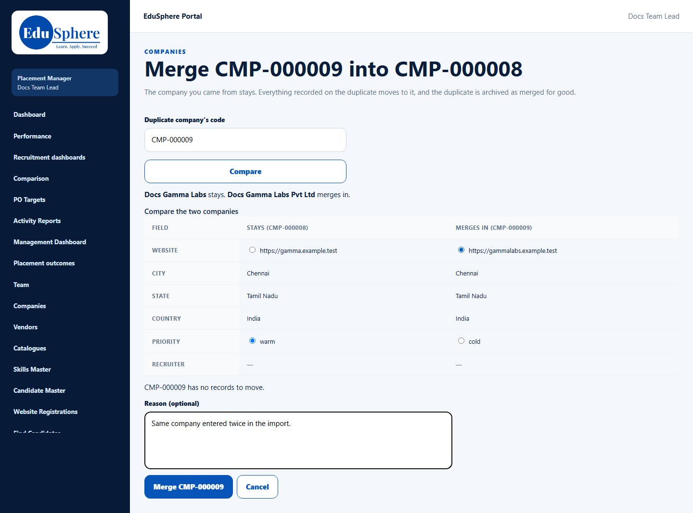
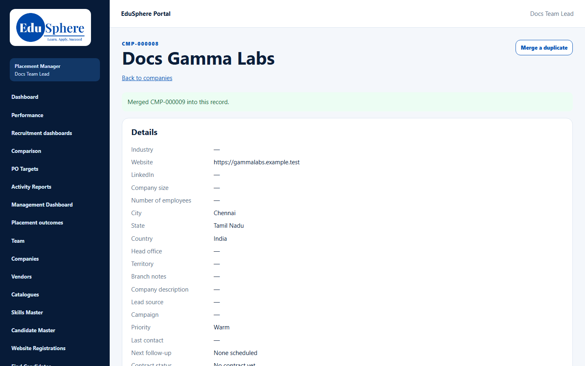
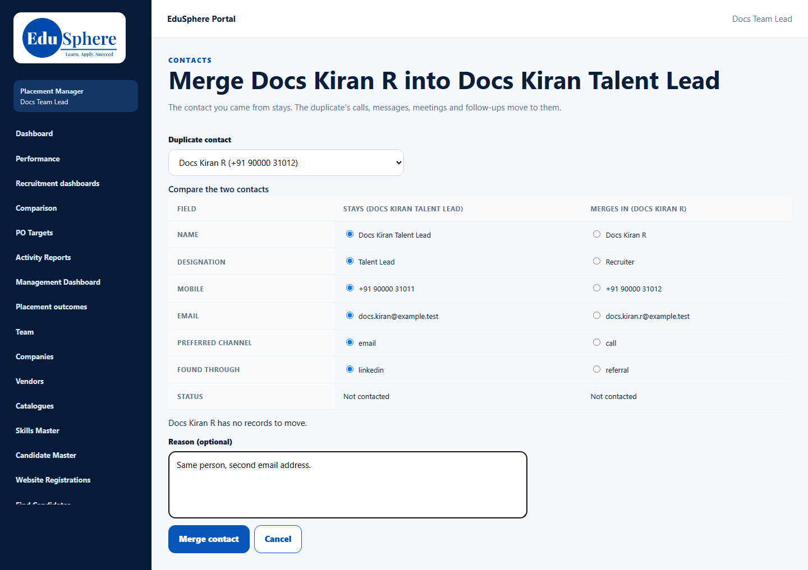
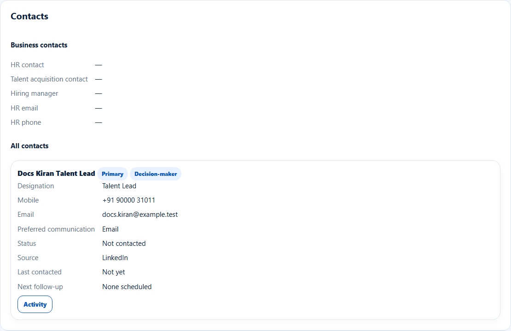

# Merge a duplicate company or contact
> Doc ID: DOC-REC-CO-013 · Verified on 2026-11-19 against `main` @ `6b61546c` · Roles: Team Lead

## Purpose
Combine two records of the same company, or of the same person, into one, keeping everything recorded on both.

## Who Can Use This Feature
- **Team Lead**. A recruiter who opens a merge page sees "Your role cannot merge duplicates. Ask your Team Lead for access."

## Prerequisites
- You know which record stays. Open that one; the duplicate merges into it.

## How to Access
- Company: the company page that stays → **Merge a duplicate**.
- Contact: the company page → **Contacts** → **Merge a duplicate** on the contact that stays (shown when the company has two or more contacts).

## Steps
### Step 1 — Compare two companies
Enter the **Duplicate company's code** (such as CMP-000123) and select **Compare**. The page shows which company stays and which merges in, then compares the fields side by side. Where the two differ, choose which value to keep. The page also lists what moves (calls, contacts, requirements and so on) or says "{code} has no records to move." Add a **Reason (optional)**.

### Step 2 — Merge the company
Select **Merge {code}** and confirm "Merge {duplicate} into {kept}? {duplicate} is archived for good and cannot be restored." The kept company opens with **Merged {code} into this record.**

### Step 3 — Merge a contact
On the contact that stays, select **Merge a duplicate**, then choose the **Duplicate contact**. Compare the fields (name, designation, mobile, email, preferred channel, how they were found, status), choose the values to keep, add a **Reason (optional)** and select **Merge contact**. Confirm "Merge {duplicate} into {kept}? This cannot be undone." The company page shows **The duplicate contact was merged.**

## Validation Messages
| Message | When |
|---|---|
| Merged {code} into this record. | Company merged |
| The duplicate contact was merged. | Contact merged |
| Enter the duplicate company's code, such as CMP-000123. | Compare with an empty code (from code; not captured) |

## Tips
- A merge cannot be undone. The merged company stays only as history ("Merged into {code} {name}. This record is kept for history and cannot be restored.").
- When the two companies have different recruiters, the page warns that the duplicate's recruiter loses access to what moves (from code; not captured).
- The page may block a merge and say why; the **Merge** button then stays disabled (from code; not captured).

## Related Features
- [Import companies](co-012-import-companies.md)
- [Company contacts](co-004-contacts.md)
