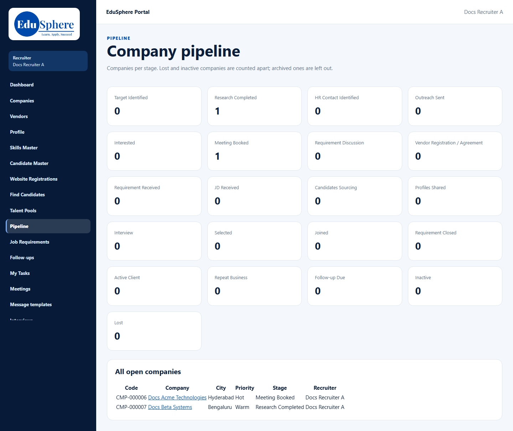
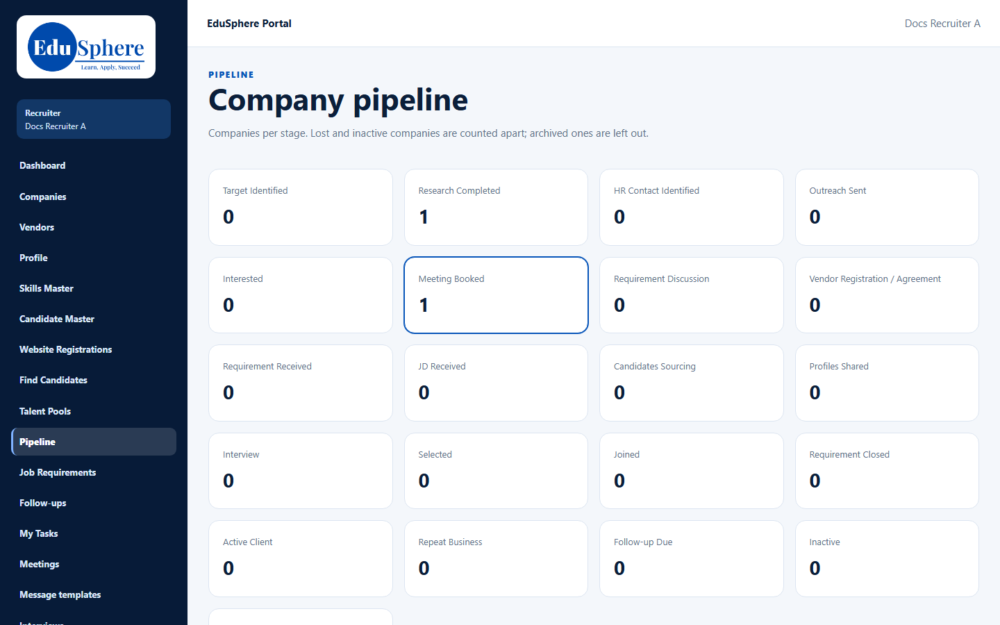

# Pipeline board
> Doc ID: DOC-REC-CO-014 · Verified on 2026-11-19 against `main` @ `6b61546c` · Roles: Recruiter, Team Lead

## Purpose
Count companies at each stage and list the companies at any one stage.

## Who Can Use This Feature
- **Recruiter**: their own companies.
- **Team Lead**: the team's companies plus unassigned ones.

## Prerequisites
- None.

## How to Access
Sidebar → **Pipeline** (`/recruiter/pipeline`).

## Steps
### Step 1 — Read the counts
A tile for each stage shows how many companies are at it, followed by **Active Client**, **Repeat Business**, **Follow-up Due**, **Inactive** and **Lost**. Lost and inactive companies are counted apart; archived ones are left out. Below, **All open companies** lists code, company, city, priority, stage and recruiter.

### Step 2 — Open one stage
Select a tile to list only the companies at that stage. **Show all stages** goes back. Select a company name to open it.

## Tips
- The Team Lead's board also counts unassigned companies, shown as **Unassigned** in the Recruiter column.

## Related Features
- [Pipeline stage, lost and inactive](co-010-pipeline-stage.md)
- [Companies list](co-001-companies-list.md)
