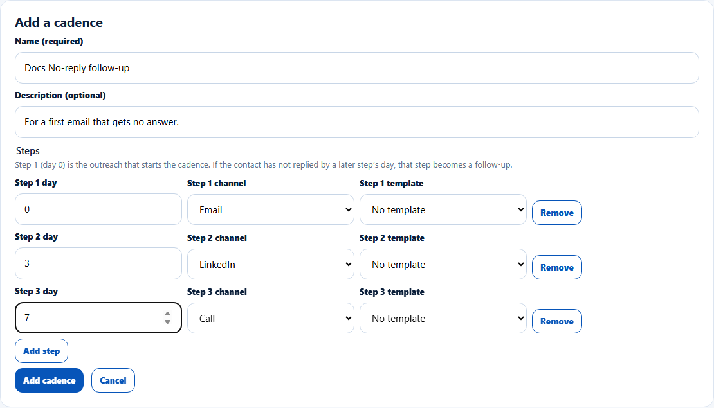
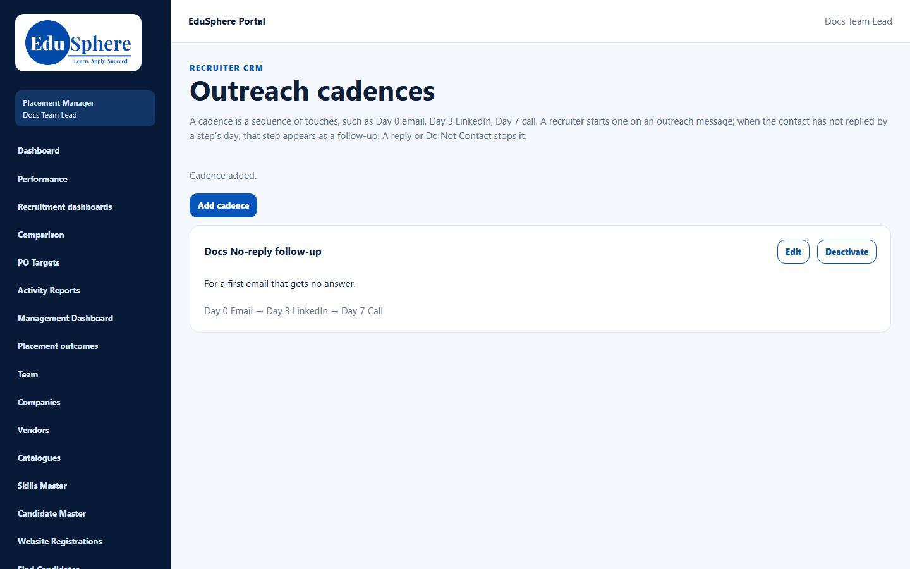
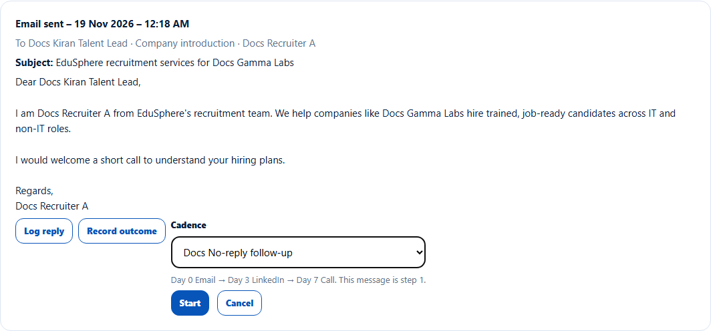
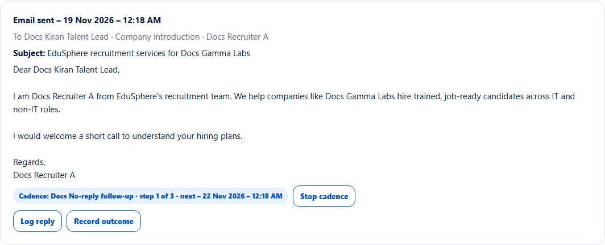

# Outreach cadences
> Doc ID: DOC-REC-CO-015 · Verified on 2026-11-19 against `main` @ `6b61546c` · Roles: Team Lead (library), Recruiter (start and stop)

## Purpose
Follow up automatically on outreach that gets no reply: a cadence is a sequence of touches such as Day 0 email, Day 3 LinkedIn, Day 7 call.

## Who Can Use This Feature
- **Team Lead**: adds, edits, activates and deactivates cadences.
- **Recruiter**: starts a cadence on a message they sent, and stops it.

## Prerequisites
- For starting: a sent message to a contact who has not replied and has no meeting booked.

## How to Access
- Team Lead: **Outreach cadences** (`/recruiter/manager/cadences`).
- Recruiter: company page → **Messages** → **Start cadence** on a message.

## Steps
### Step 1 — Add a cadence (Team Lead)
Select **Add cadence**. Enter the **Name (required)** and **Description (optional)**. Under **Steps**, set each step's **day** (0 to 90), **channel** (Email, WhatsApp, LinkedIn, Call) and optional **template**. Step 1 (day 0) is the outreach that starts the cadence. Use **Add step** (up to 10) and **Remove**; a cadence needs at least two steps. Select **Add cadence**: **Cadence added.**

### Step 2 — The cadence library
Each cadence shows its steps ("Day 0 Email → Day 3 LinkedIn → Day 7 Call") with **Edit** and **Deactivate**.

### Step 3 — Start a cadence on a message (Recruiter)
On a sent message, select **Start cadence**, choose the **Cadence** (its steps are shown, and "This message is step 1.") and select **Start**: **Cadence started for {name}.**

### Step 4 — Follow the cadence
The message shows **Cadence: {name} · step 1 of 3** and when the next step is due, with **Stop cadence**. When the contact has not replied by a step's day, that step appears as a follow-up (captured in session S15). A reply or **Do not contact** stops it.

## Validation Messages
| Message | When |
|---|---|
| Cadence added. | Cadence saved |
| Cadence started for {name}. | Cadence started |
| This contact has already replied | Start on a contact who replied, or who has a meeting booked |
| Cadence stopped. | Stopped (from code; not captured) |

## Tips
- **Start cadence** is offered on every unanswered message, but EduSphere refuses it when the contact has replied to any message or has a meeting booked. In our test both Docs Acme Technologies contacts were refused, so the cadence was started on Docs Gamma Labs.

## Related Features
- [Messages](co-009-messages.md)
- [Message templates](../masters/mst-004-message-templates.md)
