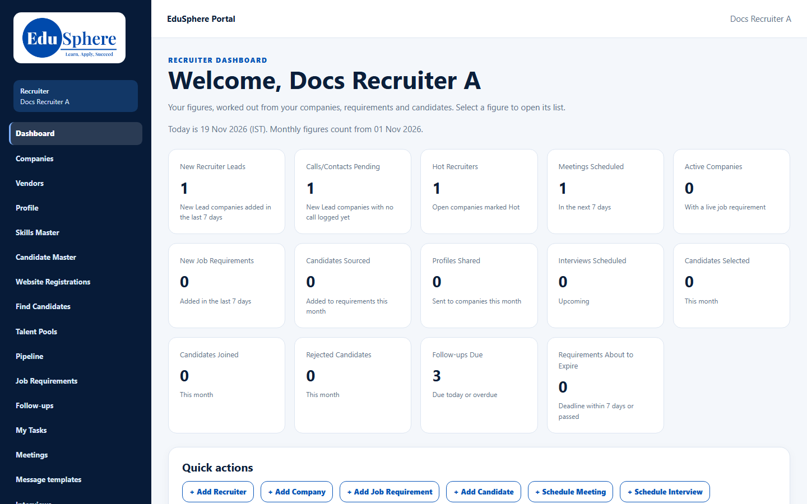
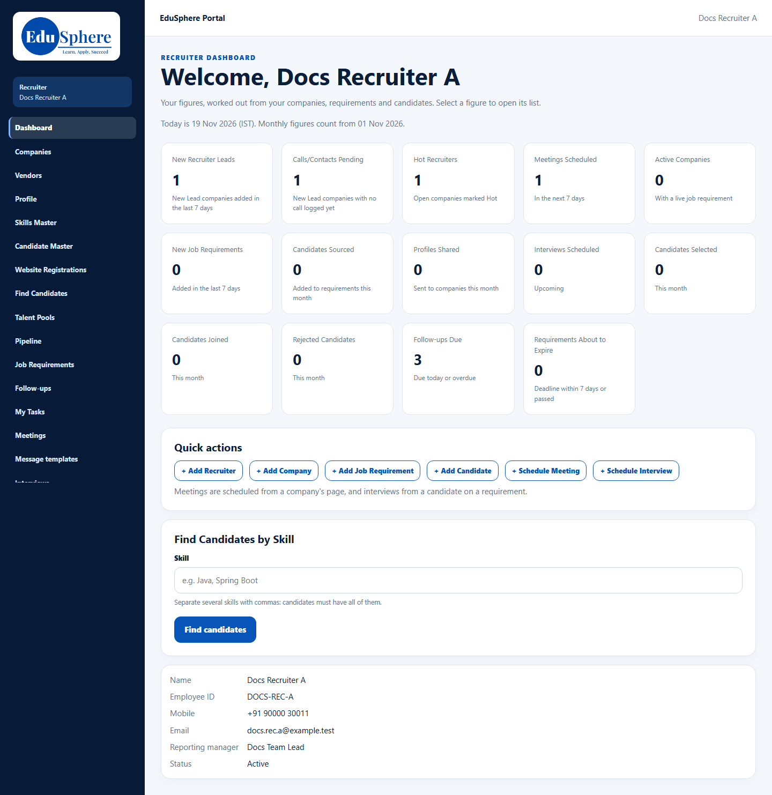

# Recruiter dashboard
> Doc ID: DOC-REC-DASH-001 · Verified on 2026-11-19 against `main` @ `6b61546c` · Roles: Recruiter

## Purpose
See your figures for today and this month, open any figure's list, and start common tasks.

## Who Can Use This Feature
- **Recruiter**. The Team Lead's version is [Team Lead dashboard](dash-002-team-lead-dashboard.md).

## Prerequisites
- None. The recruiter lands here after signing in.

## How to Access
Sidebar → **Dashboard** (`/recruiter/dashboard`).

## Steps
### Step 1 — Read the figures
The figures are worked out from your companies, requirements and candidates. The page shows today's date (IST) and that monthly figures count from the 1st of the month.

| Figure | Counts |
|---|---|
| New Recruiter Leads | New Lead companies added in the last 7 days |
| Calls/Contacts Pending | New Lead companies with no call logged yet |
| Hot Recruiters | Open companies marked Hot |
| Meetings Scheduled | In the next 7 days |
| Active Companies | With a live job requirement |
| New Job Requirements | Added in the last 7 days |
| Candidates Sourced | Added to requirements this month |
| Profiles Shared | Sent to companies this month |
| Interviews Scheduled | Upcoming |
| Candidates Selected | This month |
| Candidates Joined | This month |
| Rejected Candidates | This month |
| Follow-ups Due | Due today or overdue |
| Requirements About to Expire | Deadline within 7 days or passed |

### Step 2 — Open a figure's list
Select a figure to open its list. For example, **Follow-ups Due** opens **Follow-ups** showing the ones due today.

### Step 3 — Quick actions and Find Candidates by Skill
**Quick actions**: **+ Add Recruiter**, **+ Add Company**, **+ Add Job Requirement**, **+ Add Candidate**, **+ Schedule Meeting**, **+ Schedule Interview**. Meetings are scheduled from a company's page, and interviews from a candidate on a requirement. **Find Candidates by Skill**: enter one or more skills separated by commas (candidates must have all of them) and select **Find candidates**. Below, your own details: name, Employee ID, mobile, email, reporting manager and status.

## Tips
- "Recruiter Leads" and "Hot Recruiters" count companies (the hiring companies you work), not recruiters.

## Related Features
- [Follow-ups](../work/work-001-follow-ups.md)
- [Pipeline board](../companies/co-014-pipeline-board.md)
- [Recruiter workspace](../navigation/nav-001-recruiter-workspace.md)
