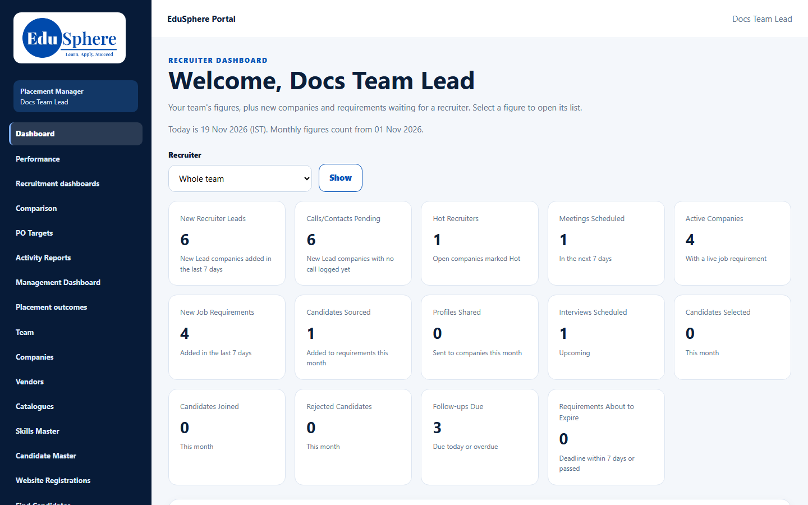

# Team Lead dashboard
> Doc ID: DOC-REC-DASH-002 · Verified on 2026-11-19 against `main` @ `6b61546c` · Roles: Team Lead

## Purpose
See the whole team's figures, or one recruiter's, including new companies and requirements waiting for a recruiter.

## Who Can Use This Feature
- **Team Lead** (placement manager).

## Prerequisites
- None.

## How to Access
Sidebar → **Dashboard** (`/recruiter/dashboard`). The Team Lead lands on **Team** after signing in.

## Steps
### Step 1 — The whole team
The figures are the same as on the [Recruiter dashboard](dash-001-recruiter-dashboard.md), counted for the whole team plus unassigned companies and requirements. In our test the team view counted 6 New Recruiter Leads against Recruiter A's 1, because the demo companies are unassigned.

### Step 2 — One recruiter
In **Recruiter**, choose a name (or **Whole team**) and select **Show**. The page says whose figures it shows ("Docs Recruiter A's figures.").

## Tips
- The Team Lead's **Quick actions** are **+ Add Recruiter**, **+ Add Company**, **+ Add Job Requirement** and **+ Add Candidate**; there is no Schedule Meeting or Schedule Interview.

## Related Features
- [Team Lead workspace](../navigation/nav-002-team-lead-workspace.md)
- [Pipeline board](../companies/co-014-pipeline-board.md)
