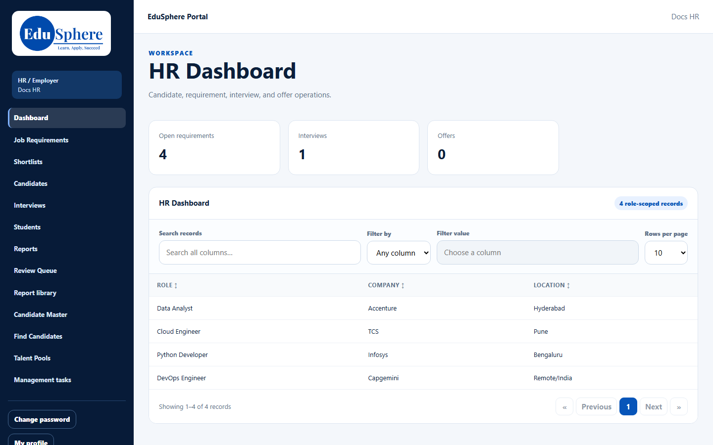

# HR dashboard
> Doc ID: DOC-REC-DASH-003 · Verified on 2026-11-18 against `main` @ `6b61546c` · Roles: HR Team

## Purpose
See the open hiring work at a glance.

## Who Can Use This Feature
- **HR Team** (read only).

## Prerequisites
- None.

## How to Access
Sign in at `/it/login`; you land on **HR Dashboard** ("Candidate, requirement, interview, and offer operations.").

## Steps
### Step 1 — Read the figures
Tiles **Open requirements**, **Interviews** and **Offers**.

### Step 2 — Read the open requirements
The table lists **Role**, **Company** and **Location** of each open requirement. Use **Search records**, **Filter by** and **Rows per page** to narrow it.

## Expected Result
Nothing can be changed here; requirements are worked by recruiters.

## Tips
- The four requirements in the screenshot (Accenture, TCS, Infosys, Capgemini) are the demo system's seed data.

## Related Features
- [HR, HR Manager, Placement Officer and Interviewer portals](../navigation/nav-003-it-portals.md)
