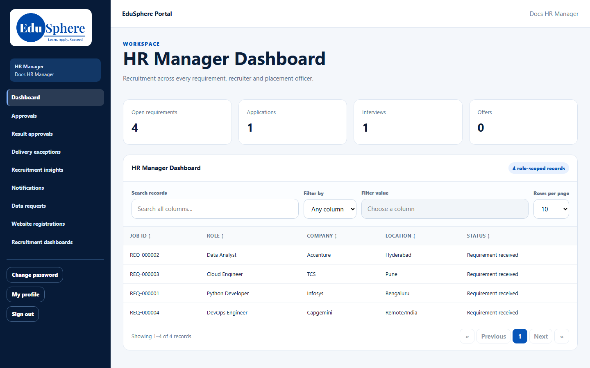

# HR Manager dashboard
> Doc ID: DOC-REC-DASH-004 · Verified on 2026-11-18 against `main` @ `6b61546c` · Roles: HR Manager

## Purpose
See recruitment across every requirement, recruiter and placement officer.

## Who Can Use This Feature
- **HR Manager** (read only).

## Prerequisites
- None.

## How to Access
Sign in at `/it/login`; you land on **HR Manager Dashboard** ("Recruitment across every requirement, recruiter and placement officer.").

## Steps
### Step 1 — Read the figures
Tiles **Open requirements**, **Applications**, **Interviews** and **Offers**.

### Step 2 — Read the open requirements
The table lists **Job ID** (for example **REQ-000001**), **Role**, **Company**, **Location** and **Status**. It shows no candidate, salary or feedback details.

## Expected Result
Use **Approvals**, **Result approvals** and **Data requests** in the sidebar for the decisions waiting on you.

## Related Features
- [HR, HR Manager, Placement Officer and Interviewer portals](../navigation/nav-003-it-portals.md)
