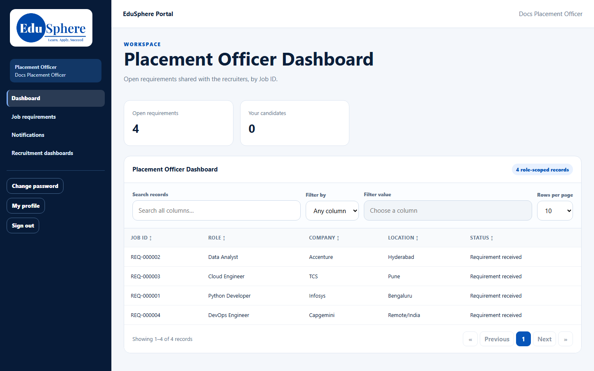

# Placement Officer dashboard
> Doc ID: DOC-REC-DASH-005 · Verified on 2026-11-18 against `main` @ `6b61546c` · Roles: Placement Officer

## Purpose
See the open requirements shared with the recruiters and how many candidates you look after.

## Who Can Use This Feature
- **Placement Officer** (read only).

## Prerequisites
- None.

## How to Access
Sign in at `/it/login`; you land on **Placement Officer Dashboard** ("Open requirements shared with the recruiters, by Job ID.").

## Steps
### Step 1 — Read the figures
Tiles **Open requirements** and **Your candidates** (candidates where you are the placement officer).

### Step 2 — Read the requirements
The table lists **Job ID**, **Role**, **Company**, **Location** and **Status**.

## Expected Result
To work on a requirement you co-own, use **Job requirements** in the sidebar.

## Related Features
- [HR, HR Manager, Placement Officer and Interviewer portals](../navigation/nav-003-it-portals.md)
