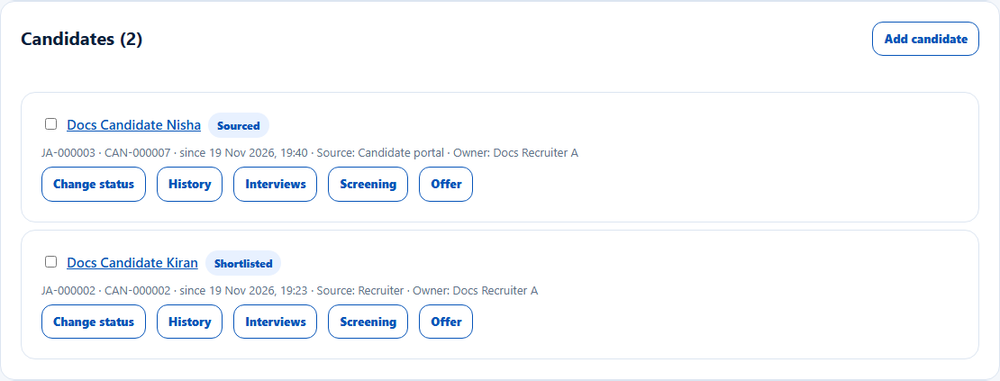
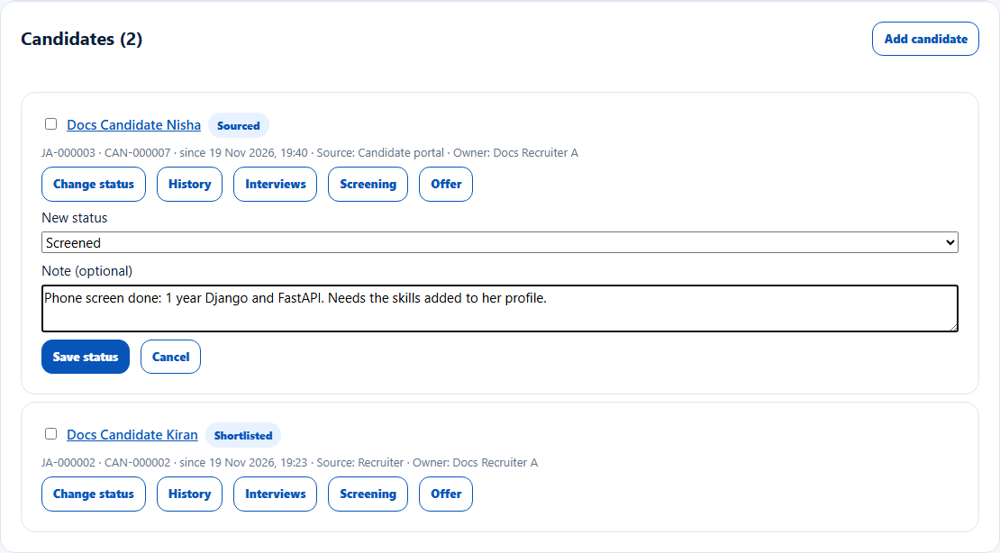
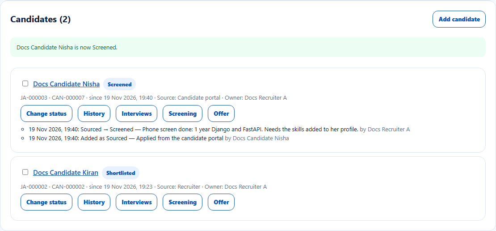
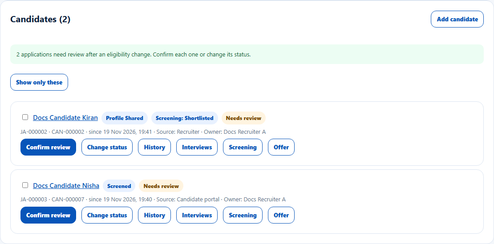

# Candidates on a requirement and application statuses
> Doc ID: DOC-REC-HIRE-001 · Verified on 2026-11-19 against `main` @ `6b61546c` · Roles: Recruiter (owner), Team Lead

## Purpose
See everyone being considered for a job requirement, where each one stands, and move them through the hiring stages.

## Who Can Use This Feature
- The requirement's **Recruiter** owner and the **Team Lead**. The Placement Officer's requirement page has no candidate cards ([Co-owned requirements](../placement-officer/po-001-co-owned-requirements.md)).

## Prerequisites
- An open requirement ([Job requirements](../requirements/req-001-requirements-list.md)).

## How to Access
Requirement page → **Candidates ({n})**.

## Steps
### Step 1 — Read the list
Each candidate shows the name, the application status (and the screening result once there is one), the application ID (**JA-000002**), the candidate ID, since when, the **Source** (Recruiter, Candidate portal…) and the **Owner**. Each row has **Change status**, **History**, **Interviews**, **Screening** and **Offer**, and a box to select the candidate for [sharing](hire-004-share-profiles.md).

People arrive here in three ways:
- **Shortlist** from [Find Candidates](../search/srch-004-bulk-actions.md) (Kiran, added as **Shortlisted**).
- The candidate applies from the portal ([Jobs for you](../candidate-portal/cand-005-jobs-apply.md)): Nisha, added as **Sourced**, "Applied from the candidate portal".
- **Add candidate** on this card: pick the **Candidate**, a **Starting status** (Sourced, Screened, Shortlisted) and an optional **Note**.

### Step 2 — Change the status
Select **Change status**, choose the **New status** and add a **Note (optional)**, then **Save status**: **Docs Candidate Nisha is now Screened.**

| Status | Meaning |
|---|---|
| Sourced | Found or applied; not yet checked |
| Screened | Checked by the recruiter |
| Shortlisted | Ready to put forward |
| Profile Shared | Sent to the client (set automatically by [sharing](hire-004-share-profiles.md)) |
| Interview | In the client's interviews |
| Selected | Chosen by the client |
| Rejected, Withdrawn | Out of the running |

### Step 3 — History
Select **History** to see every move, with who made it and the note ("Sourced → Screened — Phone screen done… by Docs Recruiter A"; "Added as Sourced — Applied from the candidate portal by Docs Candidate Nisha").

### Step 4 — Applications that need review
When the requirement's matching rules change ([Match weights](hire-002-matching.md)), the card shows "{n} applications need review after an eligibility change. Confirm each one or change its status." with **Show only these**, and each affected row is marked **Needs review** with **Confirm review**: "Review confirmed — Docs Candidate Kiran stays Profile Shared."

## Validation Messages
| Message | When |
|---|---|
| {name} is now {status}. | Status saved |
| Review confirmed — {name} stays {status}. | Review confirmed |

## Tips
- A candidate who applied on the **public careers page** without an account is not added here automatically; open them from [Website registrations](../candidates/can-014-website-registrations.md) and use **Add candidate** (finding P17).
- The candidate sees the stage in their portal under [My applications](../candidate-portal/cand-006-my-applications.md) (Nisha's **Screened** shows as **Screening**).

## Related Features
- [Matching candidates](hire-002-matching.md)
- [Screening](hire-003-screening.md)
- [Share profiles](hire-004-share-profiles.md)
