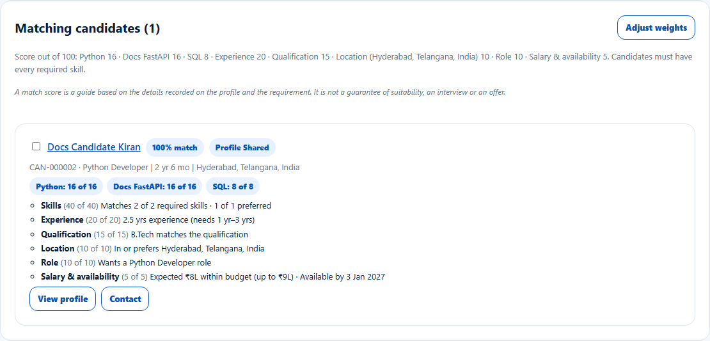
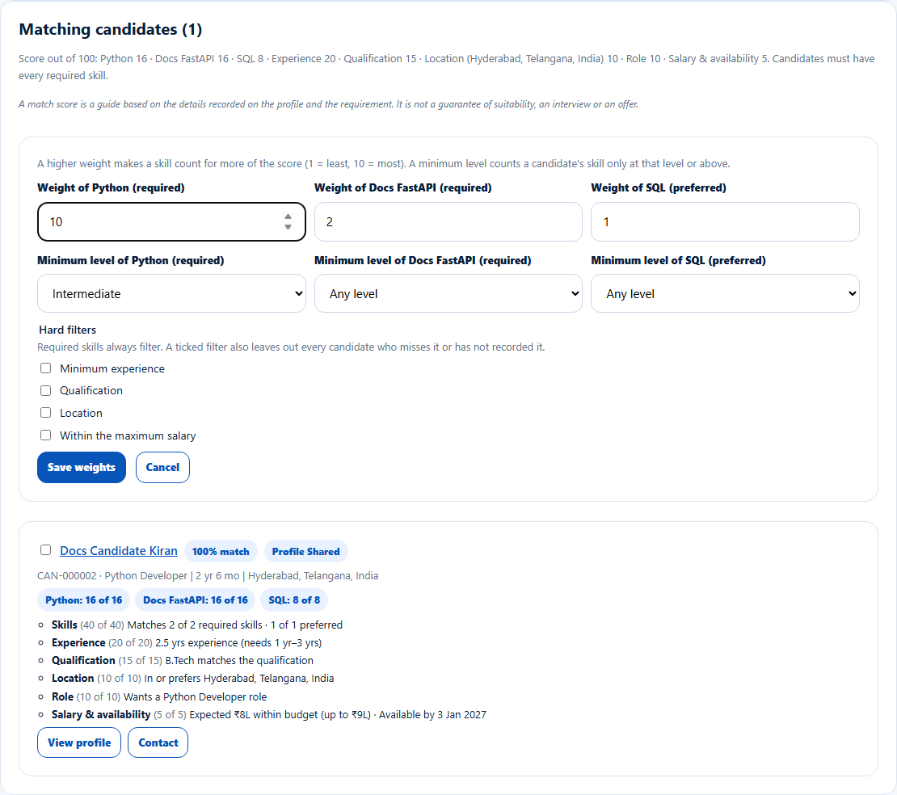
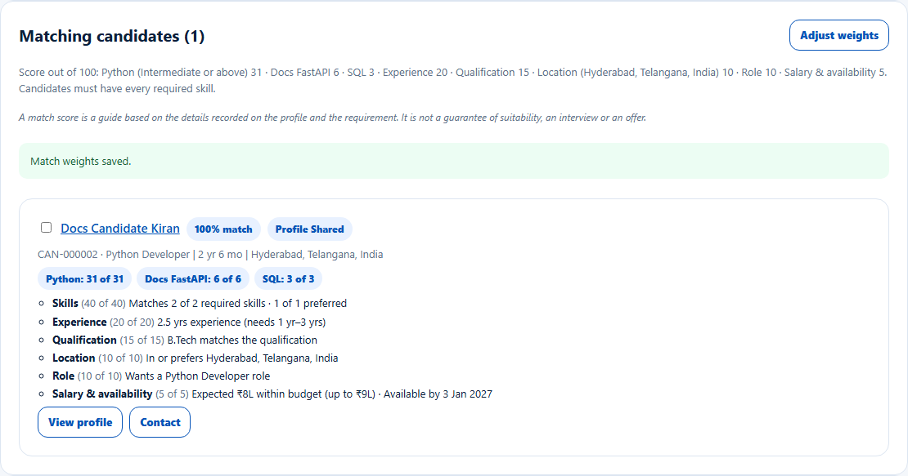

# Matching candidates and match weights
> Doc ID: DOC-REC-HIRE-002 · Verified on 2026-11-19 against `main` @ `6b61546c` · Roles: Recruiter (owner), Team Lead

## Purpose
Let EduSphere suggest the best-fitting candidates for a requirement with a score out of 100, and tune what counts most for this job.

## Who Can Use This Feature
- The requirement's **Recruiter** owner and the **Team Lead**. The default weights for every requirement are set by the Super Admin ([Match weights](../../admin-manual/admin/adm-008-match-weights.md)).

## Prerequisites
- The requirement has required skills.

## How to Access
Requirement page → **Matching candidates ({n})**.

## Steps
### Step 1 — Read the matches
The card states how the 100 points are split ("Python 16 · Docs FastAPI 16 · SQL 8 · Experience 20 · Qualification 15 · Location 10 · Role 10 · Salary & availability 5") and that "Candidates must have every required skill." Each match shows the percentage, current status, and a line per part, for example "Experience (20 of 20) 2.5 yrs experience (needs 1 yr–3 yrs)" or "Salary & availability (5 of 5) Expected ₹8L within budget (up to ₹9L)", with **View profile** and **Contact**.

"A match score is a guide based on the details recorded on the profile and the requirement. It is not a guarantee of suitability, an interview or an offer."

### Step 2 — Adjust the weights for this requirement
Select **Adjust weights**. For each skill set the **Weight** (1 = least, 10 = most) and a **Minimum level** (Any level, Beginner, Intermediate, Advanced, Expert): "A minimum level counts a candidate's skill only at that level or above." Under **Hard filters** tick any of **Minimum experience**, **Qualification**, **Location** and **Within the maximum salary**: "A ticked filter also leaves out every candidate who misses it or has not recorded it."

### Step 3 — Save
Select **Save weights**: **Match weights saved.** The split changes (Python weight 10 and minimum Intermediate gave "Python (Intermediate or above) 31 · Docs FastAPI 6 · SQL 3").

Saving can change who is eligible, so applications already on the requirement are marked **Needs review** ([Candidates](hire-001-candidates-statuses.md#step-4--applications-that-need-review)).

## Validation Messages
| Message | When |
|---|---|
| Match weights saved. | Saved |

## Tips
- Candidates without a required skill on their profile never appear here, however good their resume: Nisha (no skills recorded) is not matched.
- Use **Contact** to reach a match before adding them to the requirement.

## Related Features
- [Candidates and statuses](hire-001-candidates-statuses.md)
- [Find Candidates](../search/srch-001-find-candidates.md)
