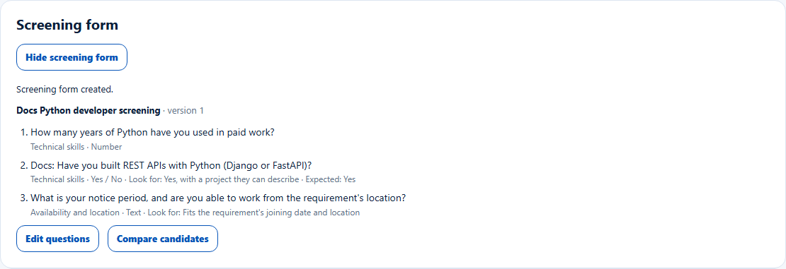
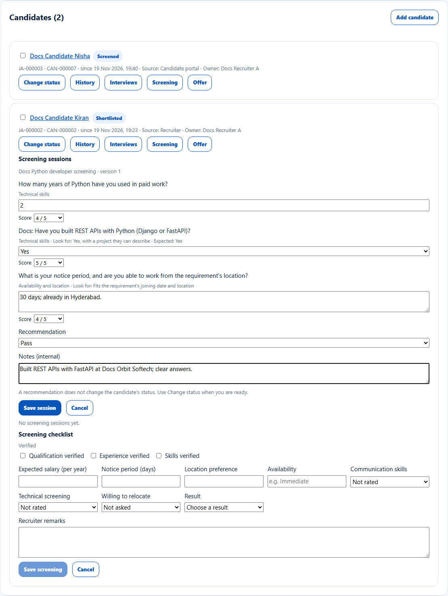
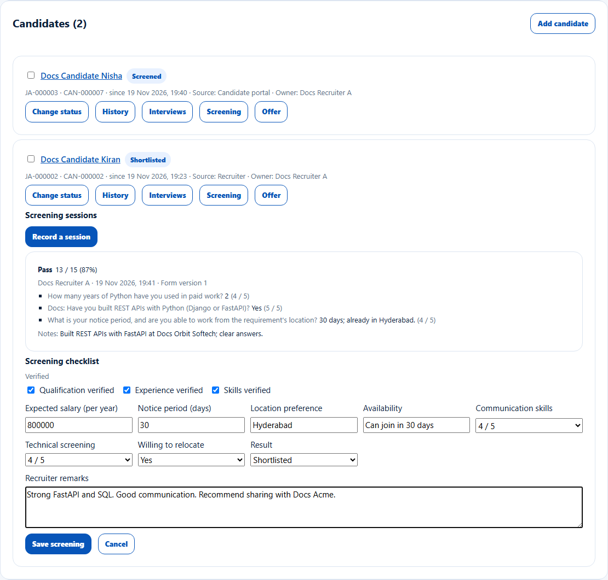

# Screening form, screening sessions and checklist
> Doc ID: DOC-REC-HIRE-003 · Verified on 2026-11-19 against `main` @ `6b61546c` · Roles: Recruiter (owner), Team Lead

## Purpose
Ask every candidate for a requirement the same questions, score the answers, and record the recruiter's checks before putting anyone forward.

## Who Can Use This Feature
- The requirement's **Recruiter** owner and the **Team Lead**.

## Prerequisites
- For the form: a question template in the [Screening bank](../masters/mst-006-screening-bank.md) (here "Docs Python developer screening"), or the default.

## How to Access
Requirement page → **Screening form**; candidate row → **Screening**.

## Steps
### Step 1 — Create the requirement's screening form
Select **Show screening form**. "This requirement has no screening form yet." Choose a **Template** (**Default (Standard 5-category screening)** or a saved one) and select **Create form**: **Screening form created.** The form lists each question with its category, answer type, what to look for and the expected answer, and offers **Edit questions** and **Compare candidates**.

### Step 2 — Record a screening session
On the candidate's row select **Screening**, then **Record a session for {name}**. Answer each question (a number, Yes / No or text), give each answer a **Score** (0 / 5 to 5 / 5), choose a **Recommendation** (Pass, Hold, Reject) and add **Notes (internal)**. Select **Save session**: **Session recorded.** The session shows the recommendation and total ("Pass 13 / 15 (87%)"), who recorded it, when, the form version and each answer with its score.

### Step 3 — Fill in the screening checklist
Below the sessions, the **Screening checklist**: tick **Qualification verified**, **Experience verified**, **Skills verified**; enter **Expected salary (per year)**, **Notice period (days)**, **Location preference**, **Availability**; rate **Communication skills** and **Technical screening** (1 / 5 to 5 / 5); **Willing to relocate**; and the **Result** (Shortlisted, Hold, Rejected, Need More Information) with **Recruiter remarks**. Select **Save screening**: **Screening saved — Docs Candidate Kiran is now Shortlisted.** The row then shows "Screening: Shortlisted".

## Validation Messages
| Message | When |
|---|---|
| Screening form created. | Form created |
| Session recorded. | Session saved |
| Screening saved — {name} is now {status}. | Checklist saved; the **Result** sets the status |

## Tips
- Each session records the form version it used ("Form version 1"); edit the questions with **Edit questions**.
- **Compare candidates** on the form compares the candidates' sessions (not opened in this guide).
- The checklist's **Result** changes the application status; a session's **Recommendation** does not.

## Related Features
- [Screening bank](../masters/mst-006-screening-bank.md)
- [Share profiles](hire-004-share-profiles.md)
