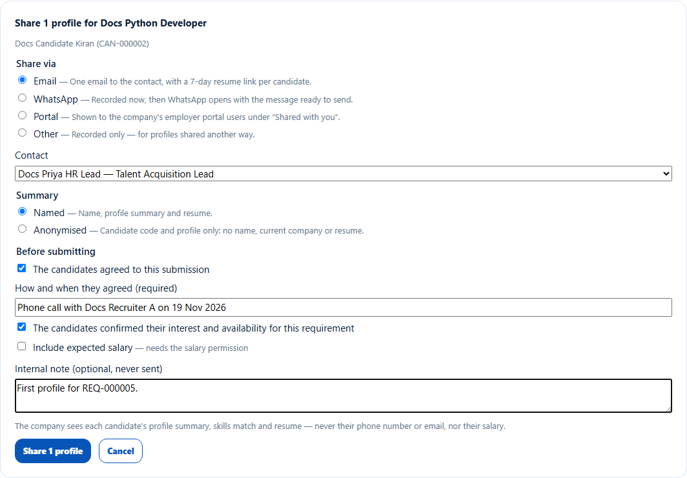

# Share profiles with the client
> Doc ID: DOC-REC-HIRE-004 · Verified on 2026-11-19 against `main` @ `6b61546c` · Roles: Recruiter (owner), Team Lead

## Purpose
Send candidates' profiles to the client company for a requirement, by email, WhatsApp or the employer portal, with the candidate's agreement recorded.

## Who Can Use This Feature
- The requirement's **Recruiter** owner and the **Team Lead**. **Include expected salary** needs the salary permission (recruiters and Team Leads have it).

## Prerequisites
- The candidates are on the requirement ([Candidates](hire-001-candidates-statuses.md)).
- They agreed to be put forward ([Permission to represent](../candidates/can-010-source-outreach.md)).
- The company has a contact ([Contacts](../companies/co-004-contacts.md)).

## How to Access
Requirement page → **Candidates** → tick **Select {name} to share** → **Share selected ({n})**. (Also from [Find Candidates](../search/srch-004-bulk-actions.md).)

## Steps
### Step 1 — Fill in the share form
**Share {n} profile for {requirement}** lists the candidates, then:
- **Share via**: **Email** ("One email to the contact, with a 7-day resume link per candidate"), **WhatsApp** ("Recorded now, then WhatsApp opens with the message ready to send"), **Portal** ("Shown to the company's employer portal users under 'Shared with you'"), **Other** ("Recorded only — for profiles shared another way").
- **Contact**: the company contact (here Docs Priya HR Lead — Talent Acquisition Lead).
- **Summary**: **Named** ("Name, profile summary and resume") or **Anonymised** ("Candidate code and profile only: no name, current company or resume").
- **Before submitting**: **The candidates agreed to this submission** with **How and when they agreed (required)**, and **The candidates confirmed their interest and availability for this requirement**.
- **Include expected salary**, **Internal note (optional, never sent)**.

"The company sees each candidate's profile summary, skills match and resume — never their phone number or email, nor their salary."

### Step 2 — Share
Select **Share {n} profile**: **Shared 1 profile for Docs Python Developer by Email with Docs Priya HR Lead. The email is queued.** Kiran's status becomes **Profile Shared**, and the share appears under [Shared profiles](hire-005-submissions.md).

## Validation Messages
| Message | When |
|---|---|
| Shared {n} profile for {requirement} by {channel} with {contact}. The email is queued. | Shared by email |

## Tips
- Use **Anonymised** when the client should judge the profile before learning who it is.
- The resume link in the email works for 7 days.

## Related Features
- [Submissions and client response](hire-005-submissions.md)
- [Permission to represent](../candidates/can-010-source-outreach.md)
