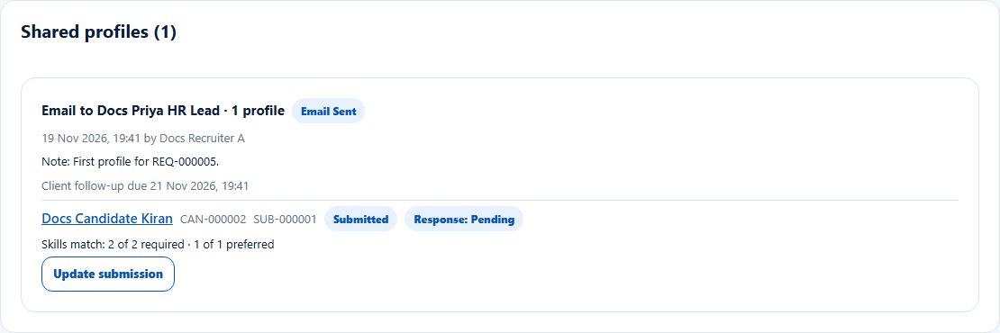
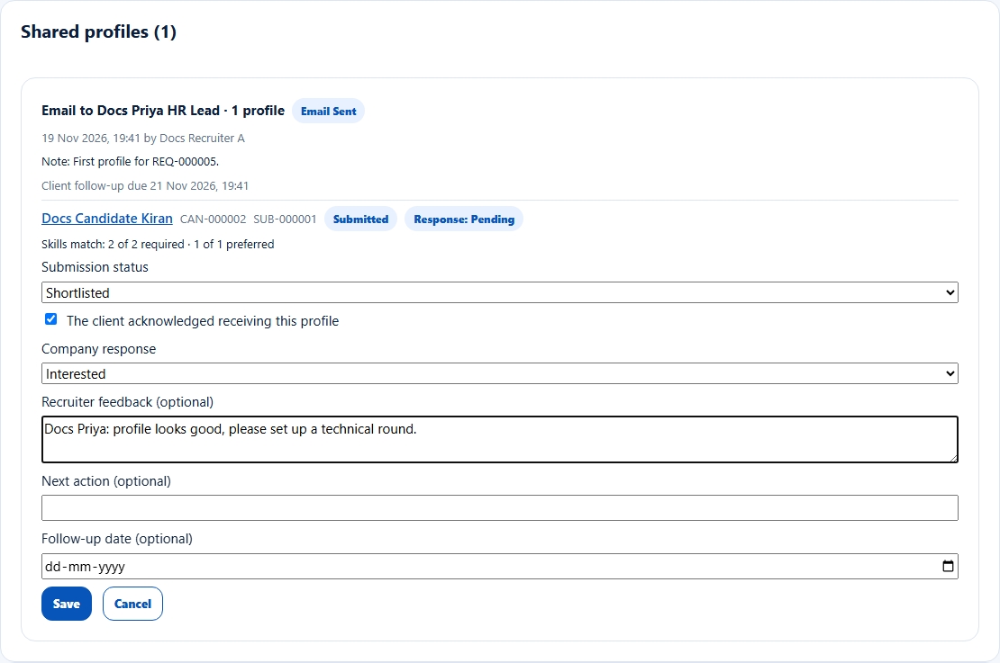
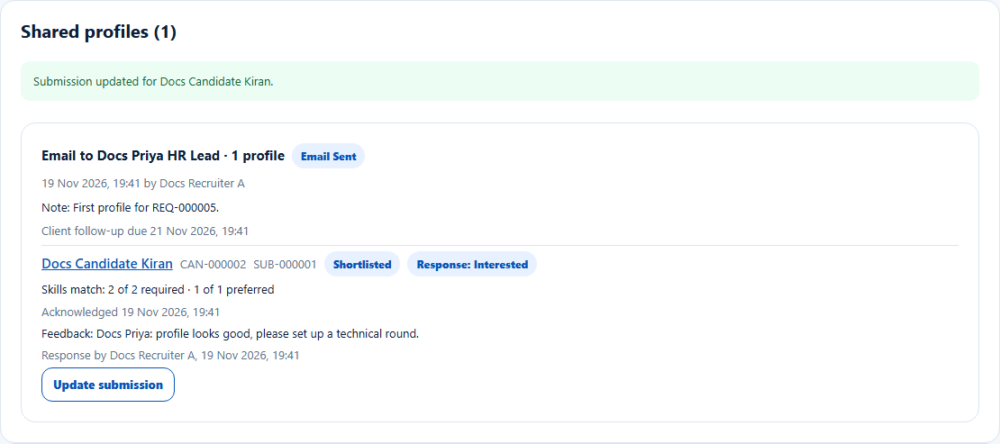
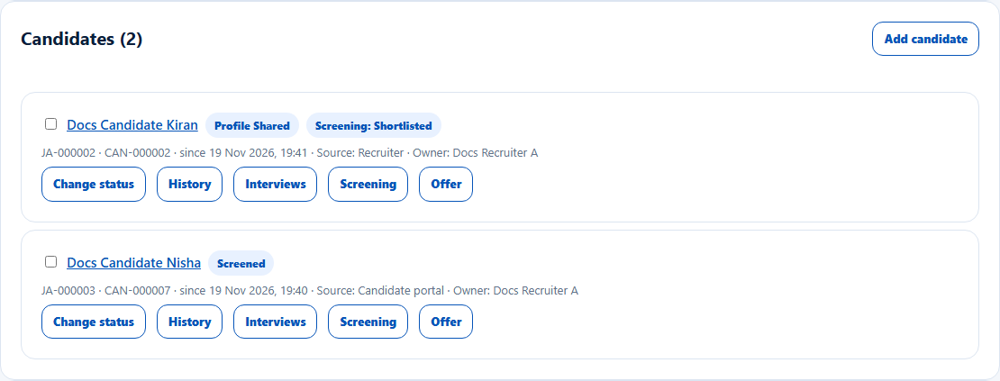

# Submission status and client response
> Doc ID: DOC-REC-HIRE-005 · Verified on 2026-11-19 against `main` @ `6b61546c` · Roles: Recruiter (owner), Team Lead

## Purpose
Track each profile sent to the client and record what the client said, so the next step (an interview, a rejection) is clear.

## Who Can Use This Feature
- The requirement's **Recruiter** owner and the **Team Lead**.

## Prerequisites
- A profile was [shared](hire-004-share-profiles.md).

## How to Access
Requirement page → **Shared profiles ({n})**.

## Steps
### Step 1 — Read the shares
Each share shows the channel and contact ("Email to Docs Priya HR Lead · 1 profile"), whether it was **Sent**, when and by whom, the internal note, and **Client follow-up due {date}** (two days later). Under it each candidate has a submission number (**SUB-000001**), the submission status (**Submitted**), **Response: Pending** and the skills match.

### Step 2 — Record the client's response
Select **Update submission for {name}**:
- **Submission status**: Submitted, Client reviewing, Shortlisted, Interview, On hold, Rejected, Selected, Withdrawn.
- **The client acknowledged receiving this profile**.
- **Company response**: Pending, Interested, Not interested, Interview requested.
- **Recruiter feedback (optional)**, **Next action (optional)**, **Follow-up date (optional)**.

Select **Save**: **Submission updated for Docs Candidate Kiran.** The submission now reads **Shortlisted**, **Response: Interested**, **Acknowledged {date}**, the feedback, and who recorded it.

## Validation Messages
| Message | When |
|---|---|
| Submission updated for {name}. | Response saved |

## Tips
- The submission status is the client's view; the application status on [Candidates](hire-001-candidates-statuses.md) is yours. Recording the client's **Shortlisted** / **Interested** did not change it: Kiran stayed **Profile Shared**.
  

## Related Features
- [Share profiles](hire-004-share-profiles.md)
- [Candidates and statuses](hire-001-candidates-statuses.md)
