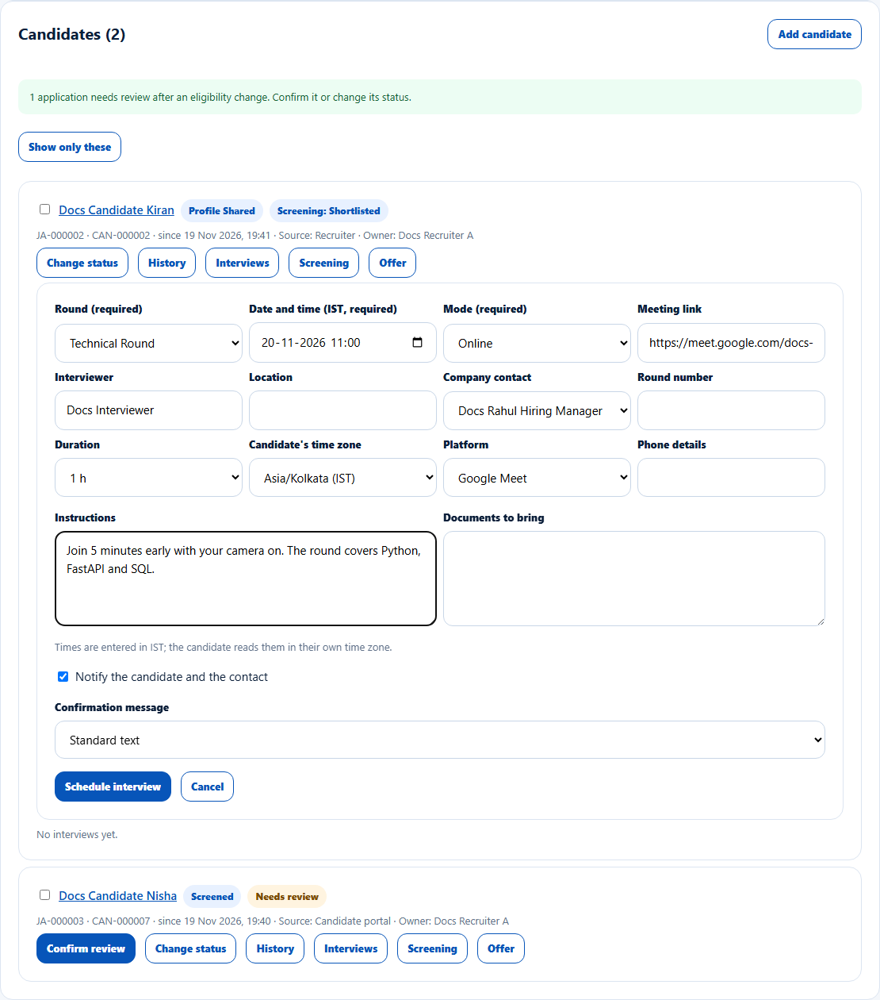
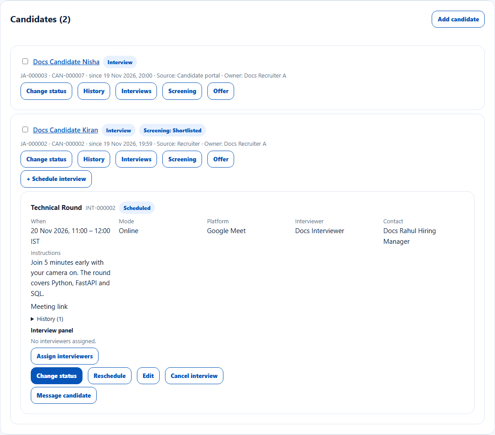
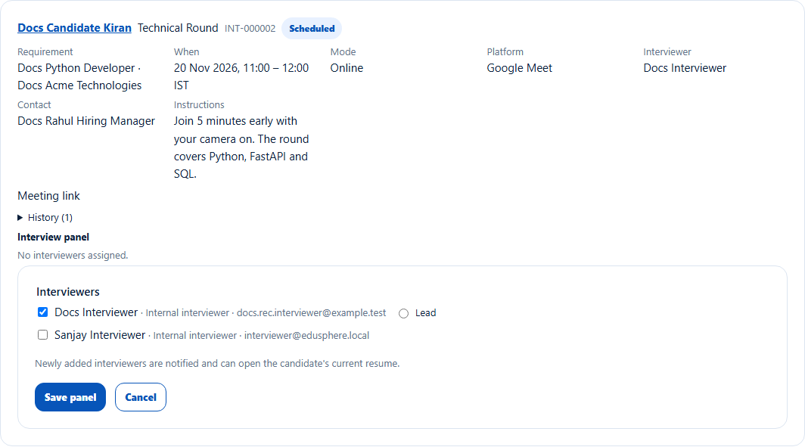

# Schedule an interview and its panel
> Doc ID: DOC-REC-HIRE-006 · Verified on 2026-11-19 against `main` @ `6b61546c` · Roles: Recruiter (owner), Team Lead (read)

## Purpose
Book an interview round for a candidate on a requirement, tell the candidate and the client contact, and assign the interviewers who give feedback.

## Who Can Use This Feature
- The requirement's **Recruiter** owner. The Team Lead sees the team's interviews read only ([Interviews list](hire-007-interviews-list.md)).

## Prerequisites
- The candidate is on the requirement ([Candidates](hire-001-candidates-statuses.md)).
- Interviewer accounts exist ([Recruitment users](../../admin-manual/admin/adm-002-create-recruitment-users.md)).

## How to Access
Requirement page → **Candidates** → **Interviews** on the candidate's row → **+ Schedule interview for {name}**.

## Steps
### Step 1 — Fill in the interview
- **Round (required)**: HR Round, Technical Round, Manager Round, Final Round, Client Round. **Round number** if there are several.
- **Date and time (IST, required)**, **Duration**, **Candidate's time zone** ("Times are entered in IST; the candidate reads them in their own time zone.").
- **Mode (required)**: Online, Phone, In person; then **Platform** (Google Meet, Microsoft Teams, Zoom, Zoho Meeting, Other) and **Meeting link**, **Phone details** or **Location**.
- **Interviewer** (a name shown on the card), **Company contact**.
- **Instructions**, **Documents to bring**.
- **Notify the candidate**, with the **Confirmation message** template.

### Step 2 — Schedule
Select **Schedule interview**: **Technical Round scheduled for Docs Candidate Kiran. Candidate: email queued. Contact: email queued.** (For a candidate with a portal account: "Candidate: notified in the portal.") The interview gets a code (**INT-000002**) and the application moves to **Interview**. The card offers **Assign interviewers**, **Change status**, **Reschedule**, **Edit**, **Cancel interview** and **Message candidate**.

### Step 3 — Assign the interview panel
Select **Assign interviewers for INT-000002**, tick each interviewer (and **Lead** for one of them), then **Save panel**: **Interview panel saved.** "Newly added interviewers are notified and can open the candidate's current resume." The panel then lists each interviewer and their feedback ("— no feedback yet").

## Validation Messages
| Message | When |
|---|---|
| {round} scheduled for {name}. Candidate: … Contact: … | Scheduled |
| Interview panel saved. | Panel saved |

## Tips
- Typing a name in **Interviewer** only labels the card. Only the **panel** gives the interviewer the interview on their dashboard and lets them give feedback (finding P18).
- The platform is a label; EduSphere does not create the meeting. Paste the link yourself (finding P6).

## Related Features
- [Interviews list](hire-007-interviews-list.md)
- [My interviews (Interviewer)](../interviewer/int-001-my-interviews.md)
