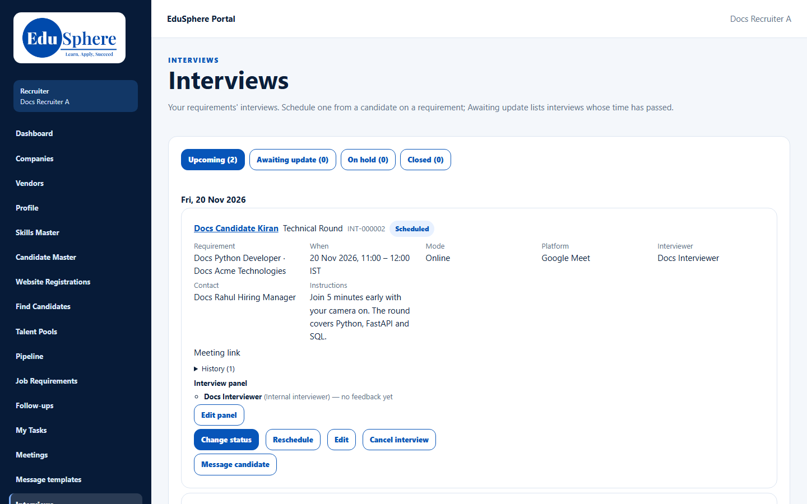
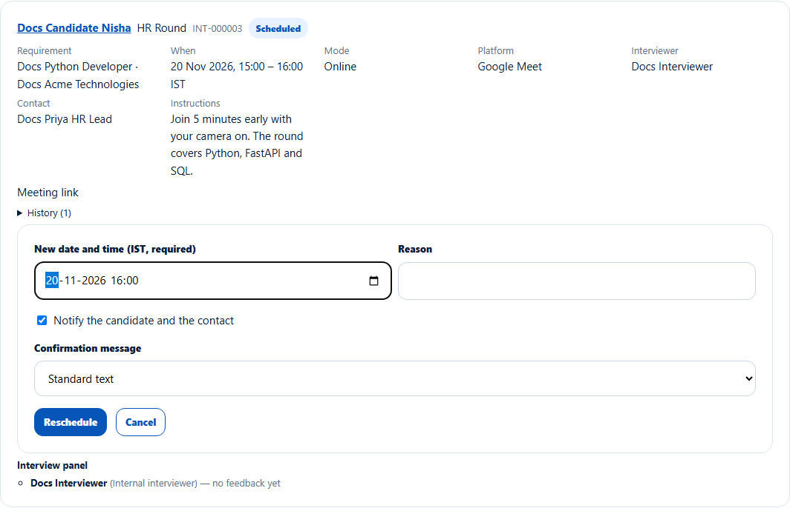
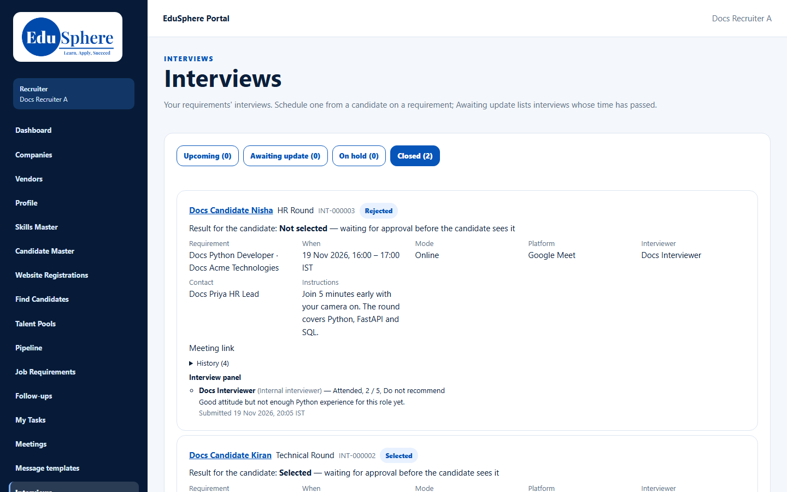

# Interviews list, reschedule, status and cancel
> Doc ID: DOC-REC-HIRE-007 · Verified on 2026-11-19 against `main` @ `6b61546c` · Roles: Recruiter, Team Lead (read)

## Purpose
See every interview on your requirements in one place, by what needs doing, and move or cancel them.

## Who Can Use This Feature
| Role | What they see |
|---|---|
| Recruiter | "Your requirements' interviews", with every action. |
| Team Lead | "Your team's interviews (read only)", plus [Interview automation](hire-009-interview-automation.md). |

## Prerequisites
- At least one [scheduled interview](hire-006-schedule-interview.md).

## How to Access
Sidebar → **Interviews** (`/recruiter/interviews`).

## Steps
### Step 1 — The tabs
"Schedule one from a candidate on a requirement; Awaiting update lists interviews whose time has passed." Tabs: **Upcoming**, **Awaiting update**, **On hold**, **Closed**. Interviews are grouped by day; each shows the candidate, round, code, status, requirement, time, mode, platform, interviewer, contact, instructions, meeting link, **History** and the **Interview panel**.

### Step 2 — Reschedule
Select **Reschedule INT-…**, enter the **New date and time (IST, required)** and a **Reason**, keep **Notify the candidate and the contact**, and save: **Interview rescheduled. Candidate: notified in the portal. Contact: email queued.** The status becomes **Rescheduled** and the history counts the change. Nisha's HR Round moved from 15:00 to 16:00.

### Step 3 — Other actions
- **Change status**: Confirmed, Completed, No Show, On Hold (and, after Completed, Selected or Rejected): see [Recording the outcome](hire-008-interview-outcome.md).
- **Edit**: change the interview's details (to move the time, use **Reschedule**).
- **Cancel interview**: with a reason; a cancelled interview is final and the application does not move, so another round can be booked (from code).
- **Message candidate**: about this interview.

### Step 4 — Closed
Once decided, interviews move to **Closed**. Until the HR Manager publishes the result, the card says "Result for the candidate: Not selected — waiting for approval before the candidate sees it".

## Validation Messages
| Message | When |
|---|---|
| Interview rescheduled. Candidate: … Contact: … | Rescheduled |

## Related Features
- [Schedule an interview](hire-006-schedule-interview.md)
- [Record the outcome](hire-008-interview-outcome.md)
