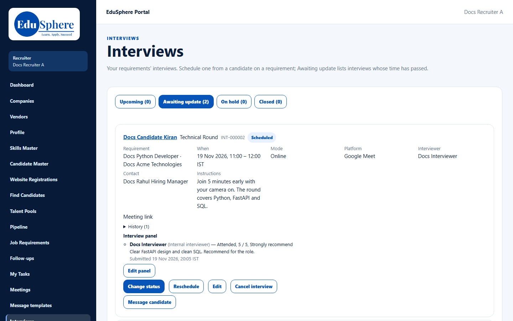
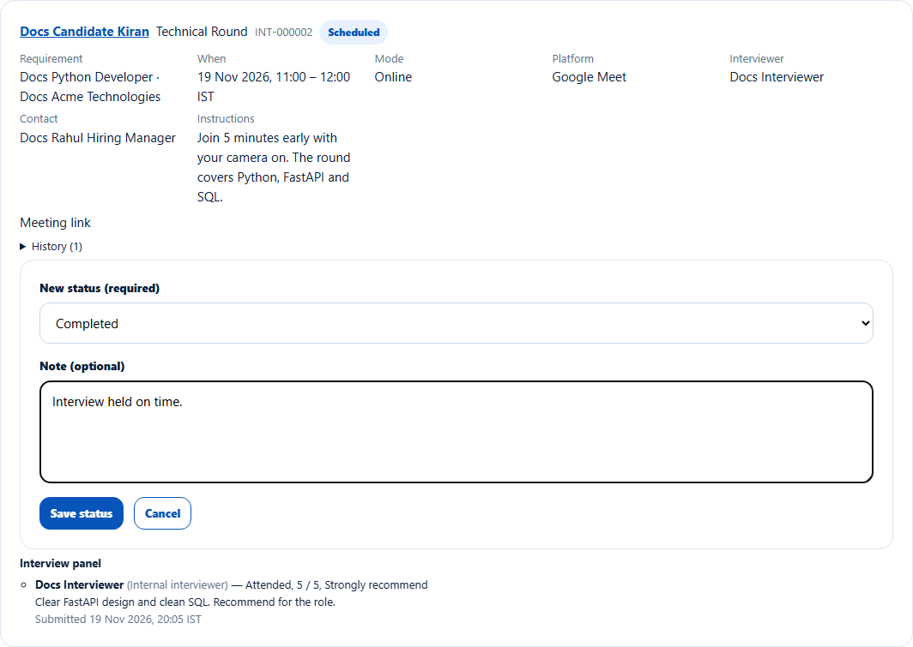
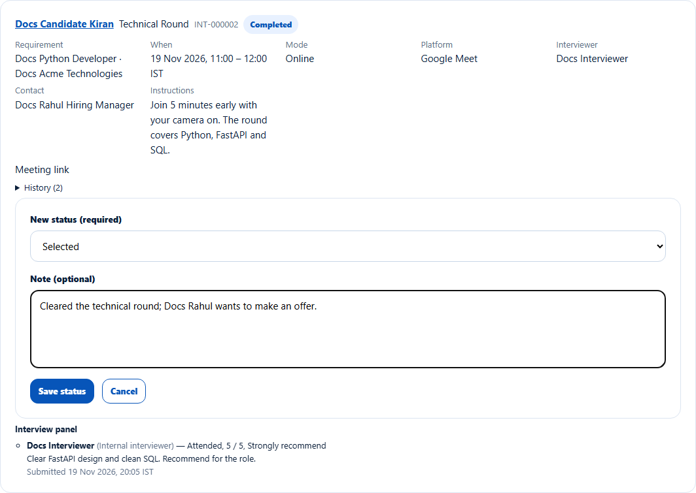

# Record the interview outcome
> Doc ID: DOC-REC-HIRE-008 · Verified on 2026-11-19 against `main` @ `6b61546c` · Roles: Recruiter (owner)

## Purpose
After the interview, mark that it took place, read the interviewers' feedback, and record the client's decision so the candidate can be told.

## Who Can Use This Feature
- The requirement's **Recruiter** owner.

## Prerequisites
- The interview time has passed (the docs stack moved the two interviews into the past with SQL; labelled "state prepared by data setup").

## How to Access
Sidebar → **Interviews** → **Awaiting update**.

## Steps
### Step 1 — Awaiting update
Interviews whose time has passed wait here. The **Interview panel** shows each interviewer's feedback ("Docs Interviewer (Internal interviewer) — Attended, 5 / 5, Strongly recommend …") once it is in ([Submit feedback](../interviewer/int-002-submit-feedback.md)).

### Step 2 — Mark it completed
Select **Change status of INT-…**, choose **Completed** in **New status (required)** (or **No Show**, **On Hold**, **Confirmed**), add a **Note (optional)**, and **Save status**: **Status saved.**

### Step 3 — Record the decision
**Change status** again now offers **Selected**, **Rejected** and **On Hold**. Choose the client's decision, add the reason, and **Save status**.

The decision becomes an **interview result** for the HR Manager to publish ([Result approvals](../hr-manager/hrm-002-result-approvals.md)):
- **Rejected** rejects the application ("Reason: Did not clear the interview") and is the final decision.
- **Selected** on a **Final Round** or **Client Round** selects the application. On other rounds the result says the candidate cleared that round; Kiran (Technical Round) was then set to **Selected** by hand on the [candidate row](hire-001-candidates-statuses.md) before the [offer](hire-010-offers.md).

## Validation Messages
| Message | When |
|---|---|
| Status saved. | Interview status saved |
| An interview cannot move from {status} to {status} | Not an allowed move (from code; not captured) |

## Tips
- Completed, No Show, Selected and Rejected can only be set after the interview's start time (from code).
- The candidate never sees feedback, scores or notes, only the published outcome and message.

## Related Features
- [Submit interview feedback](../interviewer/int-002-submit-feedback.md)
- [Result approvals](../hr-manager/hrm-002-result-approvals.md)
