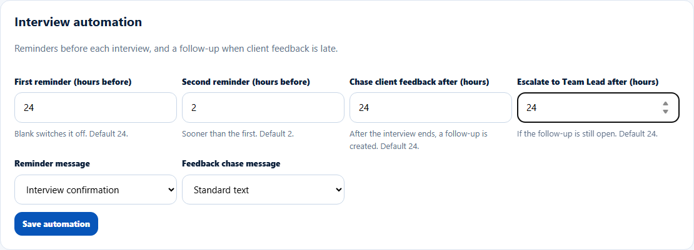
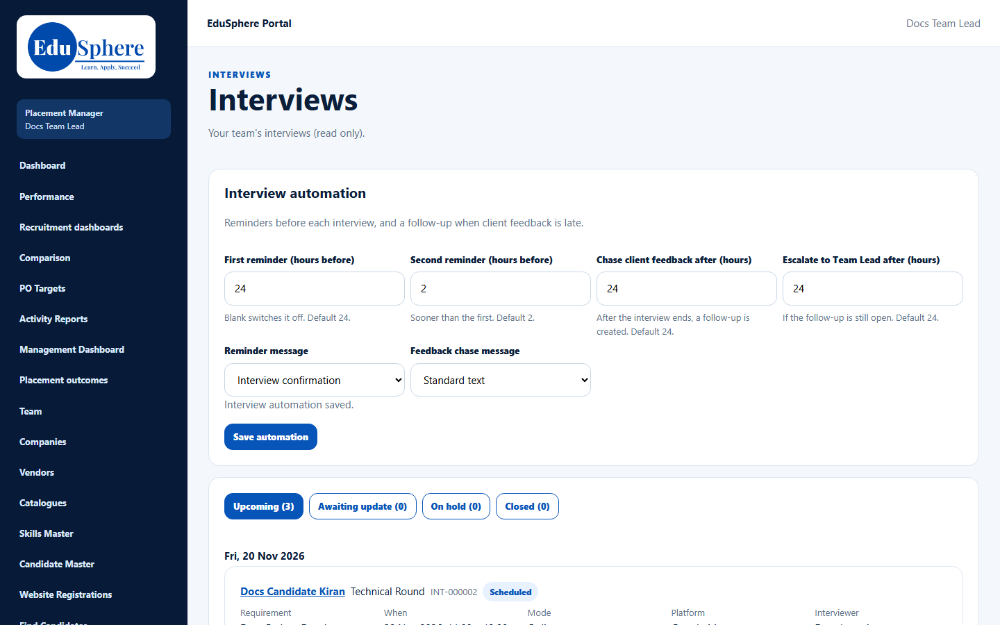

# Interview automation: reminders and feedback chase
> Doc ID: DOC-REC-HIRE-009 · Verified on 2026-11-19 against `main` @ `6b61546c` · Roles: Team Lead

## Purpose
Send reminders before every interview and chase late client feedback automatically, so nothing depends on someone remembering.

## Who Can Use This Feature
- **Team Lead**, for the whole team.

## Prerequisites
- None.

## How to Access
Sidebar → **Interviews** → **Interview automation** (top of the page).

## Steps
### Step 1 — Set the timings
"Reminders before each interview, and a follow-up when client feedback is late."
- **First reminder (hours before)**: "Blank switches it off. Default 24."
- **Second reminder (hours before)**: "Sooner than the first. Default 2."
- **Chase client feedback after (hours)**: "After the interview ends, a follow-up is created. Default 24."
- **Escalate to Team Lead after (hours)**: "If the follow-up is still open. Default 24."
- **Reminder message** and **Feedback chase message**: Standard text or an approved template (here **Interview confirmation** for reminders).

### Step 2 — Save
Select **Save automation**: **Interview automation saved.** Below it the Team Lead sees all the team's interviews, read only.

## Validation Messages
| Message | When |
|---|---|
| Interview automation saved. | Saved |

## Tips
- Background jobs send the reminders and create the chase follow-ups; their effect (follow-ups, escalations) is shown with the time-based states in session S15.

## Related Features
- [Interviews list](hire-007-interviews-list.md)
- [Message templates](../masters/mst-004-message-templates.md)
