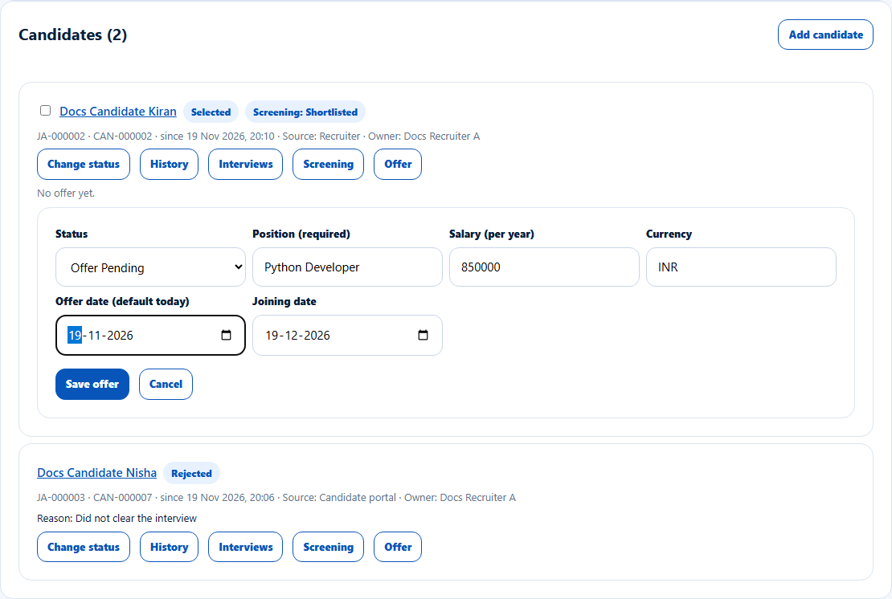
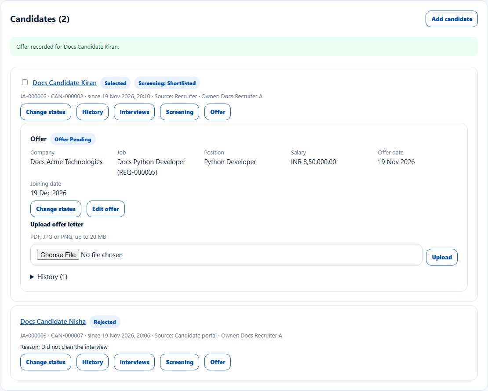
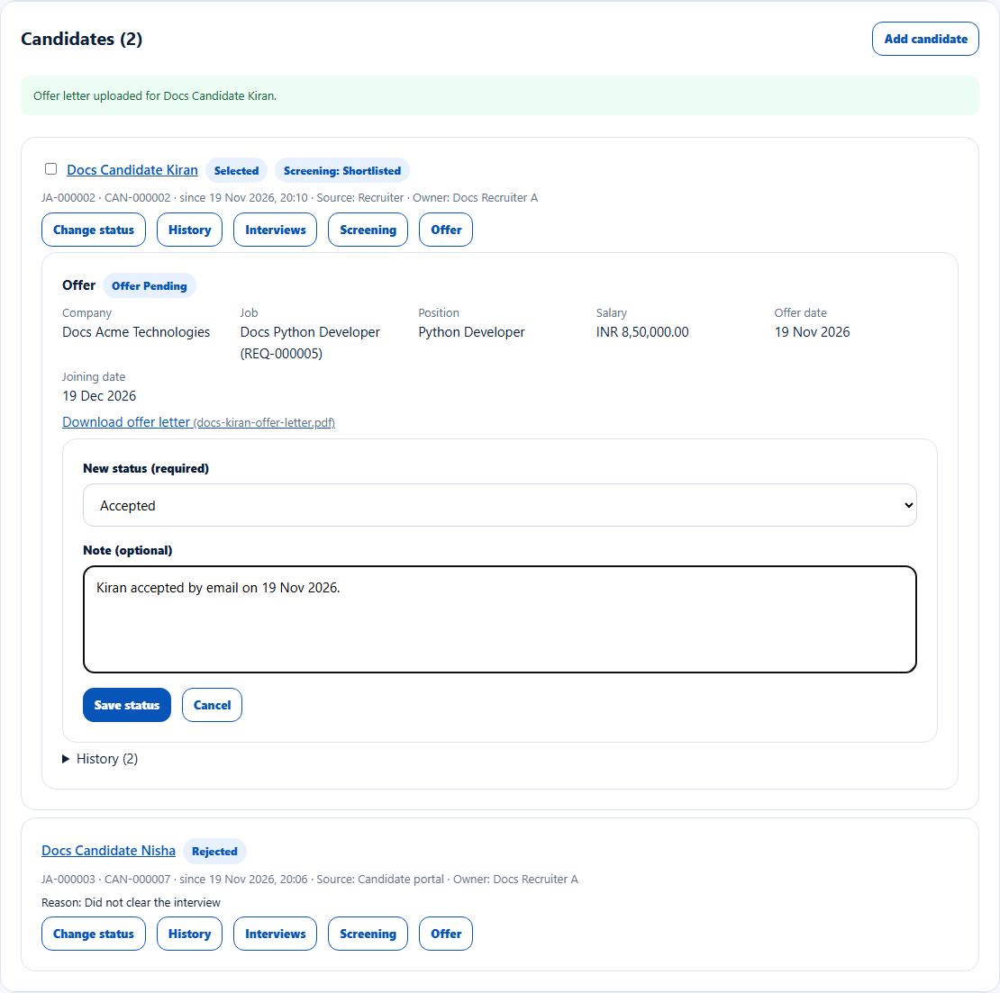
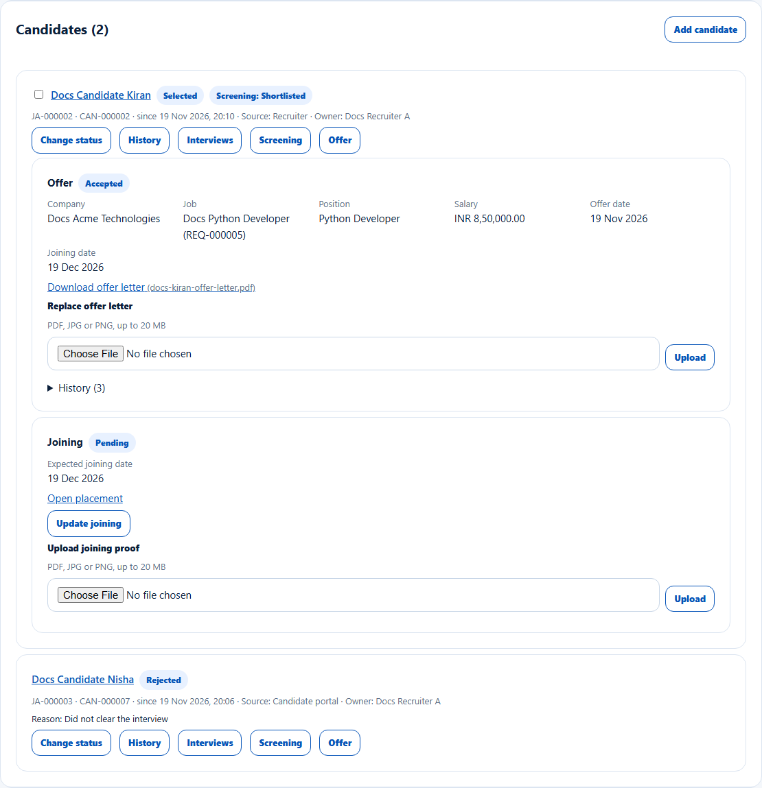
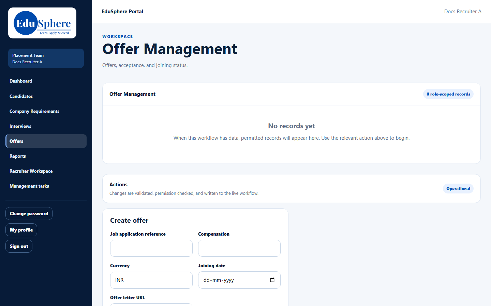

# Offers: record, status and offer letter
> Doc ID: DOC-REC-HIRE-010 · Verified on 2026-11-19 against `main` @ `6b61546c` · Roles: Recruiter (owner)

## Purpose
Record the client's offer to a selected candidate, keep the offer letter, and track whether the candidate accepts, which starts the joining.

## Who Can Use This Feature
- The requirement's **Recruiter** owner.

## Prerequisites
- The candidate's application is **Selected** ([Candidates](hire-001-candidates-statuses.md)).
- The interview result is published ("Publish the interview result before making an offer", from code).

## How to Access
Requirement page → **Candidates** → **Offer** on the candidate's row.

## Steps
### Step 1 — Record the offer
Without an offer the panel says "No offer yet." Select **+ Record offer for {name}** and fill in **Status** (Offer Pending, Offer Received), **Position (required)**, **Salary (per year)**, **Currency**, **Offer date (default today)** and **Joining date**.

Save: **Offer recorded for Docs Candidate Kiran.** The offer shows the company, job, position, salary (INR 8,50,000.00), dates, **Change status of the offer**, **Edit offer** and **Upload offer letter** (PDF, JPG or PNG, up to 20 MB).

### Step 2 — Upload the offer letter
Choose the file and select **Upload**: **Offer letter uploaded for Docs Candidate Kiran.** **Download offer letter ({file})** and **Replace offer letter** then appear.

### Step 3 — Change the offer status
Select **Change status of the offer**, choose the **New status (required)** (Offer Received, Accepted, Declined) and an optional **Note**, then **Save status**: **Offer for Docs Candidate Kiran is now Accepted.**

Accepting creates the **Joining** record at once ("Joining for Docs Candidate Kiran · Pending · Expected joining date 19 Dec 2026") with **Open placement**, **Update joining** and **Upload joining proof**: see Joining (session S12).

## Validation Messages
| Message | When |
|---|---|
| Offer recorded for {name}. | Offer saved |
| Offer letter uploaded for {name}. | Letter uploaded |
| Offer for {name} is now {status}. | Status saved |

## Tips
- The salary is the candidate's pay. EduSphere's own fee is on the requirement's commercial terms and placement, never here.
- The sidebar's **Offers** link opens the older **Offer Management** page, which does not list offers recorded on requirements (finding P19). Use the requirement page.
  

## Related Features
- [Record the interview outcome](hire-008-interview-outcome.md)
- [My applications and offers (candidate)](../candidate-portal/cand-006-my-applications.md)
