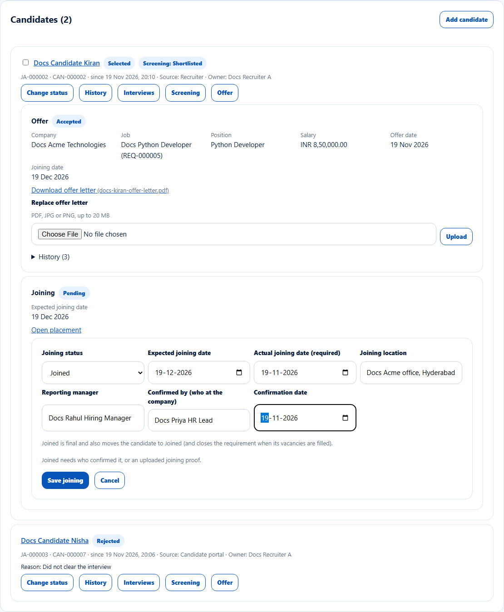
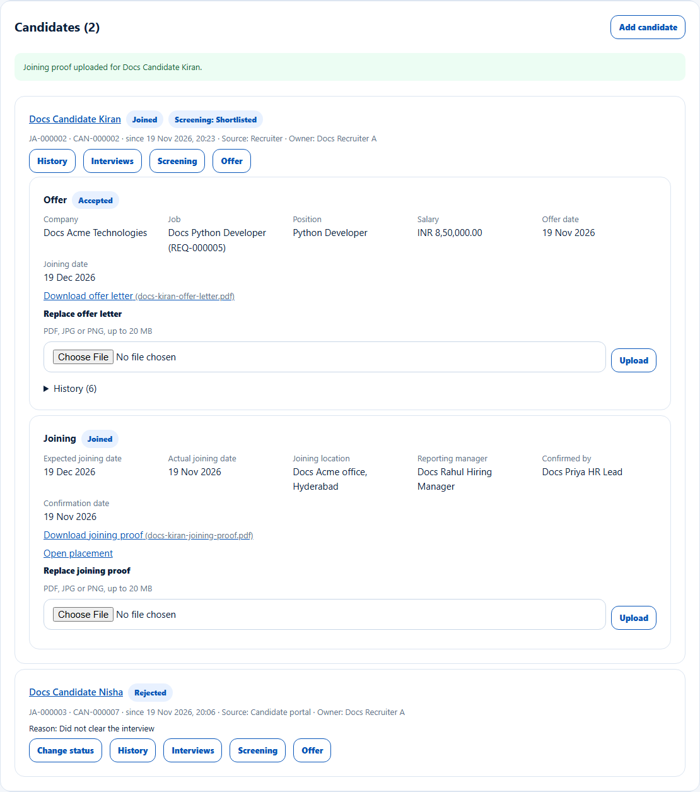

# Joining: Joined or Did not join, with proof
> Doc ID: DOC-REC-HIRE-011 · Verified on 2026-11-19 against `main` @ `6b61546c` · Roles: Recruiter (owner)

## Purpose
Record whether a candidate who accepted an offer actually joined the client, with the date and evidence. Joining is what turns an offer into a placement.

## Who Can Use This Feature
- The requirement's **Recruiter** owner.

## Prerequisites
- The candidate's offer is **Accepted** ([Offers](hire-010-offers.md)); accepting creates the joining as **Pending**.

## How to Access
Requirement page → **Candidates** → **Offer** on the candidate's row → **Update joining of {name}**. (The [Joinings list](hire-012-joinings-list.md) points here.)

## Steps
### Step 1 — Update the joining
Under **Joining for {name}** select **Update joining**:
- **Joining status**: Pending, Joined, Did Not Join.
- **Expected joining date**, **Actual joining date**.
- **Joining location**, **Reporting manager**.
- **Confirmed by (who at the company)**, **Confirmation date**.

Select **Save joining**: **Joining for Docs Candidate Kiran is now Joined.**

### Step 2 — Upload the joining proof
Under **Upload joining proof** (PDF, JPG or PNG, up to 20 MB) choose the file (here the client's joining confirmation) and select **Upload**: **Joining proof uploaded for Docs Candidate Kiran.**

### Step 3 — What joining starts
On the [placement](hire-013-placement.md) the replacement guarantee starts (90 days, from the contract), the [invoice draft](hire-014-invoice-draft.md) is created, and the [satisfaction surveys](hire-016-surveys.md) are scheduled 30 days later.

## Validation Messages
| Message | When |
|---|---|
| Joining for {name} is now {status}. | Joining saved |
| Joining proof uploaded for {name}. | Proof uploaded |

## Tips
- **Did Not Join** closes the joining without a placement fee; an open invoice draft is discarded with the reason "did not join" (from code).
- Kiran joined a month before the expected date; the placement keeps both dates.

## Related Features
- [Joinings list](hire-012-joinings-list.md)
- [Placement record](hire-013-placement.md)
