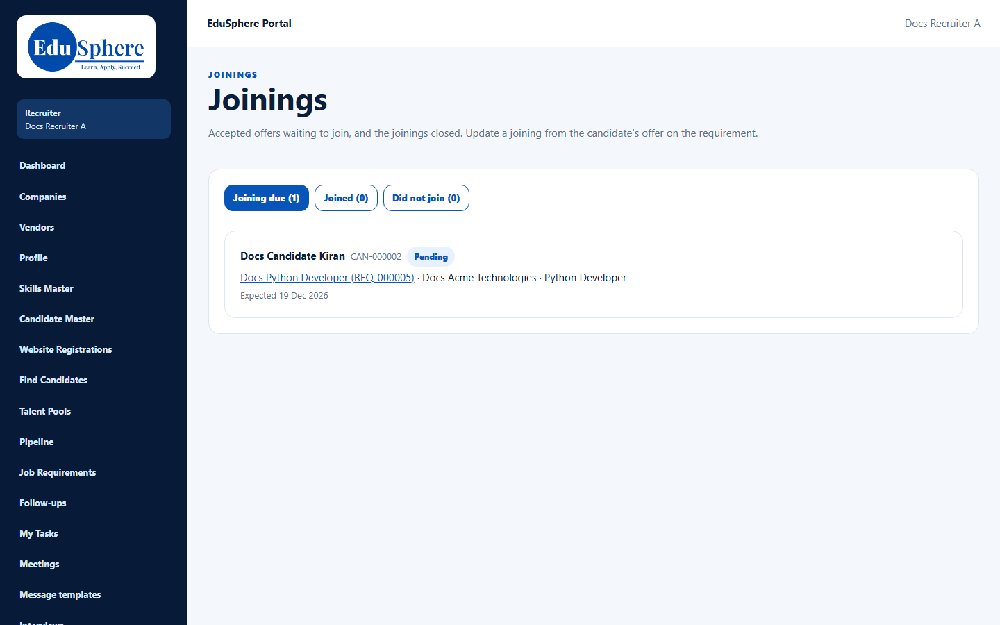
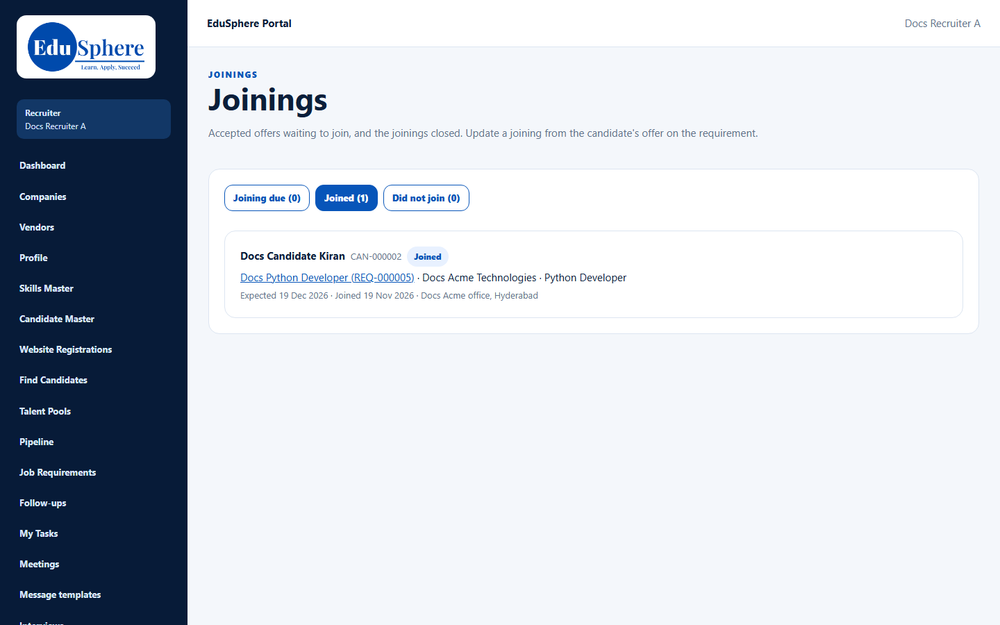

# Joinings list
> Doc ID: DOC-REC-HIRE-012 · Verified on 2026-11-19 against `main` @ `6b61546c` · Roles: Recruiter

## Purpose
See every accepted offer that is waiting to join, and the joinings already closed, in one list.

## Who Can Use This Feature
- **Recruiter**, for their requirements.

## Prerequisites
- At least one accepted offer.

## How to Access
Sidebar → **Joinings** (`/recruiter/joinings`).

## Steps
### Step 1 — Joining due
"Accepted offers waiting to join, and the joinings closed. Update a joining from the candidate's offer on the requirement." Tabs: **Joining due**, **Joined**, **Did not join**. Each row: candidate and ID, joining status, requirement, company, position and expected date, with a link to the requirement.

### Step 2 — Joined
After joining, the row moves to **Joined** with "Expected 19 Dec 2026 · Joined 19 Nov 2026 · Docs Acme office, Hyderabad".

## Tips
- The list is read only: open the requirement to [update a joining](hire-011-joining.md).

## Related Features
- [Joining](hire-011-joining.md)
- [Placements](hire-013-placement.md)
