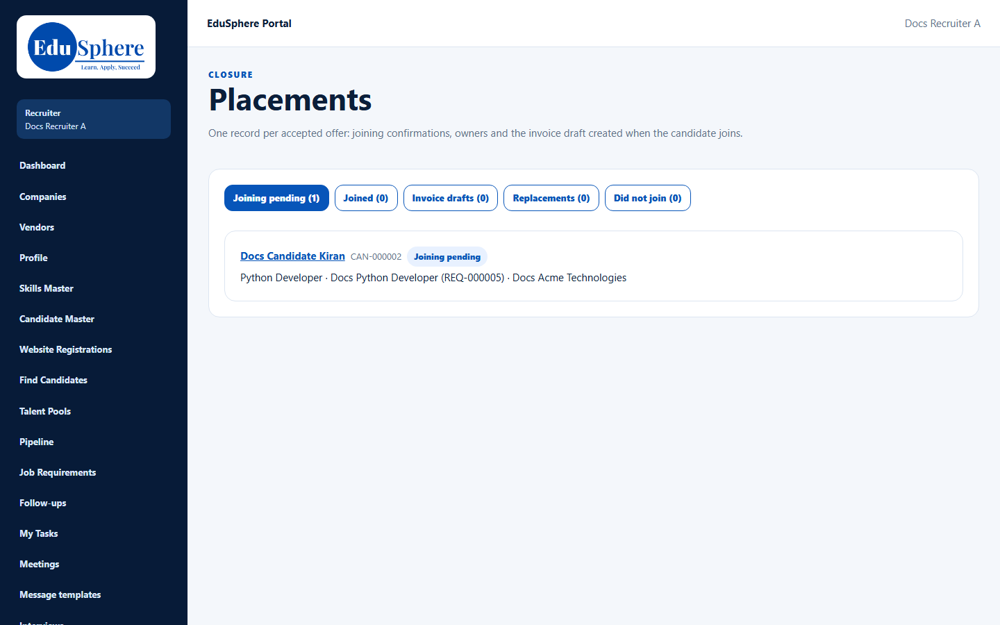
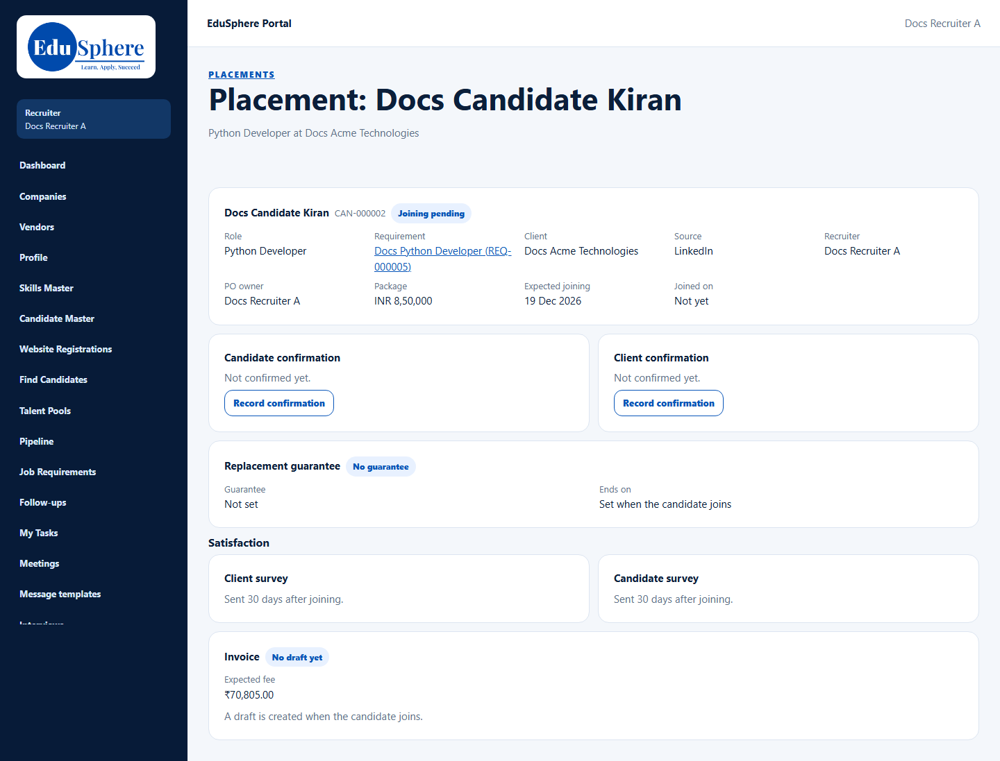
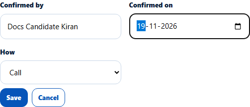
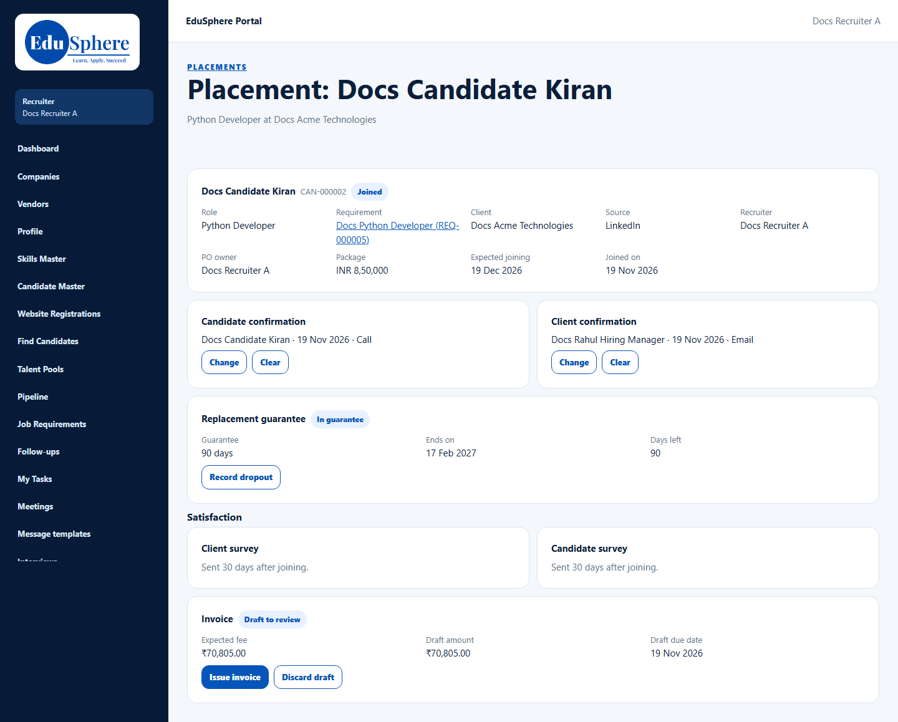

# Placement record and confirmations
> Doc ID: DOC-REC-HIRE-013 · Verified on 2026-11-19 against `main` @ `6b61546c` · Roles: Recruiter, Team Lead

## Purpose
Keep one record per accepted offer that ties together the joining, both sides' confirmation, the guarantee, the surveys and the invoice draft.

## Who Can Use This Feature
- **Recruiter** and **Team Lead**. Only a Team Lead changes the **PO owner** ("Only a Team Lead can change the PO owner", from code).

## Prerequisites
- An accepted offer (the placement is created with it).

## How to Access
Sidebar → **Placements** (`/recruiter/placements`) → the candidate; or **Open placement** from the joining.

## Steps
### Step 1 — Placements list
"One record per accepted offer: joining confirmations, owners and the invoice draft created when the candidate joins." Tabs: **Joining pending**, **Joined**, **Invoice drafts**, **Replacements**, **Did not join**.

### Step 2 — The placement page
**Placement: {name}** shows the candidate, status, role, requirement, client, source, recruiter, **PO owner**, package, expected joining and joined-on, then the cards **Candidate confirmation**, **Client confirmation**, **Replacement guarantee**, **Satisfaction** and **Invoice**. Before joining: "Set when the candidate joins", "Sent 30 days after joining", "A draft is created when the candidate joins".

### Step 3 — Record the confirmations
On each confirmation card select **Record confirmation** and fill in **Confirmed by**, **Confirmed on** and **How** (Call, Email, WhatsApp, In person, Other). Save: **Candidate confirmation saved.** / **Client confirmation saved.** Each then shows who, when and how, with **Change** and **Clear**.

### Step 4 — After joining
The status is **Joined**, the guarantee runs, and the invoice draft is waiting.

## Validation Messages
| Message | When |
|---|---|
| Candidate confirmation saved. / Client confirmation saved. | Confirmation recorded |

## Tips
- **PO owner** here is the company's assigned recruiter (Docs Recruiter A), not the requirement's placement-officer owner (Docs Placement Officer) (finding P21).

## Related Features
- [Joining](hire-011-joining.md)
- [Invoice draft](hire-014-invoice-draft.md)
- [Guarantee](hire-015-guarantee-dropout.md)
