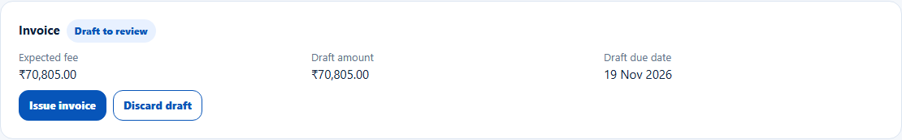
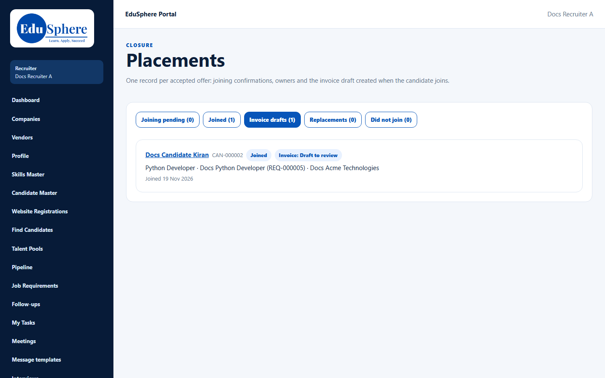
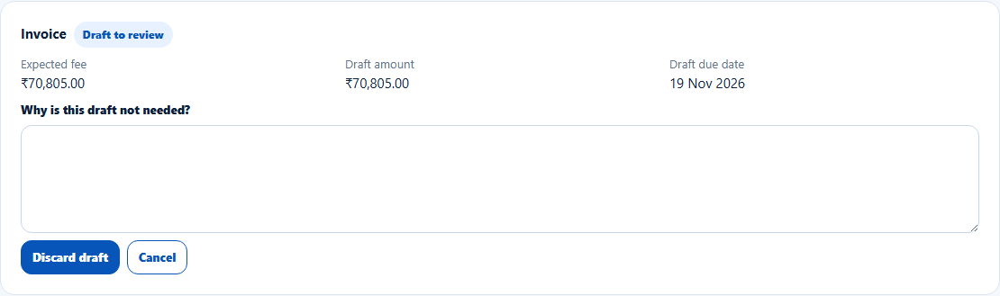

# Invoice draft (view only)
> Doc ID: DOC-REC-HIRE-014 · Verified on 2026-11-19 against `main` @ `6b61546c` · Roles: Recruiter, Team Lead

## Purpose
Prepare EduSphere's fee for a placement automatically when the candidate joins, so finance can check it before an invoice goes out.

## Who Can Use This Feature
- **Recruiter** and **Team Lead** see and review the draft. Issuing invoices and recording payments are finance tasks and are **not** shown in this guide (owner decision R3).

## Prerequisites
- The candidate has [joined](hire-011-joining.md).

## How to Access
Placement page → **Invoice**; or **Placements** → **Invoice drafts**.

## Steps
### Step 1 — Read the draft
Before joining the card says "No draft yet" with the **Expected fee** (here 8.33% of the INR 8,50,000 package: ₹70,805.00) and "A draft is created when the candidate joins." After joining it reads **Draft to review**, with **Draft amount** and **Draft due date**.

The **Invoice drafts** tab of Placements lists every placement with a draft ("Invoice: Draft to review").

### Step 2 — Discarding a draft
When no invoice should be raised, **Discard draft** asks "Why is this draft not needed?" with **Discard draft** and **Cancel**. In this guide the form was opened and cancelled; the draft was kept.

## Tips
- **Issue invoice** turns the draft into an invoice (Receivables, from code); it was never selected in this guide (R3).
- A replacement hire after a dropout gets no draft: it carries no fee (from code).
- A joining set to **Did Not Join** discards an open draft automatically (from code).

## Related Features
- [Placement record](hire-013-placement.md)
- [Commercial terms](../requirements/req-010-commercial-terms.md)
