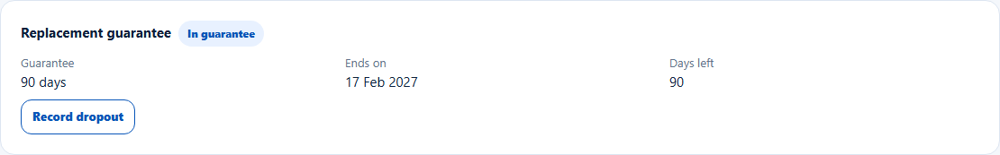
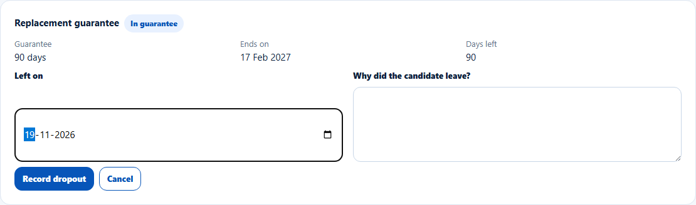

# Guarantee, dropout and replacement
> Doc ID: DOC-REC-HIRE-015 · Verified on 2026-11-19 against `main` @ `6b61546c` (dropout form only) · Roles: Recruiter, Team Lead

## Purpose
Track the replacement guarantee given to the client, and record it when a placed candidate leaves, so a free replacement can be provided.

## Who Can Use This Feature
- **Recruiter** and **Team Lead**.

## Prerequisites
- The candidate has [joined](hire-011-joining.md) ("A dropout can be recorded only after the candidate has joined", from code).

## How to Access
Placement page → **Replacement guarantee**.

## Steps
### Step 1 — The guarantee
On joining the card shows **In guarantee**, the **Guarantee** (90 days, from the company's [contract](../companies/co-008-contract.md)), **Ends on** (17 Feb 2027) and **Days left**, with **Record dropout**.

### Step 2 — Record a dropout
**Record dropout** asks **Left on** (the date) and **Why did the candidate leave?**, with **Record dropout** and **Cancel**.

In this guide the form was opened and cancelled (owner decision, 2026-11-19), so Kiran stays a successful placement. What happens after a dropout, from code:
- Inside the guarantee period the placement shows **Replacement owed** and appears under the Placements tab **Replacements**.
- A new placement on the linked requirement fills the replacement (**Replacement in progress**, then **Replaced**) and carries no fee and no invoice draft.
- If the replacement candidate does not join, the original goes back to **Replacement in progress**.
- A dropout after the guarantee ended owes no replacement.

## Validation Messages
| Message | When |
|---|---|
| A dropout can be recorded only after the candidate has joined | Before joining (from code; not captured) |
| A dropout is already recorded for this placement | Second dropout (from code; not captured) |

## Tips
- Guarantee alerts before the end date are shown with the time-based states (session S15).

## Related Features
- [Placement record](hire-013-placement.md)
- [Invoice draft](hire-014-invoice-draft.md)
