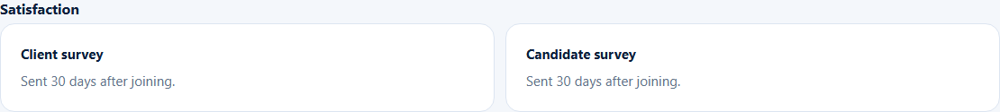

# Satisfaction surveys
> Doc ID: DOC-REC-HIRE-016 · Verified on 2026-11-19 against `main` @ `6b61546c` (before sending) · Roles: Recruiter, Team Lead · PARTIAL: sending and responses in session S15

## Purpose
Ask the client and the placed candidate how satisfied they are, a month after joining, and keep the answers on the placement.

## Who Can Use This Feature
- **Recruiter** and **Team Lead** read the results. The client contact and the candidate answer from an emailed link without signing in.

## Prerequisites
- The candidate has [joined](hire-011-joining.md).

## How to Access
Placement page → **Satisfaction**.

## Steps
### Step 1 — Before sending
The card shows **Client survey** and **Candidate survey**, each "Sent 30 days after joining."

### Step 2 — Sending and answers
VERIFICATION REQUIRED — captured in session S15 (the joining is moved 30 days back on the docs stack). From code: a daily job sends each side one survey email (shown on the company and candidate timelines) and resends it once; the link needs no login and accepts one response, with a rating and a comment.

## Related Features
- [Placement record](hire-013-placement.md)
