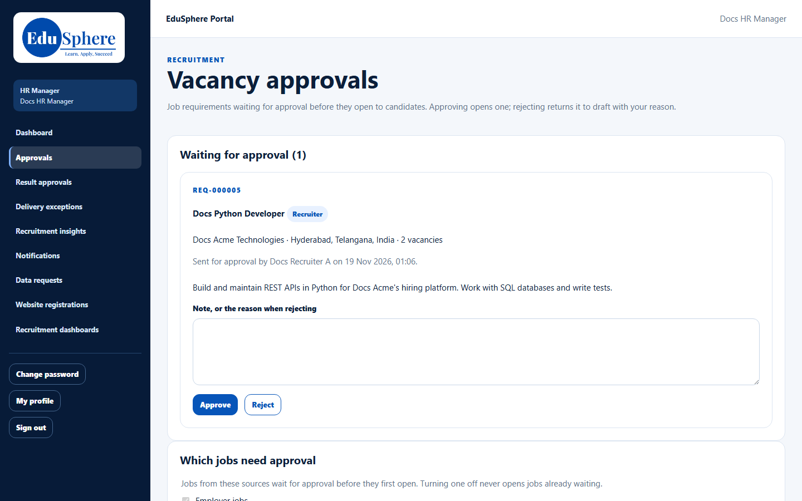
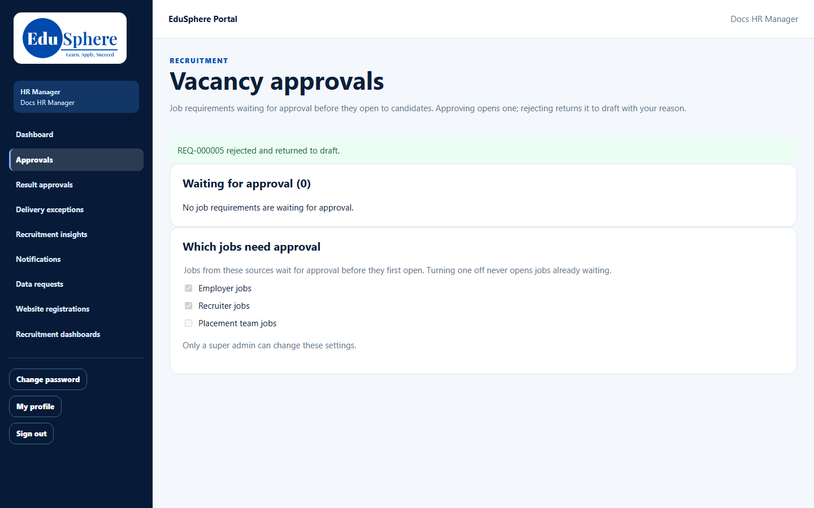
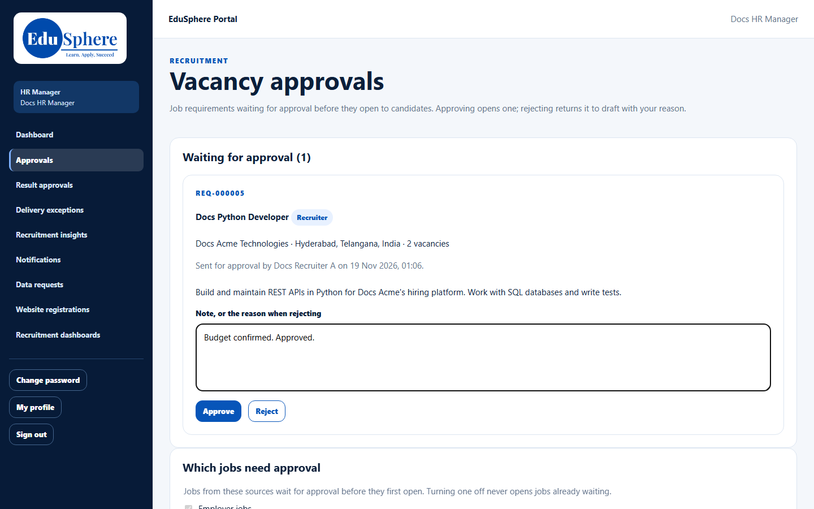

# Vacancy approvals
> Doc ID: DOC-REC-HRM-001 · Verified on 2026-11-19 against `main` @ `6b61546c` · Roles: HR Manager

## Purpose
Check job requirements before they open to candidates: approve them, or send them back to the recruiter with a reason.

## Who Can Use This Feature
- **HR Manager** decides. The Super Admin can open the same page and is the only one who can change which jobs need approval ([Approval settings](../../admin-manual/admin/adm-006-approval-settings.md)).
- Nobody decides on a requirement they submitted, created or are assigned to ("You cannot approve or reject your own job requirement", from code).

## Prerequisites
- Approval is on for the job's source, and a recruiter has [submitted](../requirements/req-007-approval.md) a requirement.

## How to Access
Sidebar → **Approvals** (`/it/hr-manager/approvals`). HR Managers are notified when a requirement is submitted (from code; notifications are covered later).

## Steps
### Step 1 — Read the queue
"Job requirements waiting for approval before they open to candidates. Approving opens one; rejecting returns it to draft with your reason." **Waiting for approval (1)** shows each requirement with its code, title, company, location, vacancies, who sent it and when, and the description. With nothing waiting it says **No job requirements are waiting for approval.**

### Step 2 — Reject with a reason
Write in **Note, or the reason when rejecting** and select **Reject**: **REQ-000005 rejected and returned to draft.** The recruiter sees the reason in the requirement's status history.

### Step 3 — Approve
When it comes back, add a note if you want and select **Approve**: **REQ-000005 approved. It is now open.** The requirement moves to **Requirement Received**.

### Step 4 — Which jobs need approval
Below the queue, **Which jobs need approval** shows the three sources (**Employer jobs**, **Recruiter jobs**, **Placement team jobs**). For the HR Manager they are read only: "Only a super admin can change these settings."

## Validation Messages
| Message | When |
|---|---|
| {code} rejected and returned to draft. | Rejected |
| {code} approved. It is now open. | Approved |
| You cannot approve or reject your own job requirement | Deciding on your own requirement (from code; not captured) |

## Tips
- A requirement that has been open once can be paused and reopened without a second approval (from code).

## Related Features
- [Submit for approval](../requirements/req-007-approval.md)
- [HR Manager dashboard](../dashboard/dash-004-hr-manager-dashboard.md)
