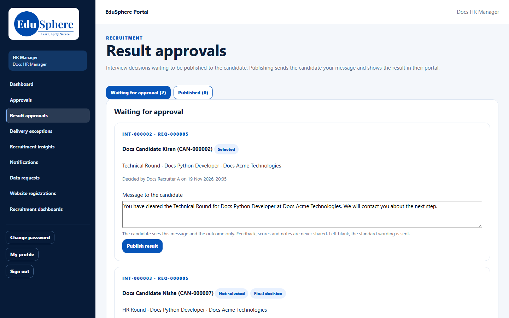
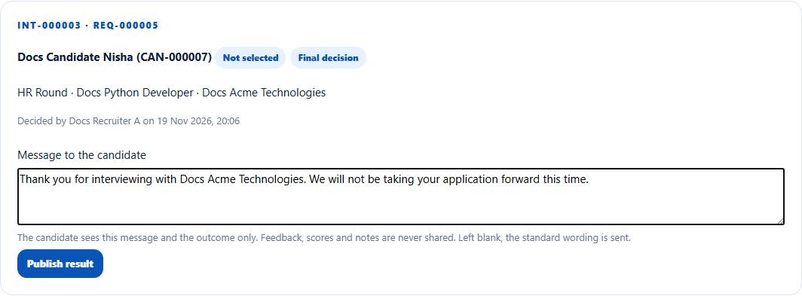
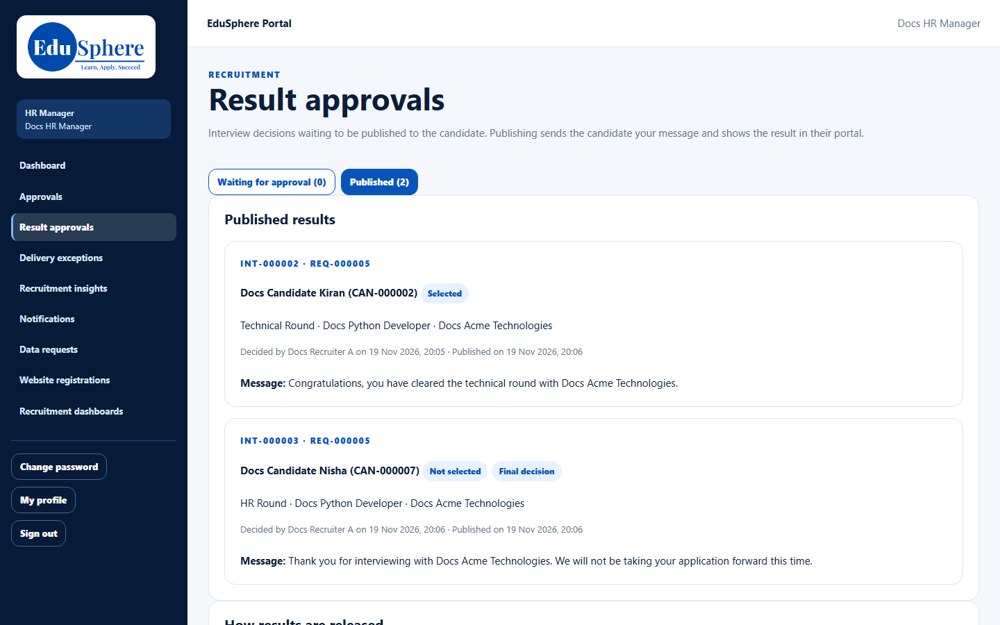

# Result approvals and publishing
> Doc ID: DOC-REC-HRM-002 · Verified on 2026-11-19 against `main` @ `6b61546c` · Roles: HR Manager

## Purpose
Check every interview decision before the candidate learns it, and send the candidate a proper message with the result.

## Who Can Use This Feature
- **HR Manager**. Nobody publishes a result they decided themselves ("You cannot publish a result you decided yourself", from code).
- Whether results need approval at all is a Super Admin setting ([Approval and release settings](../../admin-manual/admin/adm-006-approval-settings.md)); by default they do.

## Prerequisites
- A recruiter recorded **Selected** or **Rejected** on an interview ([Record the outcome](../hiring/hire-008-interview-outcome.md)).

## How to Access
Sidebar → **Result approvals** (`/it/hr-manager/results`).

## Steps
### Step 1 — Read the queue
"Interview decisions waiting to be published to the candidate. Publishing sends the candidate your message and shows the result in their portal." **Waiting for approval ({n})** lists each result: interview and requirement codes, candidate, outcome (**Selected**, or **Not selected** marked **Final decision**), round, job and company, and who decided it and when.

### Step 2 — Write the message and publish
In **Message to the candidate** write what the candidate will read: "The candidate sees this message and the outcome only. Feedback, scores and notes are never shared. Left blank, the standard wording is sent." Select **Publish result**: **Result published to Docs Candidate Nisha (CAN-000007).**

### Step 3 — Published
**Published ({n})** lists each result with the publish time and the message sent.

## Validation Messages
| Message | When |
|---|---|
| Result published to {name} ({code}). | Published |

## Tips
- The standard wording, when the message is blank: for a rejection "Thank you for interviewing for {role} at {company}. We will not be moving forward with your application this time."; for a final selection "Congratulations! You have been selected for {role} at {company}."; for a cleared round "You have cleared the {round} for {role} at {company}. We will contact you about the next step." (from code).
- Until it is published, the candidate's portal does not show the decision ([Interviews and results](../candidate-portal/cand-007-interviews-results.md)).

## Related Features
- [Record the interview outcome](../hiring/hire-008-interview-outcome.md)
- [Vacancy approvals](hrm-001-vacancy-approvals.md)
