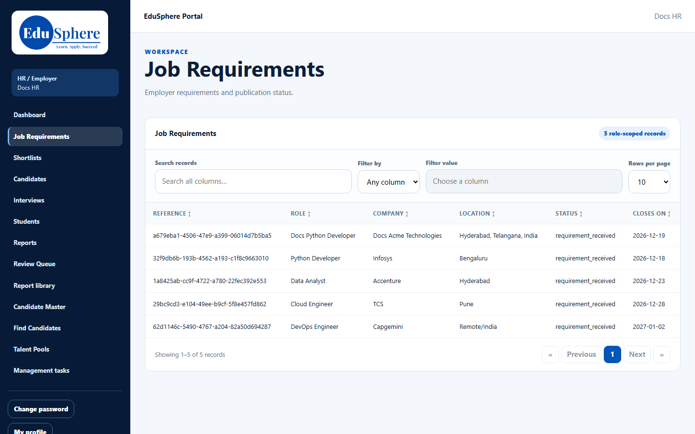
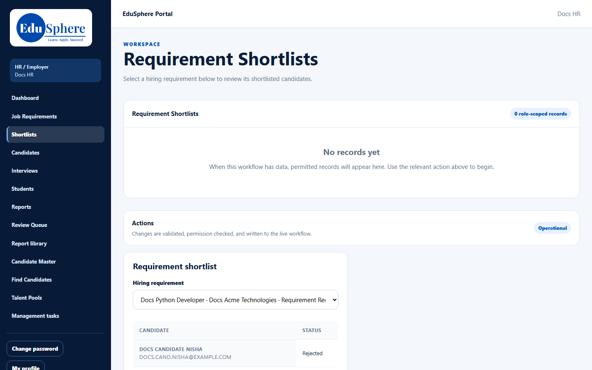

# HR: Job requirements and shortlists (read)
> Doc ID: DOC-REC-HR-001 · Verified on 2026-11-19 against `main` @ `6b61546c` · Roles: HR Team

## Purpose
Let HR see which job requirements are open and who is shortlisted on them, without changing anything.

## Who Can Use This Feature
- **HR Team** (Docs HR).

## Prerequisites
- None.

## How to Access
Sign in at `/it/login` → sidebar **Job Requirements** (`/it/hr/job-requirements`) and **Shortlists** (`/it/hr/shortlists`).

## Steps
### Step 1 — Job requirements
"Employer requirements and publication status." A searchable table: **Reference**, **Role**, **Company**, **Location**, **Status**, **Closes on**, with **Filter by** a column and **Rows per page**.

### Step 2 — Requirement shortlists
"Select a hiring requirement below to review its shortlisted candidates." Choose the requirement in **Hiring requirement**. For REQ-000005 the list stayed empty: no candidate was at **Shortlisted** at that point (Kiran was at Interview, Nisha had been rejected).

## Tips
- These are older screens: **Reference** shows the requirement's internal ID (not REQ-000005) and **Status** the raw value (`requirement_received`) (finding P20). Use the reference to match a row with what recruiters see.
- For the full picture use the recruiters' views HR can read: [Candidate Master and Find Candidates](hr-006-read-only-candidates.md).

## Related Features
- [Candidate database and interviews](hr-002-candidates-interviews.md)
- [Placement reports](hr-003-placement-reports.md)
