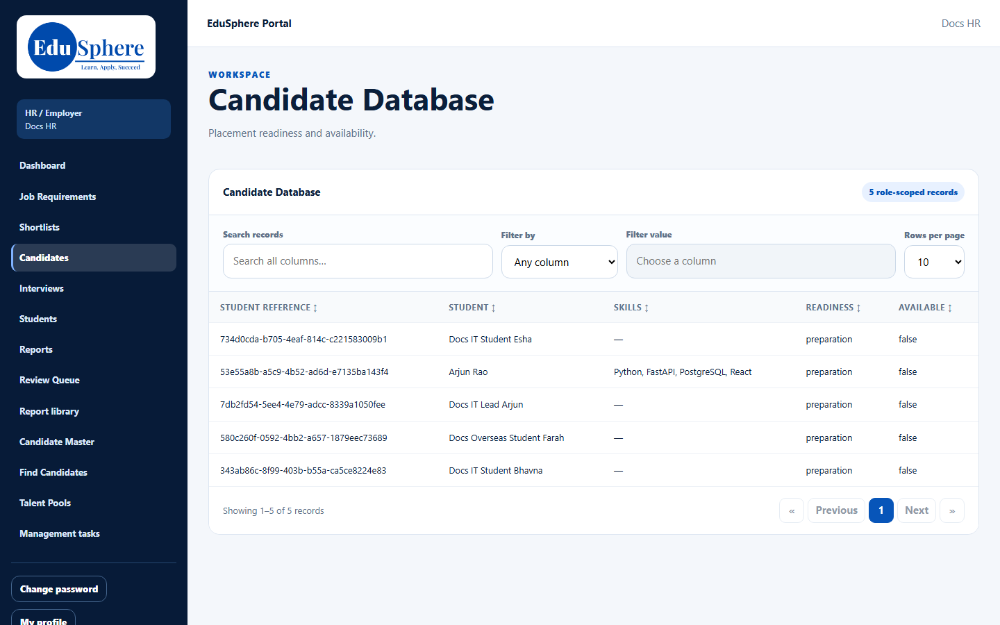
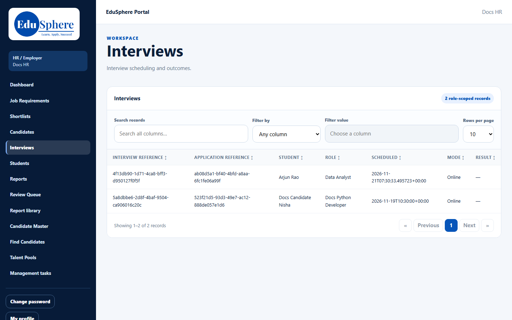

# HR: Candidate database and interviews (read)
> Doc ID: DOC-REC-HR-002 · Verified on 2026-11-19 against `main` @ `6b61546c` · Roles: HR Team

## Purpose
Let HR follow EduSphere students' placement readiness and see the interviews being held.

## Who Can Use This Feature
- **HR Team**.

## Prerequisites
- None.

## How to Access
Sidebar → **Candidates** (`/it/hr/candidates`) and **Interviews** (`/it/hr/interviews`).

## Steps
### Step 1 — Candidate database
"Placement readiness and availability." Despite its name, this lists **EduSphere IT students** (Docs IT Lead Arjun, Docs IT Student Bhavna…), not the recruitment Candidate Master: **Student reference**, **Student**, **Skills**, **Readiness** (here **preparation**), **Available**.

### Step 2 — Interviews
"Interview scheduling and outcomes." **Interview reference**, **Application reference**, **Student**, **Role**, **Scheduled**, **Mode**, **Result**. Nisha's HR Round appeared here, but Kiran's Technical Round did not, and Nisha's **Result** stayed **—** after her result was published (finding P20).

## Tips
- References are internal IDs and times are raw UTC timestamps (finding P20).
- Nisha has a candidate-portal login and was listed; Kiran, added by a recruiter and with no login, was not. Check a candidate's interviews on the recruiters' screens.
- For the recruitment candidates (external people as well as students) use [Candidate Master](hr-006-read-only-candidates.md).

## Related Features
- [Job requirements and shortlists](hr-001-requirements-shortlists.md)
- [HR read-only Candidate Master](hr-006-read-only-candidates.md)
