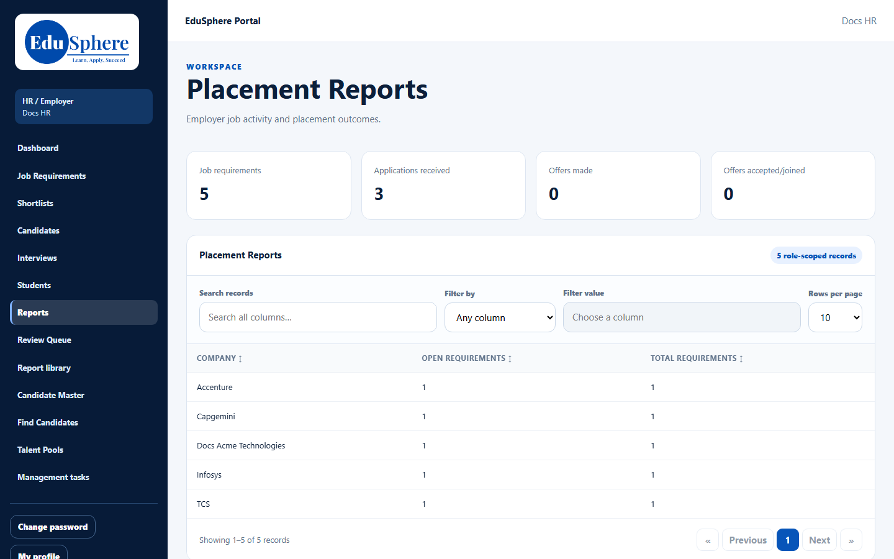

# HR: Placement reports
> Doc ID: DOC-REC-HR-003 · Verified on 2026-11-19 against `main` @ `6b61546c` · Roles: HR Team

## Purpose
Give HR the headline numbers of placement activity and the requirements per company.

## Who Can Use This Feature
- **HR Team**.

## Prerequisites
- None.

## How to Access
Sidebar → **Reports** (`/it/hr/reports`).

## Steps
### Step 1 — Read the report
"Employer job activity and placement outcomes." Four figures: **Job requirements**, **Applications received**, **Offers made**, **Offers accepted/joined**. Below, a table per company: **Company**, **Open requirements**, **Total requirements**.

## Tips
- The screenshot was taken before Kiran's offer. Once the offer was recorded and accepted, the figures read **Offers made 1** and **Offers accepted/joined 1**.

## Related Features
- [Job requirements and shortlists](hr-001-requirements-shortlists.md)
