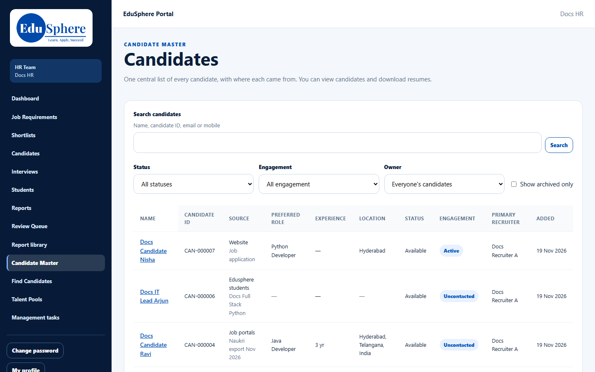
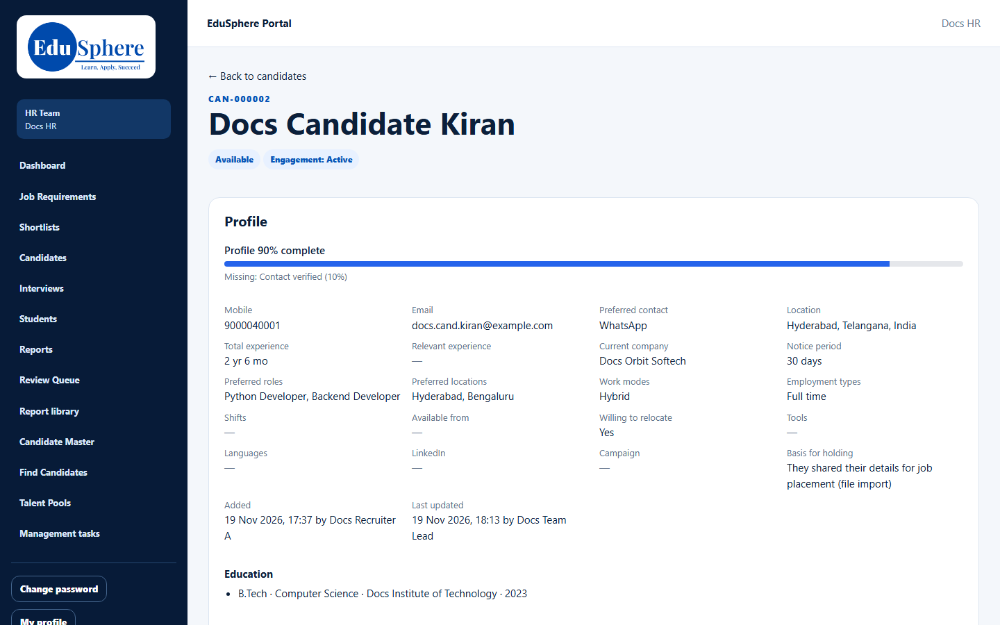
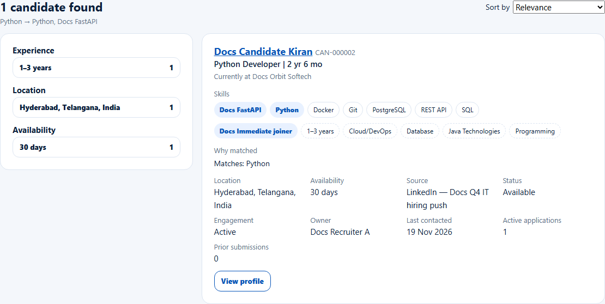
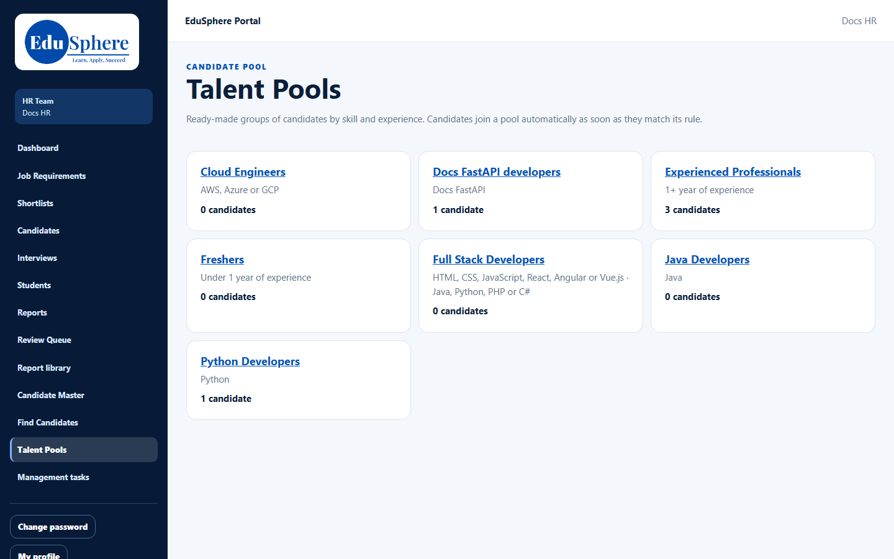

# HR: Candidate Master, Find Candidates and Talent Pools (read only)
> Doc ID: DOC-REC-HR-006 · Verified on 2026-11-19 against `main` @ `6b61546c` · Roles: HR Team

## Purpose
Let HR look up any candidate, read their profile and download the resume, without changing anything or seeing salaries.

## Who Can Use This Feature
- **HR Team** (Docs HR). Sidebar: **Candidate Master**, **Find Candidates**, **Talent Pools** (with HR's own Job Requirements, Shortlists, Candidates, Interviews, Students, Reports, Review Queue).

## Prerequisites
- None.

## How to Access
Sign in at `/it/login` → sidebar **Candidate Master**.

## Steps
### Step 1 — The list
The same Candidate Master, with the line "You can view candidates and download resumes." No **Import candidates** or **+ Add candidate**, and no **Source** filter.

### Step 2 — A candidate page
No **Edit**, **Archive** or any card buttons. The profile has no salary rows. The resume has **Preview** and **Download** only.

### Step 3 — Find Candidates
The search works the same, without **Package** or **Candidate source** filters and without the **Lowest expected salary** sort. Cards have **View profile** only: no salary, no Contact, Shortlist or selection boxes.

### Step 4 — Talent pools
The same pools, without **+ New pool**.

## What Each Role Sees
| | Recruiter | Team Lead | HR | Placement Officer |
|---|---|---|---|---|
| Candidate Master | Full | Full + settings, Unassigned Queue, Duplicate Review | Read, resumes | No access |
| Salary (profile, filters, cards) | Yes | Yes | No | — |
| Find Candidates actions | Shortlist, share, task | Same + export | View only | — |
| Talent pools | Open | Open, add, edit | Open | — |

## Tips
- To change a candidate, ask their primary recruiter (shown on the list and the page).

## Related Features
- [Candidate Master](../candidates/can-001-candidate-list.md)
- [Find Candidates](../search/srch-001-find-candidates.md)
