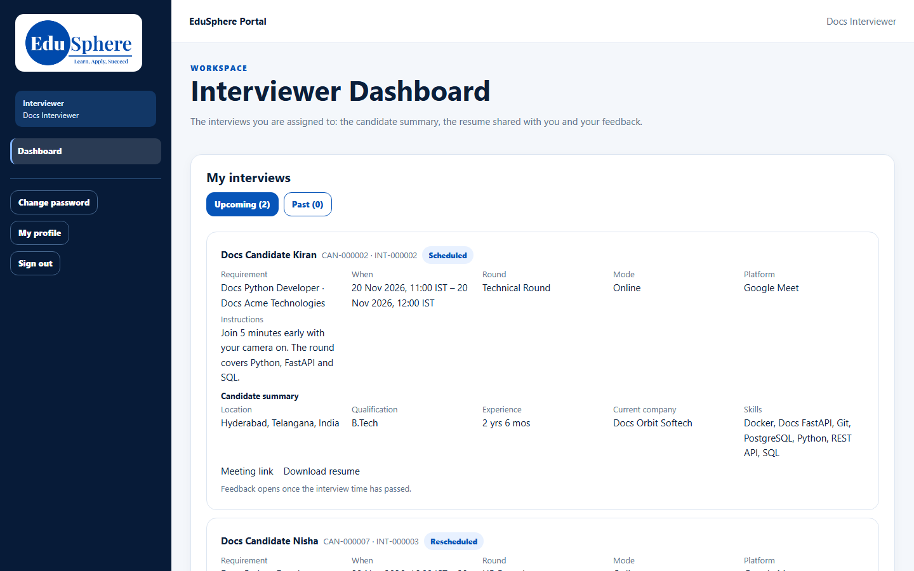
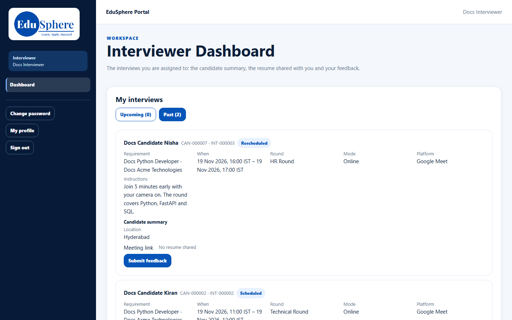

# My interviews (Interviewer)
> Doc ID: DOC-REC-INT-001 · Verified on 2026-11-19 against `main` @ `6b61546c` · Roles: Interviewer

## Purpose
Show interviewers the interviews they are on, with what they need to prepare: when, how to join, a candidate summary and the resume.

## Who Can Use This Feature
- **Interviewer** accounts (Docs Interviewer), once added to an interview's **panel** ([Schedule an interview](../hiring/hire-006-schedule-interview.md#step-3--assign-the-interview-panel)).

## Prerequisites
- A recruiter has put you on the interview panel.

## How to Access
Sign in at `/it/login` → **Interviewer Dashboard** (`/it/interviewer/dashboard`).

## Steps
### Step 1 — Upcoming interviews
"The interviews you are assigned to: the candidate summary, the resume shared with you and your feedback." **Upcoming** lists each interview: candidate and codes, status, requirement, time, round, mode, platform, instructions, **Candidate summary** (location, qualification, experience, current company, skills), the **Meeting link** and **Download resume**. Before the time: "Feedback opens once the interview time has passed."

With no panel assignment: "No interviews are assigned to you yet."

### Step 2 — Past interviews
After the interview time, it moves to **Past** with **Submit feedback** ([Submit feedback](int-002-submit-feedback.md)).

## Tips
- "No resume shared" means the candidate has no resume on their candidate record (Nisha's careers-page resume is not on it).
- The candidate summary has no salary, phone or email.

## Related Features
- [Submit interview feedback](int-002-submit-feedback.md)
