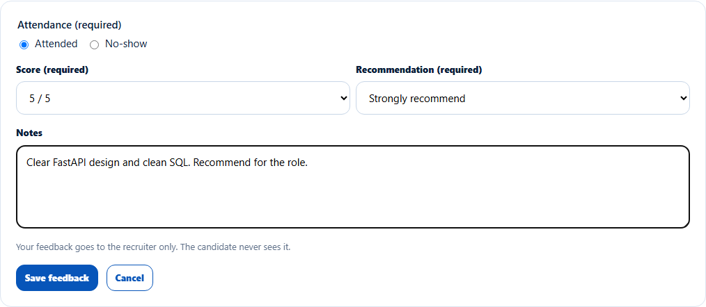
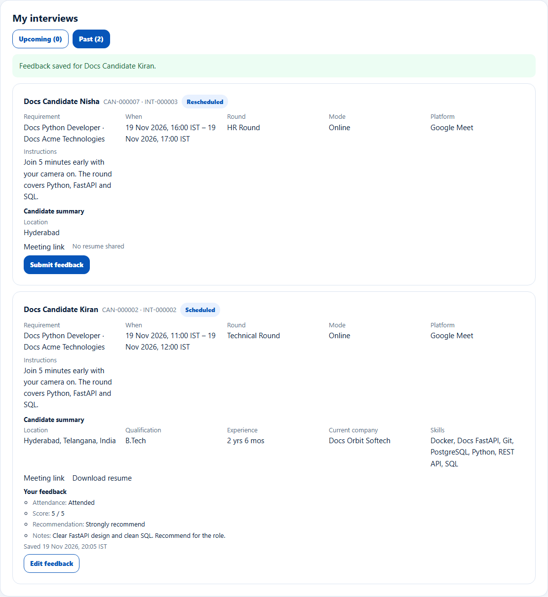

# Submit interview feedback
> Doc ID: DOC-REC-INT-002 · Verified on 2026-11-19 against `main` @ `6b61546c` · Roles: Interviewer

## Purpose
Give the recruiter a structured view of the interview: whether the candidate attended, a score, a recommendation and notes.

## Who Can Use This Feature
- An **Interviewer** on the interview's panel. The recruiter can also **Record feedback** on the interview card.

## Prerequisites
- The interview time has passed (here prepared by data setup: the two interviews were moved into the past on the docs stack).

## How to Access
**Interviewer Dashboard** → **Past** → **Submit feedback** on the interview.

## Steps
### Step 1 — Fill in the feedback
- **Attendance (required)**: Attended, No-show.
- **Score (required)**: 1 / 5 to 5 / 5.
- **Recommendation (required)**: Strongly recommend, Recommend, Do not recommend, Strongly do not recommend.
- **Notes**.

"Your feedback goes to the recruiter only. The candidate never sees it."

### Step 2 — Save
Select **Save feedback**: **Feedback saved for Docs Candidate Kiran.** The card shows **Your feedback** with the saved time and **Edit feedback**. The recruiter sees it on the interview's panel.

## Validation Messages
| Message | When |
|---|---|
| Feedback saved for {name}. | Saved |

## Tips
- Docs Interviewer gave Kiran 5 / 5, Strongly recommend, and Nisha 2 / 5, Do not recommend.
- Feedback can be edited after saving.

## Related Features
- [My interviews](int-001-my-interviews.md)
- [Record the interview outcome](../hiring/hire-008-interview-outcome.md)
