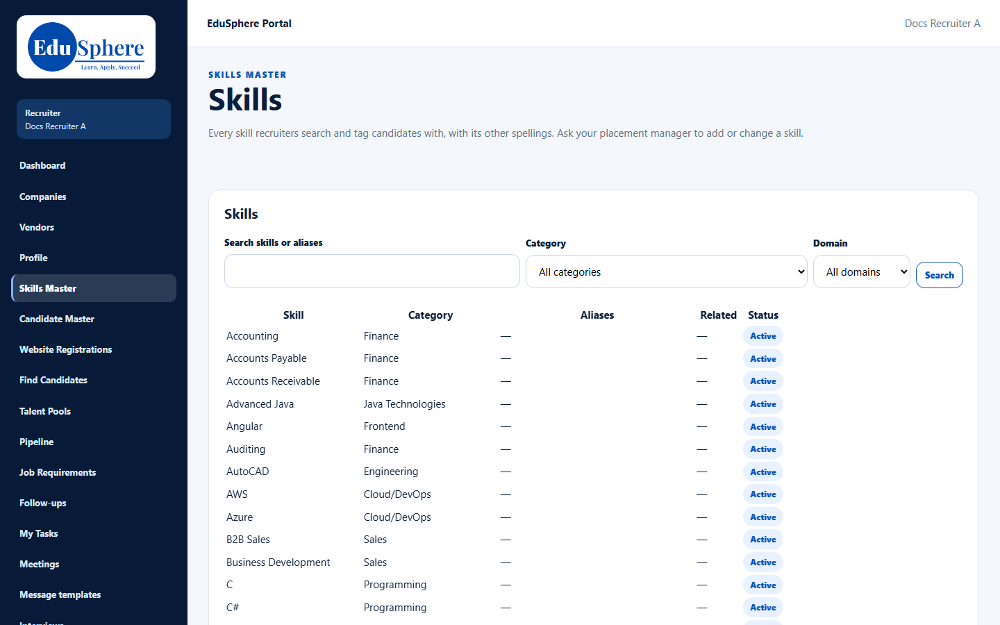
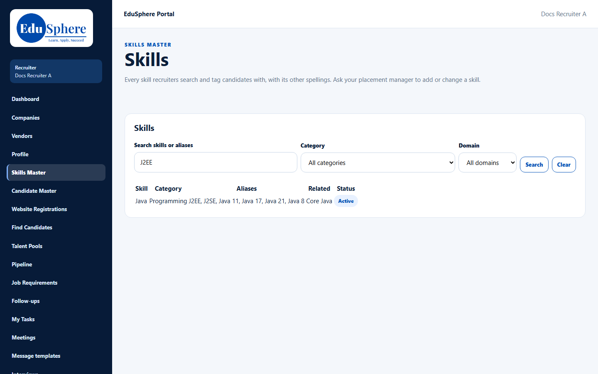

# Skills Master
> Doc ID: DOC-REC-MST-001 · Verified on 2026-11-18 against `main` @ `6b61546c` · Roles: Recruiter (read); Team Lead (see MST-002)

## Purpose
Look up the skills used to tag candidates and requirements, with their other spellings (aliases) and related skills.

## Who Can Use This Feature
| Role | What they see |
|---|---|
| Recruiter | Read-only list ("Ask your placement manager to add or change a skill.") |
| Team Lead | The same list with **Manage**, plus categories and **Create skill** ([Manage skills](mst-002-manage-skills.md)) |

## Prerequisites
- None.

## How to Access
Sidebar **Skills Master** (page **Skills**).

## Steps
### Step 1 — Search
Type a skill or an alias in **Search skills or aliases**, optionally pick a **Category** and **Domain** (**IT** / **Non-IT**), and select **Search**. **Clear** resets the search.

### Step 2 — Read the result
Each row shows **Skill**, **Category**, **Aliases**, **Related** and **Status**. Searching an alias finds its skill: **J2EE** finds **Java** (aliases J2EE, J2SE, Java 8 … Java 21; related Core Java).

## Expected Result
You know the exact skill name to use when tagging a candidate or searching.

## Tips
- Search and matching count aliases and related skills, so a candidate tagged **Java** is found by a search for **J2EE**.

## Related Features
- [Manage skills](mst-002-manage-skills.md)
