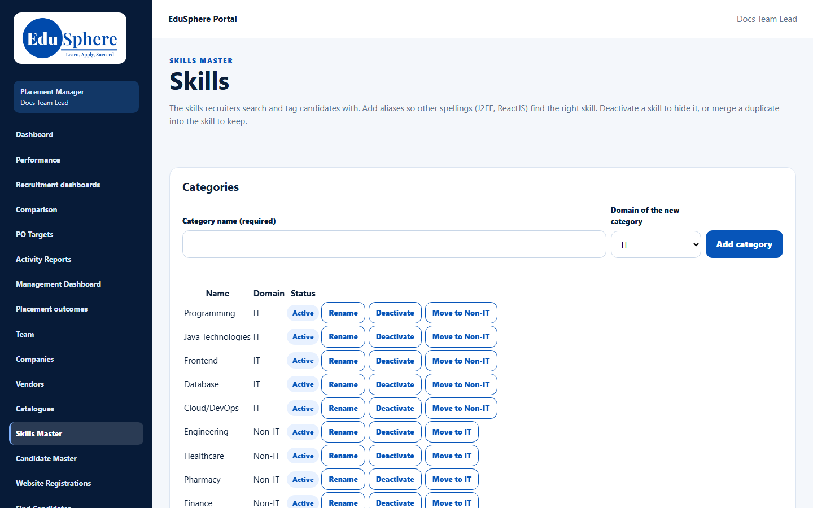
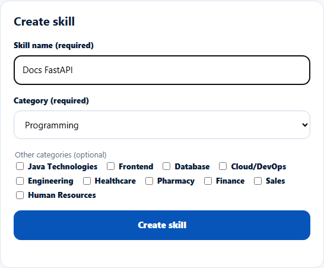
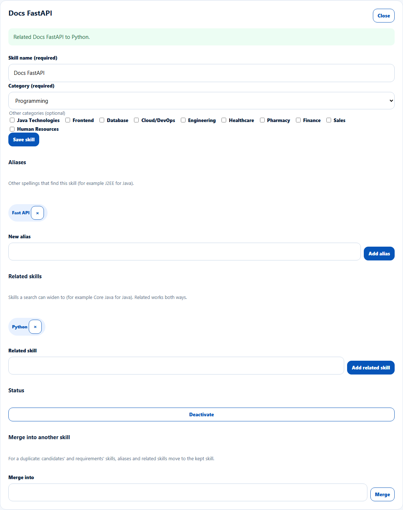
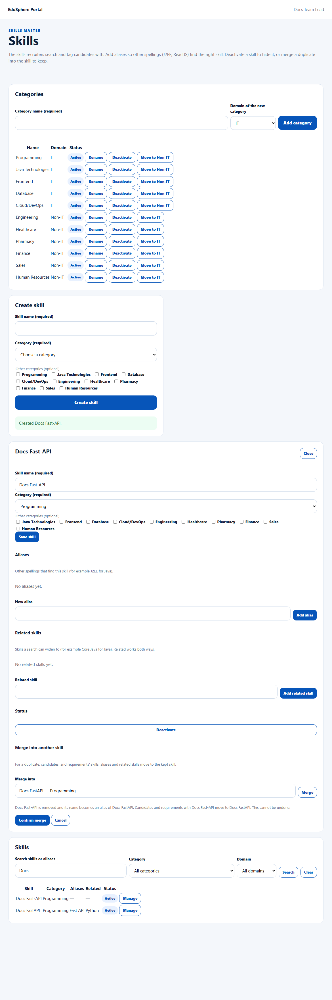

# Manage skills, categories, aliases and merges
> Doc ID: DOC-REC-MST-002 · Verified on 2026-11-18 against `main` @ `6b61546c` · Roles: Team Lead

## Purpose
Keep the skills list clean: add skills, give them aliases and related skills, and merge duplicates.

## Who Can Use This Feature
- **Team Lead** (and Super Admin) at `/recruiter/manager/skills`. Recruiters only read the list.

## Prerequisites
- None.

## How to Access
Team Lead sidebar **Skills Master** (page **Skills**: "Add aliases so other spellings (J2EE, ReactJS) find the right skill. Deactivate a skill to hide it, or merge a duplicate into the skill to keep.").

## Steps
### Step 1 — Categories (optional)
Under **Categories**, enter **Category name (required)**, choose **Domain of the new category** (**IT** / **Non-IT**) and select **Add category**. Each category has **Rename**, **Deactivate** and **Move to Non-IT** / **Move to IT**.

### Step 2 — Create a skill
Under **Create skill**, enter **Skill name (required)**, choose **Category (required)** and, if it fits more than one, tick **Other categories (optional)**. Select **Create skill**. The message **Created {skill}.** appears.

### Step 3 — Aliases and related skills
In **Skills**, select **Manage** on the skill. The panel lets you edit the skill (**Save skill**), add **New alias** → **Add alias** ("Added alias {alias}.") and add a **Related skill** → **Add related skill** ("Related {skill} to {other}."). Remove one with **×**. Related works both ways.

### Step 4 — Merge a duplicate
Open **Manage** on the duplicate. Under **Merge into another skill**, pick the skill to keep in **Merge into** and select **Merge**. The panel warns: "{duplicate} is removed and its name becomes an alias of {kept}. Candidates and requirements with {duplicate} move to {kept}. This cannot be undone." Select **Confirm merge** (or **Cancel**). The message **Merged {duplicate} into {kept}.** appears.

### Step 5 — Deactivate (optional)
**Deactivate** in the panel hides a skill from pickers. Not captured.

## Validation Messages
| Message | When |
|---|---|
| Created {skill}. | Skill created |
| Added alias {alias}. | Alias added |
| Related {skill} to {other}. | Related skill added |
| Merged {duplicate} into {kept}. | Merge confirmed |

## Related Features
- [Skills Master](mst-001-skills-master.md)
