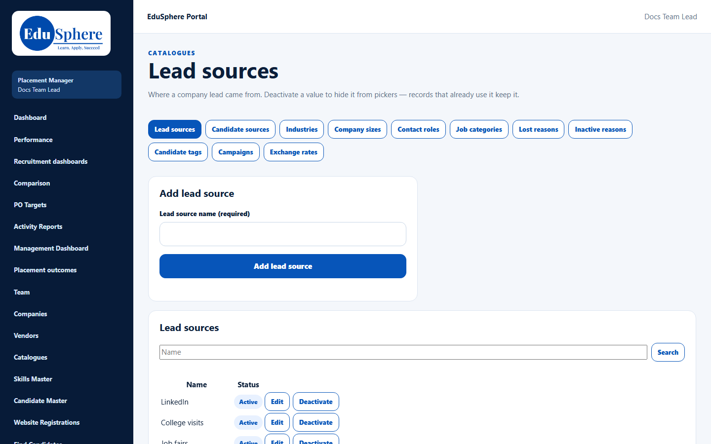
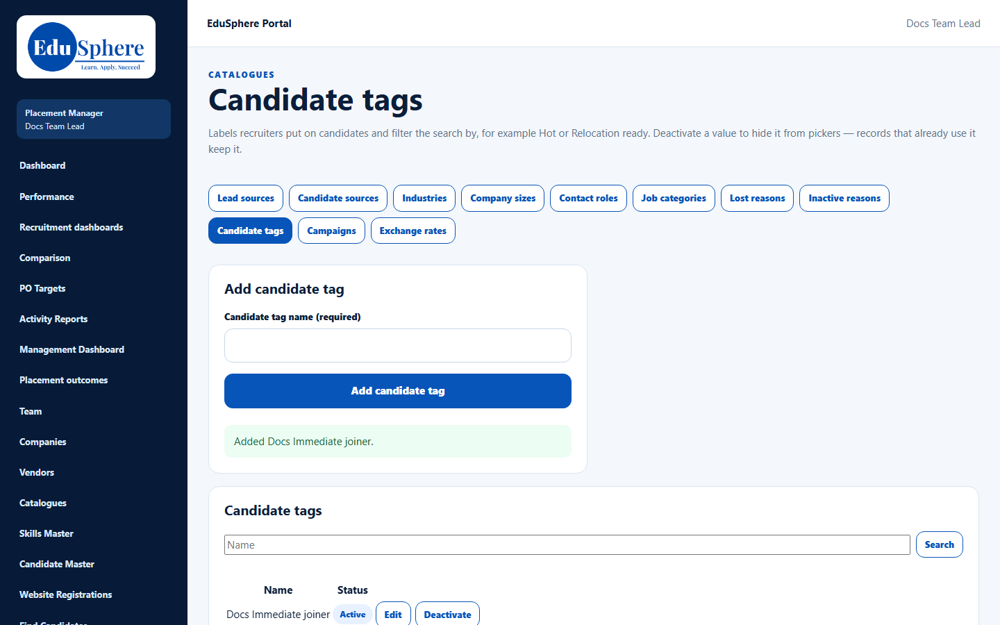
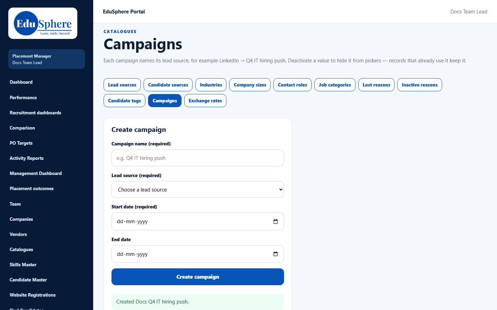
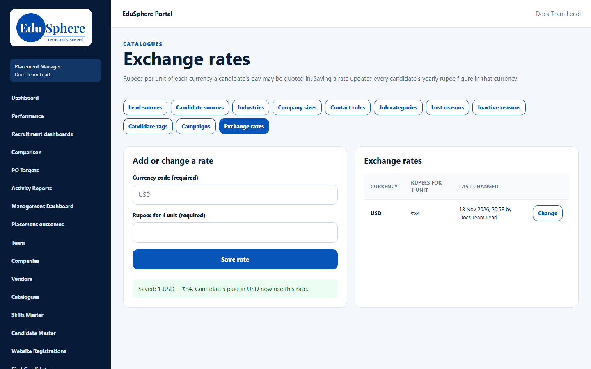

# Catalogues
> Doc ID: DOC-REC-MST-003 · Verified on 2026-11-18 against `main` @ `6b61546c` · Roles: Team Lead

## Purpose
Maintain the lists recruiters pick from: lead and candidate sources, industries, company sizes, contact roles, job categories, lost and inactive reasons, candidate tags, campaigns and exchange rates.

## Who Can Use This Feature
- **Team Lead** (and Super Admin). Recruiters see these values in pickers.

## Prerequisites
- None.

## How to Access
Team Lead sidebar **Catalogues**. Tabs: **Lead sources**, **Candidate sources**, **Industries**, **Company sizes**, **Contact roles**, **Job categories**, **Lost reasons**, **Inactive reasons**, **Candidate tags**, **Campaigns**, **Exchange rates**.

## Steps
### Step 1 — Add a value
On a value tab, type the **{value} name (required)** and select **Add {value}** (for example **Add candidate tag**). The message **Added {name}.** appears. Each value has **Edit** and **Deactivate**: "Deactivate a value to hide it from pickers — records that already use it keep it."

### Step 2 — Campaigns
On **Campaigns** ("Each campaign names its lead source, for example LinkedIn → Q4 IT hiring push."), enter **Campaign name (required)**, **Lead source (required)**, **Start date (required)** and **End date**, then **Create campaign**: **Created {campaign}.**

### Step 3 — Exchange rates
On **Exchange rates**, enter **Currency code (required)** and **Rupees for 1 unit (required)**, then **Save rate**. The message reads, for example, **Saved: 1 USD = ₹84. Candidates paid in USD now use this rate.** "INR needs none; add a rate before entering pay in another currency."

## Validation Messages
| Message | When |
|---|---|
| Added {name}. | Value added |
| Created {campaign}. | Campaign created |
| Saved: 1 {code} = ₹{rate}. Candidates paid in {code} now use this rate. | Rate saved |

## Tips
- An exchange rate only converts candidate pay to rupees for search and comparison; it records no money.

## Related Features
- [Manage skills](mst-002-manage-skills.md)
