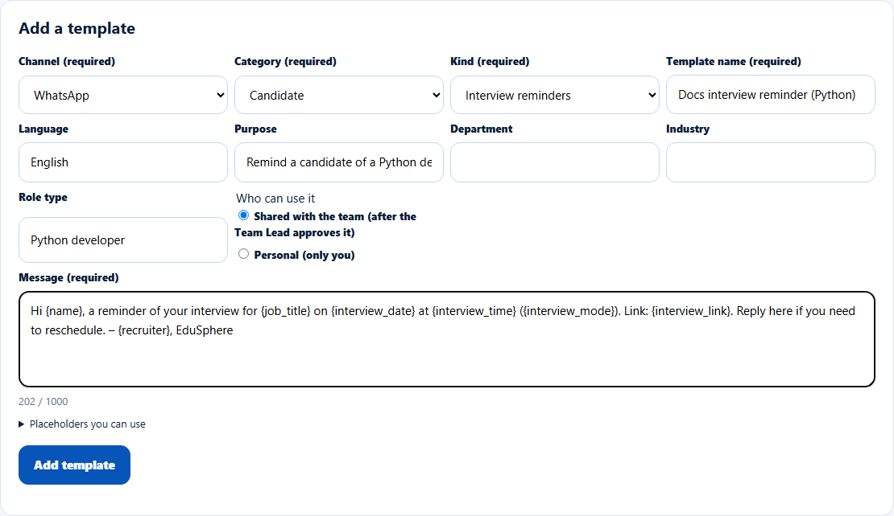
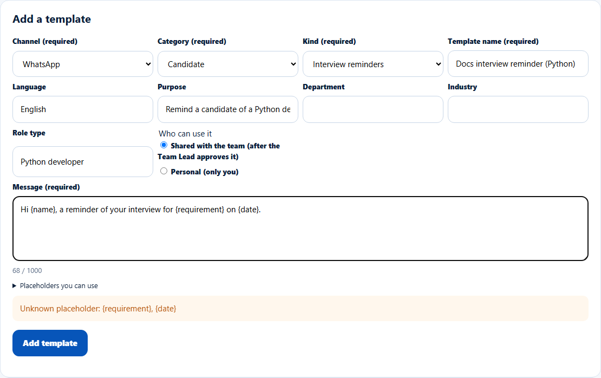
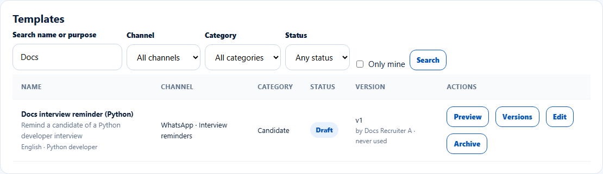
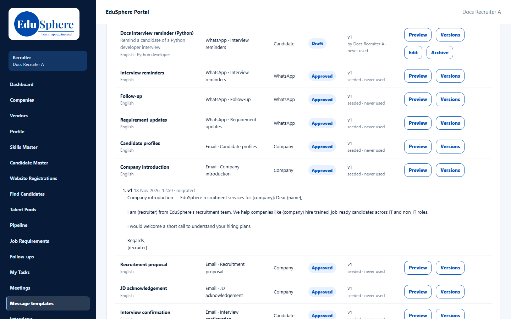

# Message template library
> Doc ID: DOC-REC-MST-004 · Verified on 2026-11-18 against `main` @ `6b61546c` · Roles: Recruiter (Team Lead: also approves, see MST-005)

## Purpose
Keep ready-made Email, WhatsApp, LinkedIn and calling-script texts to start messages from on a company, contact, requirement, candidate or interview.

## Who Can Use This Feature
| Role | Can do |
|---|---|
| Recruiter | Add personal templates (only you) or shared ones (Draft until approved), preview, see versions, edit and archive their own |
| Team Lead | Everything, plus **Approve** shared drafts ([Approve templates](mst-005-approve-templates.md)) |

## Prerequisites
- None. The library comes with approved seeded templates (Candidate profiles, JD confirmation, Interview reminders, Company introduction and more).

## How to Access
Sidebar **Message templates**.

## Steps
### Step 1 — Fill in Add a template
Choose **Channel (required)** (WhatsApp, Email, LinkedIn, Calling script), **Category (required)** (Company, LinkedIn, WhatsApp, Calling, College/TPO, Candidate) and **Kind (required)**. Enter **Template name (required)**, and optionally **Language**, **Purpose**, **Department**, **Industry** and **Role type**. Under **Who can use it** choose **Shared with the team (after the Team Lead approves it)** or **Personal (only you)**. Write the **Message (required)** (up to 1000 characters) using the **Placeholders you can use**.

### Step 2 — Use only listed placeholders
Allowed placeholders: `{name}`, `{company}`, `{recruiter}`, `{designation}`, `{job_title}`, `{job_location}`, `{package_range}`, `{candidate}`, `{interview_date}`, `{interview_time}`, `{interview_mode}`, `{interview_link}`. Anything else is flagged at once.

### Step 3 — Add
Select **Add template**. A shared template shows **Created {name} as a draft. The Team Lead approves it before the team can use it.** and the status **Draft**.

### Step 4 — Preview and versions
Filter by **Search name or purpose**, **Channel**, **Category**, **Status** (Draft, Approved, Archived) or **Only mine**. **Preview** shows the text with sample values; **Versions** lists every version with its date. Editing saves a new version (**Save (new version)**); **Archive** hides a template without deleting it.

## Validation Messages
| Message | When |
|---|---|
| Unknown placeholder: {list} | The message uses a placeholder that isn't listed |
| Created {name} as a draft. The Team Lead approves it before the team can use it. | Shared template added |

## Related Features
- [Approve shared templates](mst-005-approve-templates.md)
