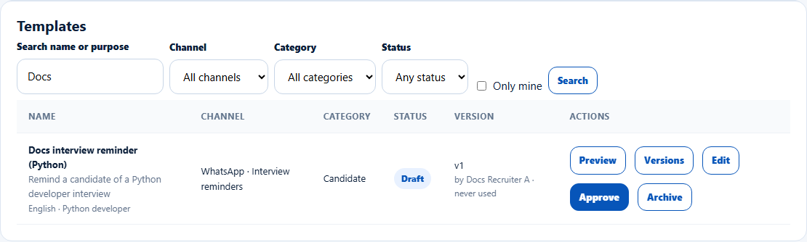
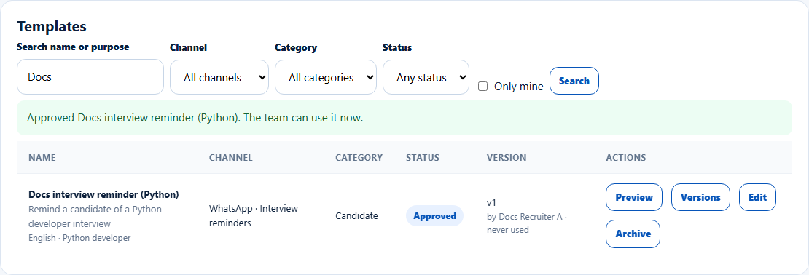

# Approve shared templates
> Doc ID: DOC-REC-MST-005 · Verified on 2026-11-18 against `main` @ `6b61546c` · Roles: Team Lead

## Purpose
Review recruiters' shared templates and make them available to the whole team.

## Who Can Use This Feature
- **Team Lead** (and Super Admin), at `/recruiter/manager/templates`.

## Prerequisites
- A recruiter added a shared template ([Message template library](mst-004-message-templates.md)).

## How to Access
Team Lead sidebar **Message templates** ("Approve recruiters' drafts to share them; edits keep every version. Archive a template to hide it — it is never deleted.").

## Steps
### Step 1 — Find the drafts
Filter **Status** to **Draft**, or search by name. A draft shows **Draft**, the version and "by {recruiter}", with **Preview**, **Versions**, **Edit**, **Approve** and **Archive**.

### Step 2 — Approve
Select **Approve**. The message **Approved {name}. The team can use it now.** appears and the status becomes **Approved**.

## Validation Messages
| Message | When |
|---|---|
| Approved {name}. The team can use it now. | Approved |

## Tips
- Approved templates appear in every message composer (companies, candidates, interviews) and in outreach cadences.

## Related Features
- [Message template library](mst-004-message-templates.md)
