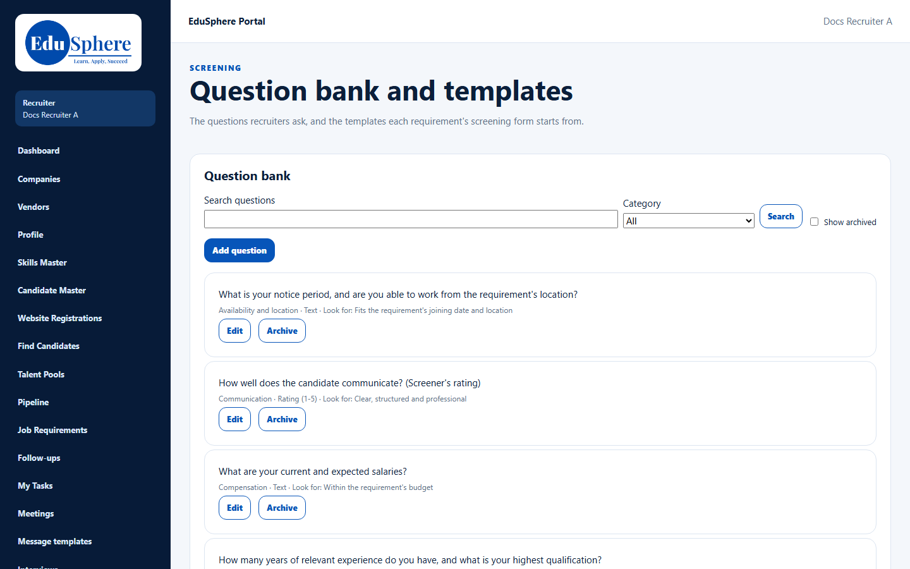
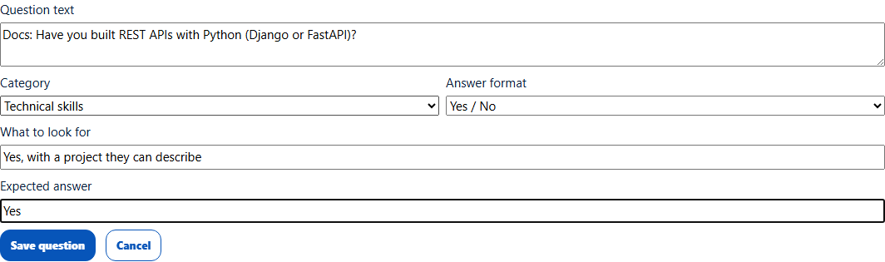
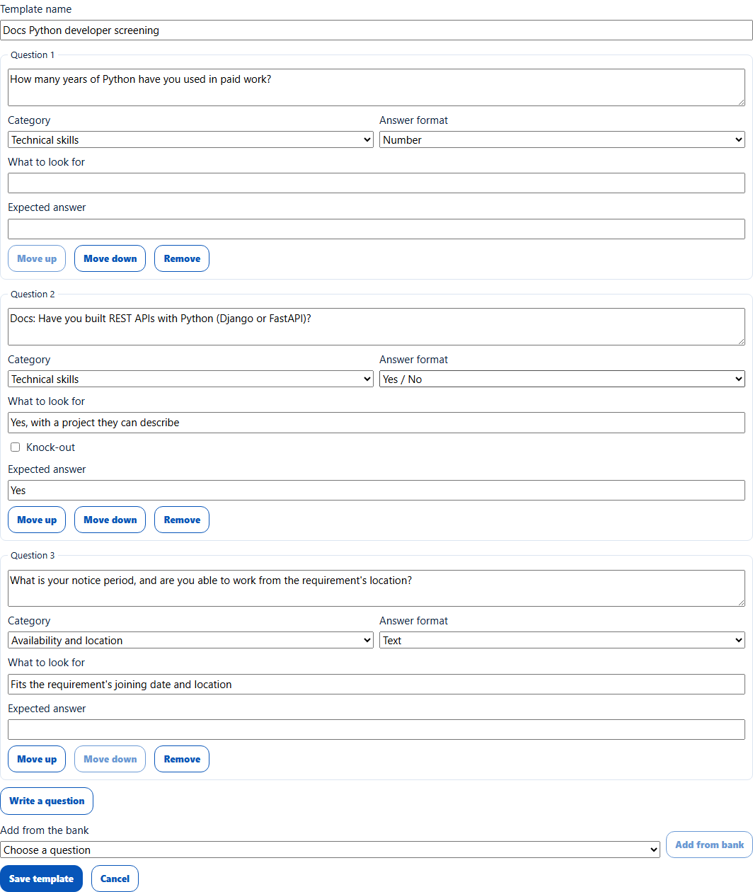
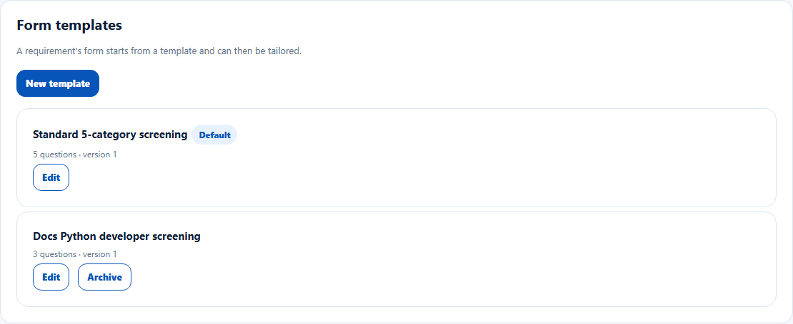

# Screening question bank and form templates
> Doc ID: DOC-REC-MST-006 · Verified on 2026-11-18 against `main` @ `6b61546c` · Roles: Recruiter, Team Lead

## Purpose
Keep the screening questions recruiters ask, and the form templates each requirement's screening form starts from.

## Who Can Use This Feature
- **Recruiter**: sidebar **Screening Bank** (`/recruiter/screening-bank`).
- **Team Lead**: the same page at `/recruiter/manager/screening-bank`; Team Leads also approve knock-out questions on a requirement's form.

## Prerequisites
- None. The bank comes with five questions and the **Standard 5-category screening** template.

## How to Access
Sidebar **Screening Bank** (page **Question bank and templates**).

## Steps
### Step 1 — Add a question
Select **Add question**. Fill **Question text**, **Category** (Experience and qualification, Technical skills, Communication, Availability and location, Compensation), **Answer format** (Text, Yes / No, Number, Choice, Rating (1-5)), **What to look for** and **Expected answer**. A **Choice** question needs **Choices (one per line)**. Select **Save question**; it appears in the bank.

### Step 2 — Find and maintain questions
Search with **Search questions** and **Category**; tick **Show archived** to see archived ones. Each question has **Edit** and **Archive** / **Restore**.

### Step 3 — Create a form template
Under **Form templates** select **New template**. Enter **Template name**, write questions (**Write a question**) or pick from the bank (**Add from the bank** → **Add from bank**). For each question set its category, answer format, what to look for, expected answer and, for Yes / No questions, **Knock-out**. Reorder with **Move up** / **Move down**, or **Remove**. Select **Save template**.

## Validation Messages
| Message | When |
|---|---|
| Write the question. | Question text empty (from code; not captured) |
| Give at least two choices. | A Choice question with fewer than two choices (from code; not captured) |
| Name the template. | Template name empty (from code; not captured) |

## Tips
- Saving a question or template shows no message; it simply appears in the list.
- "A requirement's form starts from a template and can then be tailored." See the hiring-flow pages.

## Related Features
- [Message template library](mst-004-message-templates.md)
