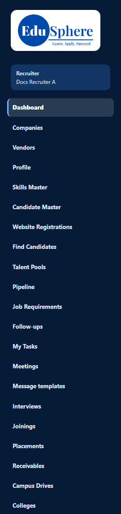

# Recruiter workspace tour
> Doc ID: DOC-REC-NAV-001 · Verified on 2026-11-18 against `main` @ `6b61546c` · Roles: Recruiter

## Purpose
Know where everything is in the Recruiter workspace.

## Who Can Use This Feature
- **Recruiter** (role placement team).

## Prerequisites
- You are signed in at `/it/login`.

## How to Access
The left sidebar, under **Recruiter · {your name}**.

## The sidebar
| Item | Page heading | Covered in |
|---|---|---|
| Dashboard | Welcome, {name} | [Recruiter dashboard](../dashboard/dash-001-recruiter-dashboard.md) |
| Companies | Your companies | Companies pages |
| Profile | My profile | [Recruiter profile](../account-access/auth-004-profile-password.md) |
| Skills Master | Skills | Masters pages |
| Candidate Master | Candidates | Candidates pages |
| Website Registrations | New website registrations | Candidates pages |
| Find Candidates | Find Candidates | Search pages |
| Talent Pools | Talent Pools | Search pages |
| Pipeline | Company pipeline | Companies pages |
| Job Requirements | Your job requirements | Requirements pages |
| Follow-ups, My Tasks, Meetings | Follow-ups, My tasks, Meetings | Daily work pages |
| Message templates | Message templates | Masters pages |
| Interviews, Joinings, Placements | Interviews, Joinings, Placements | Hiring pages |
| Screening Bank | Question bank and templates | Masters pages |
| Notifications | Notifications | Daily work pages |
| Candidates, Company Requirements, Interviews, Offers, Reports | The older placement screens (`/it/placement/*`) | [Legacy placement screens](../hr/leg-001-legacy-placement.md) |
| Management tasks | Management tasks | Work management assigns you |
| Vendors, Receivables, Campus Drives, Colleges, Campus calendar, My Performance, My Targets, Daily Plan, Activity Reports, Recruitment dashboards, Report library | — | Phase 2 of this guide |

The footer has **Change password**, **My profile** and **Sign out**.

## Tips
- Every item listed opened for a recruiter during verification.

## Related Features
- [Team Lead workspace tour](nav-002-team-lead-workspace.md)
