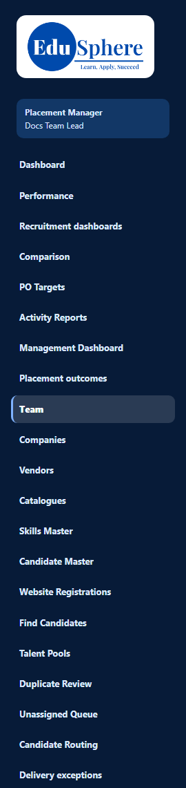

# Team Lead workspace tour
> Doc ID: DOC-REC-NAV-002 · Verified on 2026-11-18 against `main` @ `6b61546c` · Roles: Team Lead (placement manager)

## Purpose
Know the extra pages a Team Lead has for managing recruiters, candidates and settings.

## Who Can Use This Feature
- **Team Lead** (role placement manager), signed in at `/admin/login`.

## Prerequisites
- None.

## How to Access
The left sidebar, under **Placement Manager · {your name}**. You land on **Team**.

## The sidebar
| Item | Page heading | What differs from a recruiter |
|---|---|---|
| Team | Recruiters who report to you | Your recruiters with their counts; bulk reassign ([Team page](../../admin-manual/admin/adm-004-team-reassign.md)) |
| Dashboard | Welcome, {name} | Pick the whole team or one recruiter |
| Companies, Job Requirements | Your team's companies / Your team's job requirements | The team's records plus unassigned ones |
| Catalogues | Lead sources (and other tabs) | Manage catalogue values |
| Skills Master | Skills | Create and manage skills |
| Duplicate Review, Unassigned Queue, Candidate Routing | Duplicate review, Candidates, Candidate routing | Candidate housekeeping |
| Delivery exceptions | Delivery exceptions | Retry failed notices |
| Follow-ups, Meetings, Interviews, Joinings | (same headings) | The team's lists, read only |
| Message templates | Message templates | Approve shared templates |
| Outreach cadences, Intake automation, Screening Bank | Outreach cadences, Intake automation, Question bank and templates | Set them up for the team |
| Candidate Master, Website Registrations, Find Candidates, Talent Pools, Pipeline, My Tasks, Placements, Notifications, Management tasks | as for a recruiter | — |
| Performance, Recruitment dashboards, Comparison, PO Targets, Activity Reports, Management Dashboard, Placement outcomes, Recruitment insights, Vendors, Receivables, Campus Drives, Colleges, Campus calendar, Report library | — | Phase 2 of this guide |

## Tips
- The Team Lead has no links to the older `/it/placement/*` screens.

## Related Features
- [Recruiter workspace tour](nav-001-recruiter-workspace.md)
