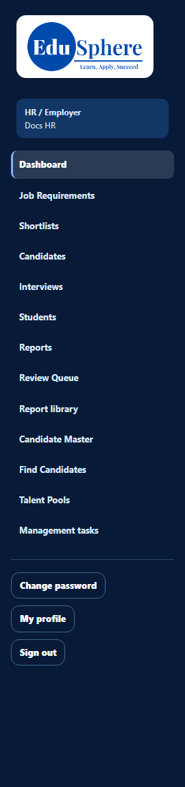

# HR, HR Manager, Placement Officer and Interviewer portals
> Doc ID: DOC-REC-NAV-003 · Verified on 2026-11-18 against `main` @ `6b61546c` · Roles: HR Team, HR Manager, Placement Officer, Interviewer

## Purpose
Know what each of the four IT recruitment portals contains.

## Who Can Use This Feature
| Role | Sidebar title | Signs in at |
|---|---|---|
| HR Team | **HR / Employer** | `/it/login` |
| HR Manager | **HR Manager** | `/it/login` |
| Placement Officer | **Placement Officer** | `/it/login` |
| Interviewer | **Interviewer** | `/it/login` |

## Prerequisites
- None.

## How to Access
The left sidebar after signing in.

## HR Team
**Dashboard**, **Job Requirements**, **Shortlists**, **Candidates**, **Interviews**, **Students**, **Reports**, **Review Queue**, **Report library**, then the recruiter pages **Candidate Master**, **Find Candidates** and **Talent Pools** (read only), and **Management tasks**.

## HR Manager
**Dashboard**, **Approvals** (Vacancy approvals), **Result approvals**, **Delivery exceptions**, **Recruitment insights**, **Notifications**, **Data requests** (Candidate data requests), **Website registrations** and **Recruitment dashboards**. There is no Management tasks link.

## Placement Officer
**Dashboard**, **Job requirements** (the requirements you co-own), **Notifications** and **Recruitment dashboards**.

## Interviewer
**Dashboard** only: your interviews and feedback.

## Tips
- Recruitment insights, Recruitment dashboards and Report library are covered in Phase 2 of this guide.

## Related Features
- [HR dashboard](../dashboard/dash-003-hr-dashboard.md)
- [HR Manager dashboard](../dashboard/dash-004-hr-manager-dashboard.md)
- [Placement Officer dashboard](../dashboard/dash-005-placement-officer-dashboard.md)
