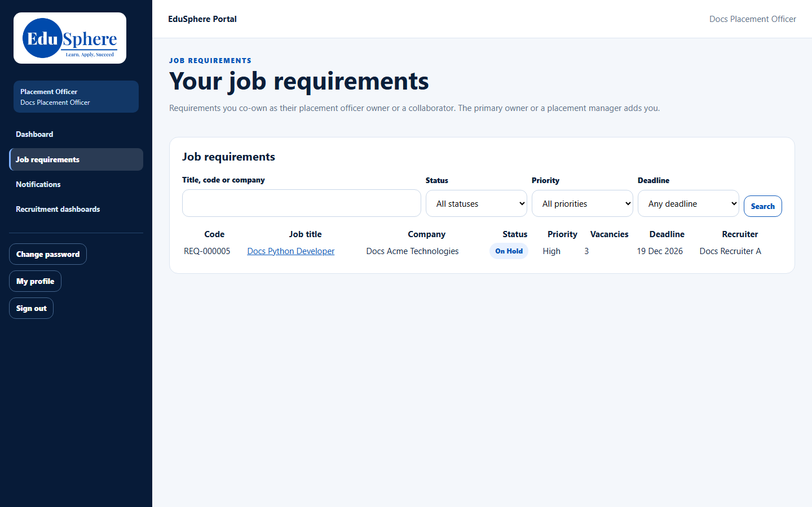
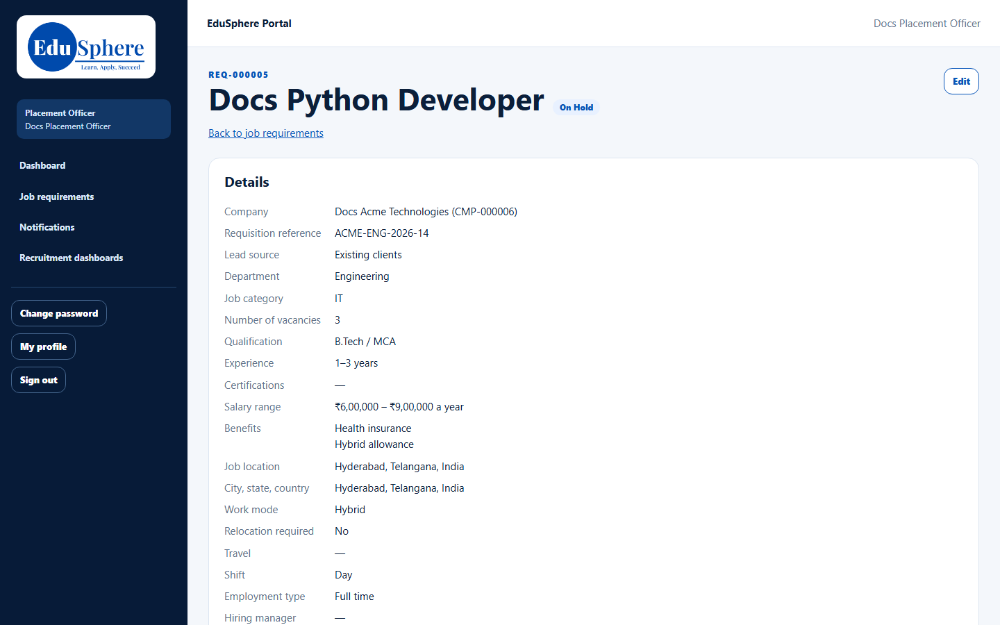
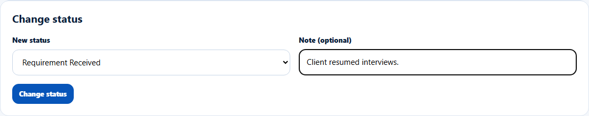

# Co-owned requirements: edit and change status
> Doc ID: DOC-REC-PO-001 · Verified on 2026-11-19 against `main` @ `6b61546c` · Roles: Placement Officer

## Purpose
Work on the job requirements you have been added to: keep the details and JD current, update the sourcing plan and tasks, and move the status.

## Who Can Use This Feature
- **Placement Officer**, on requirements where they are a **Placement officer owner** or **Collaborator**.

## Prerequisites
- The requirement's primary owner or a placement manager has added you ([Owners](../requirements/req-009-owners.md)). Until then the requirement is not in your list, and its link shows **Job requirement not found**.

## How to Access
Sidebar → **Job requirements** (`/recruiter/requirements`). Your sidebar has Dashboard, Job requirements, Notifications and Recruitment dashboards.

## Steps
### Step 1 — Open your list
The list says "Requirements you co-own as their placement officer owner or a collaborator. The primary owner or a placement manager adds you." There is no **Add job requirement** button. The filters are the same as the recruiter's.

### Step 2 — Open the requirement
Select the job title. Your page has **Details** (with **Edit**), **Job description (JD)** (**Edit JD**, **Upload**), **Validation checklist**, **Tasks** (**Mark done**), **Sourcing plan** (**Edit plan**, **Copy**), **Visibility**, **Change status**, **Owners**, **Ownership history**, **Status history**, **Revisions** and **Change history**.

### Step 3 — Change the status
In **Change status**, choose the **New status**, add a note and select **Change status**. Docs Placement Officer moved REQ-000005 from **On Hold** back to **Requirement Received** ("Client resumed interviews."): **Status changed to Requirement Received.**

## What Each Role Sees on the Requirement Page
| Card | Recruiter (owner) | Team Lead | Placement Officer (co-owner) |
|---|---|---|---|
| Details, JD, checklist, tasks, sourcing plan, status, owners, history | Yes | Yes | Yes |
| Commercial terms | Yes | Yes | No |
| Visibility | Read | Change | Read |
| Assignment (reassign) | No | Yes | No |
| Add owner | Yes | Yes | No |
| Candidates, Screening form, Matching, Shared profiles, Messages, Revenue | Yes | Yes | No |

## Validation Messages
| Message | When |
|---|---|
| Status changed to {status}. | Status moved |
| Job requirement not found | Opening a requirement you were not added to |

## Tips
- The status moves you can choose are the same as the owner's ([status table](../requirements/req-003-requirement-page.md)).

## Related Features
- [Owners and assignment](../requirements/req-009-owners.md)
- [Placement Officer dashboard](../dashboard/dash-005-placement-officer-dashboard.md)
