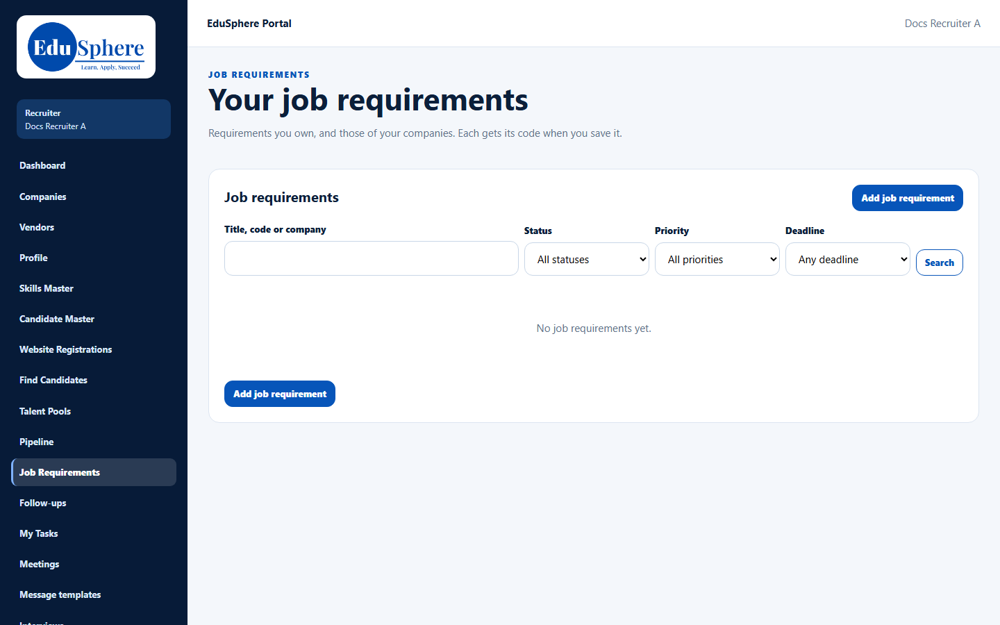
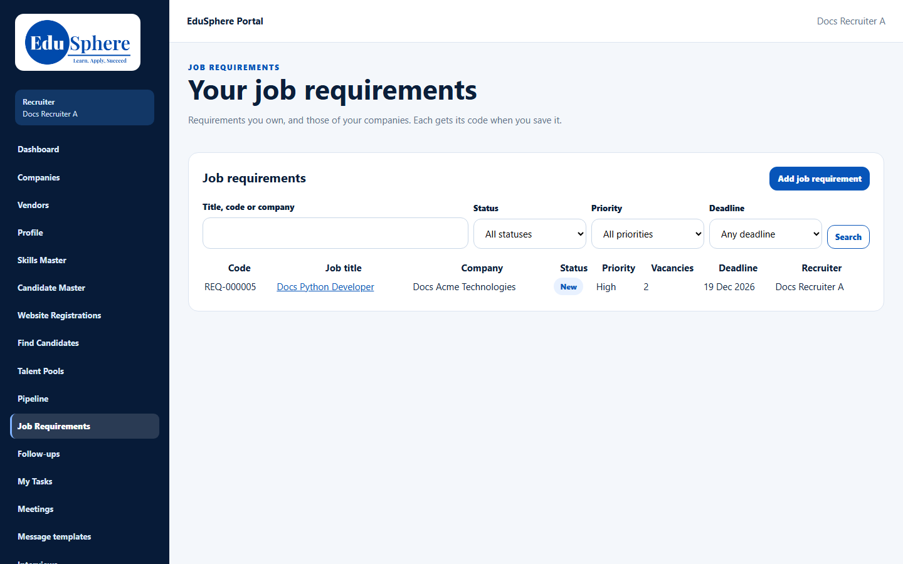
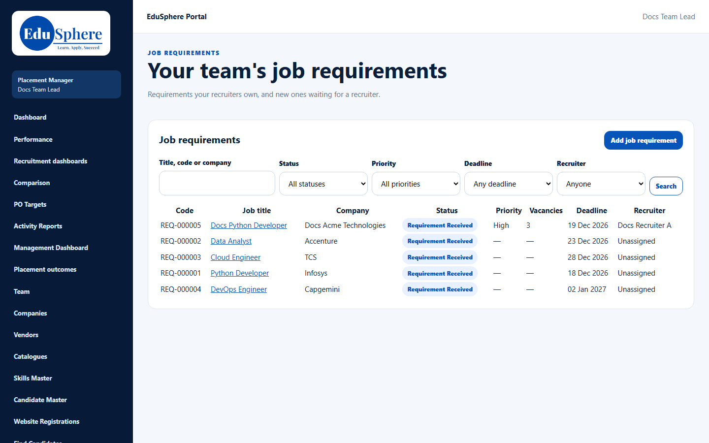

# Job requirements list and filters
> Doc ID: DOC-REC-REQ-001 · Verified on 2026-11-19 against `main` @ `6b61546c` · Roles: Recruiter, Team Lead, Placement Officer

## Purpose
Find a job requirement (an opening a client company has asked you to fill) and open its page.

## Who Can Use This Feature
| Role | What the list shows |
|---|---|
| Recruiter | "Your job requirements": requirements you own, and those of your companies. |
| Team Lead | "Your team's job requirements": requirements your recruiters own, and new ones waiting for a recruiter. Has an extra **Recruiter** filter. |
| Placement Officer | "Your job requirements": only requirements you co-own as their placement officer owner or a collaborator. No **Add job requirement** button. See [Co-owned requirements](../placement-officer/po-001-co-owned-requirements.md). |

## Prerequisites
- You are signed in to the recruitment workspace.

## How to Access
Sidebar → **Job Requirements** (`/recruiter/requirements`).

## Steps
### Step 1 — Open the list
Before you add anything the list says **No job requirements yet.** with an **Add job requirement** button.

Each requirement gets its code (REQ-000005 here) when it is saved. The table shows **Code**, **Job title**, **Company**, **Status**, **Priority**, **Vacancies**, **Deadline** and **Recruiter**. Select the job title to open the [requirement page](req-003-requirement-page.md).

### Step 2 — Filter
Use any of the filters, then select **Search**:
- **Title, code or company**: free text.
- **Status**: All statuses, New, Pending Approval, Requirement Received, Sourcing, Shortlisting, Profiles Shared, Interviewing, Selected, Joined, Filled, On Hold, Closed, Cancelled.
- **Priority**: All priorities, High, Medium, Low.
- **Deadline**: Any deadline, Deadline soon, Deadline passed.
- **Recruiter** (Team Lead only): Anyone, Unassigned, or one recruiter.

## Tips
- The Team Lead filtered **Priority = High** and still saw REQ-000005 with 3 vacancies and deadline 19 Dec 2026.
- Choose **Unassigned** to find new requirements no recruiter has picked up yet.

## Related Features
- [Add a job requirement](req-002-add-requirement.md)
- [Requirement page](req-003-requirement-page.md)
