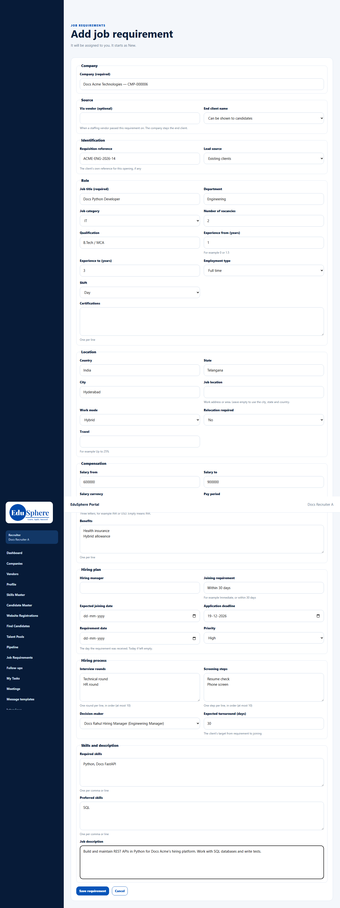
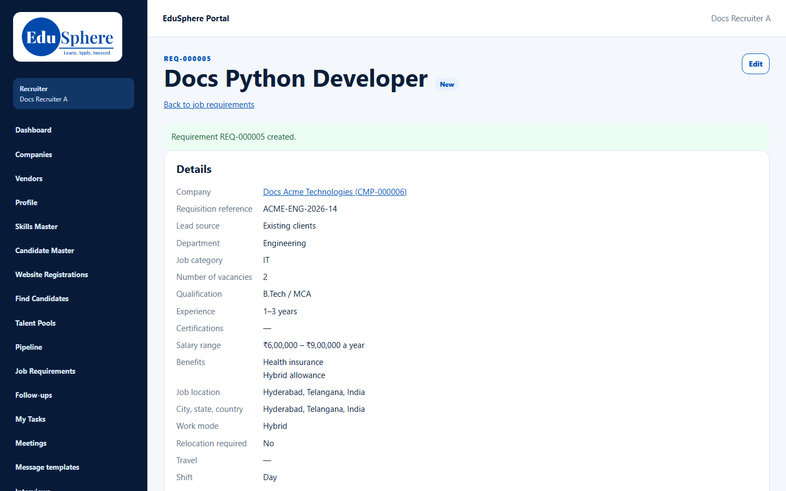

# Add a job requirement
> Doc ID: DOC-REC-REQ-002 · Verified on 2026-11-19 against `main` @ `6b61546c` · Roles: Recruiter, Team Lead

## Purpose
Record a new opening from a client company so you can plan sourcing, share profiles and track it to joining.

## Who Can Use This Feature
- **Recruiter** and **Team Lead**. The requirement is assigned to the person who adds it.
- The Placement Officer cannot add requirements.

## Prerequisites
- The client company exists in [Companies](../companies/co-002-add-company.md). Add its contacts first if you want to pick a decision-maker.

## How to Access
**Job Requirements** → **Add job requirement** (`/recruiter/requirements/new`).

## Steps
### Step 1 — Fill in the form
The form says "It will be assigned to you. It starts as New." Only **Company** and **Job title** are required.

| Section | Fields |
|---|---|
| Company | **Company (required)**: type and choose. |
| Source | **Via vendor (optional)**: when a staffing vendor passed it on; the company stays the end client. **End client name**: Can be shown to candidates, or Staff only (candidates see "Confidential client"). |
| Identification | **Requisition reference** (the client's own reference), **Lead source** (LinkedIn, College visits, Job fairs, Recruitment events, Company visits, Website, Google, Social media, Referrals, Existing clients, BDM network, Corporate database, Cold calling, Email campaigns, WhatsApp campaigns). |
| Role | **Job title (required)**, **Department**, **Job category** (IT, Sales, Marketing, Finance, HR, Engineering), **Number of vacancies**, **Qualification**, **Experience from / to (years)**, **Employment type** (Full time, Part time, Contract, Internship, Temporary), **Shift** (Day, Night, Rotational, Flexible), **Certifications** (one per line). |
| Location | **Country**, **State**, **City**, **Job location** (leave empty to use city, state and country), **Work mode** (On-site, Remote, Hybrid), **Relocation required**, **Travel**. |
| Compensation | **Salary from / to**, **Salary currency** (three letters; empty means INR), **Pay period** (A year, A month), **Benefits** (one per line). |
| Hiring plan | **Hiring manager**, **Joining requirement**, **Expected joining date**, **Application deadline**, **Requirement date** (today if empty), **Priority** (High, Medium, Low). |
| Hiring process | **Interview rounds** and **Screening steps** (one per line, in order, at most 10 each), **Decision-maker** (the company's contacts), **Expected turnaround (days)**. |
| Skills and description | **Required skills**, **Preferred skills** (one per comma or line), **Job description**. |

Example: Docs Recruiter A added **Docs Python Developer** for Docs Acme Technologies: reference ACME-ENG-2026-14, 2 vacancies, 1–3 years, Hyderabad, Hybrid, ₹6,00,000 – ₹9,00,000 a year, deadline 30 days out, priority High, decision-maker Docs Rahul Hiring Manager, required skills Python and Docs FastAPI.

### Step 2 — Save
Select **Save requirement**. The [requirement page](req-003-requirement-page.md) opens with **Requirement REQ-000005 created.**

## Validation Messages
| Message | When |
|---|---|
| Requirement REQ-000005 created. | Saved |

## Tips
- **Hiring manager** searches EduSphere staff accounts, not the company's contacts (only Docs Interviewer was offered). Put the client's person in **Decision-maker** (finding P12).
- **Decision-maker** lists the chosen company's contacts with their designation ("Docs Rahul Hiring Manager (Engineering Manager)").
- Two tasks are created for you on save: **Prepare the sourcing plan** (due in 1 day) and **Screen the first shortlisted profiles** (due in 3 days). See [Checklist and tasks](req-005-checklist-tasks.md).
- Once a company has job requirements, its pipeline stage moves with them (see [Pipeline stage](../companies/co-010-pipeline-stage.md)).

## Related Features
- [Requirements list](req-001-requirements-list.md)
- [Submit for approval](req-007-approval.md)
