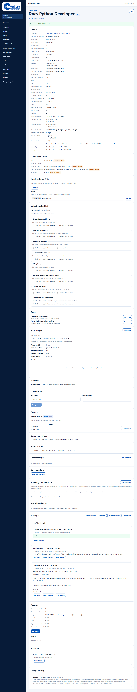
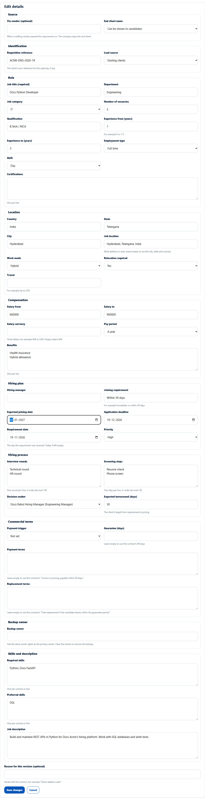
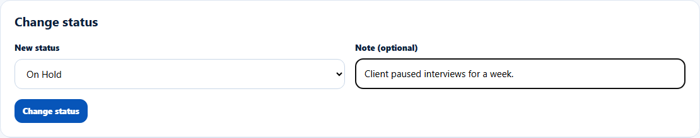
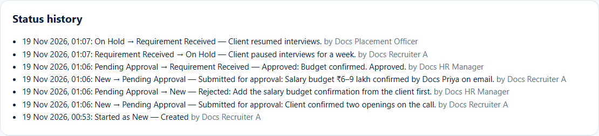

# Requirement page, edit and change status
> Doc ID: DOC-REC-REQ-003 · Verified on 2026-11-19 against `main` @ `6b61546c` · Roles: Recruiter (owner), Team Lead, Placement Officer (co-owner)

## Purpose
See everything about one job requirement in one place, correct its details, and move it through its statuses.

## Who Can Use This Feature
- **Recruiter** who owns the requirement (primary owner or collaborator).
- **Team Lead** for the team's requirements.
- **Placement Officer** on requirements they co-own: see [Co-owned requirements](../placement-officer/po-001-co-owned-requirements.md) for the smaller page they get.

## Prerequisites
- The requirement exists ([Add a job requirement](req-002-add-requirement.md)).

## How to Access
**Job Requirements** → select the job title.

## Steps
### Step 1 — Read the page
The header shows the code (REQ-000005), the title and the status badge. The cards, top to bottom:

| Card | What it is for |
|---|---|
| Details | Every field from the add form, plus who added it and when it last changed |
| Commercial terms | [Fee and terms from the company contract](req-010-commercial-terms.md) |
| Job description (JD) | [Create, upload and version the JD](req-004-job-description.md) |
| Validation checklist, Tasks | [Checklist and tasks](req-005-checklist-tasks.md) |
| Sourcing plan, Results by source | [Sourcing plan](req-006-sourcing-plan.md) |
| Approval | Only while approval applies: [Submit for approval](req-007-approval.md) |
| Visibility | [Who can see the job](req-008-visibility.md) |
| Assignment (Team Lead), Owners, Ownership history | [Owners and assignment](req-009-owners.md) |
| Change status, Status history | This page, steps 3–4 |
| Candidates, Screening form, Matching candidates, Shared profiles, Messages | The hiring flow (later sessions; see [Matching](../hiring/hire-002-matching.md)) |
| Revenue | Fees and invoices: Phase 2, not used in this guide |
| Revisions, Change history | Every saved version of the details, and every field change |

### Step 2 — Edit the details
Select **Edit** (top right). The **Edit details** form has the same fields as the add form. Change what you need (here **Expected joining date**) and save: **Changes saved.**

### Step 3 — Change the status
In **Change status**, choose a **New status**, add a note and select **Change status**: **Status changed to {status}.** The list only offers moves allowed from the current status.

| From | You can move to |
|---|---|
| New | Requirement Received, On Hold, Closed, Cancelled (from code; not captured) |
| Pending Approval | Cancelled only; the approver decides the rest |
| Requirement Received | Sourcing, Shortlisting, Profiles Shared, Interviewing, Selected, Filled, On Hold, Closed, Cancelled |
| On Hold | Requirement Received, Sourcing, Shortlisting, Profiles Shared, Interviewing, Selected, Closed, Cancelled |
| Cancelled | Nothing: cancelling is final (from code) |

Docs Recruiter A put REQ-000005 **On Hold** with the note "Client paused interviews for a week."

### Step 4 — Status history
**Status history** lists every move, newest first, with who made it and the note. For REQ-000005 it shows the creation, both approval submissions, the rejection, the approval, the hold and the Placement Officer's reopening.

## Validation Messages
| Message | When |
|---|---|
| Changes saved. | Details edited |
| Status changed to {status}. | Status moved |
| A requirement cannot move from {status} to {status} | A move that is not allowed (from code; not captured) |

## Tips
- **Joined** is set by the system when an accepted offer leads to a joining, not by hand.
- While approval applies, a requirement cannot be opened by changing its status; it must be approved ([Submit for approval](req-007-approval.md)).
- A Team Lead can set a company rule that blocks sourcing until the [validation checklist](req-005-checklist-tasks.md) is complete; the move is then refused.

## Related Features
- [Requirements list](req-001-requirements-list.md)
- [Owners and assignment](req-009-owners.md)
