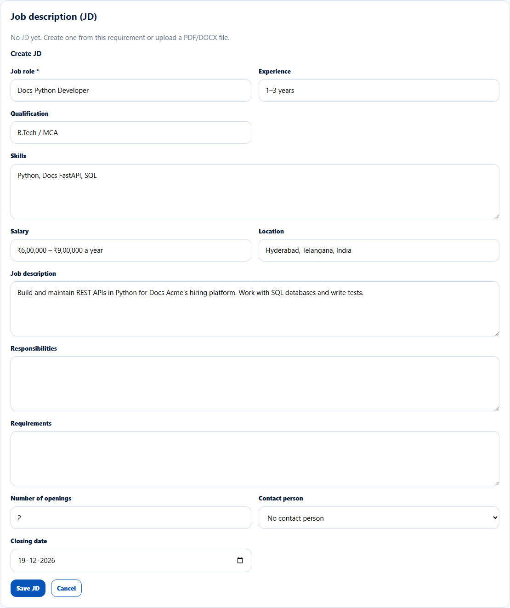
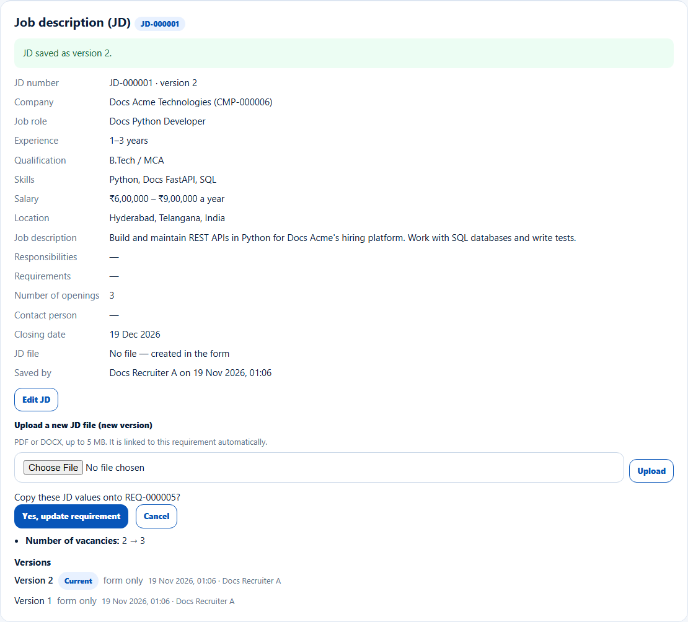
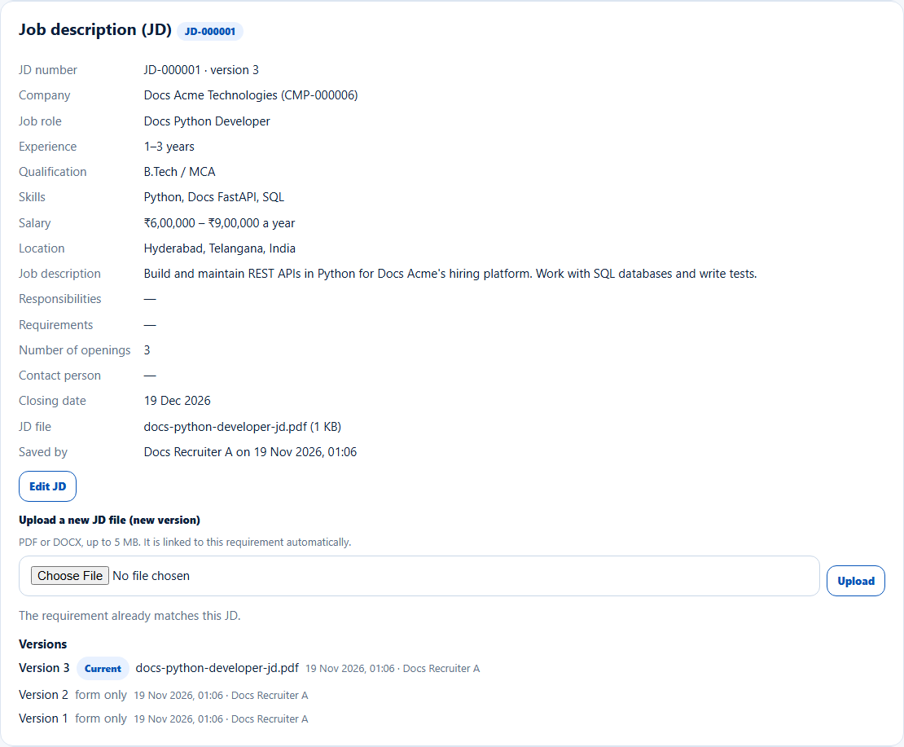

# Job description: create, upload, versions
> Doc ID: DOC-REC-REQ-004 · Verified on 2026-11-19 against `main` @ `6b61546c` · Roles: Recruiter (owner), Placement Officer (co-owner)

## Purpose
Keep the job description (JD) that goes to candidates, in versions, and copy changes from it back onto the requirement.

## Who Can Use This Feature
- The requirement's **Recruiter** owner. A co-owning **Placement Officer** also gets **Edit JD** and **Upload**.

## Prerequisites
- The requirement exists.

## How to Access
Requirement page → **Job description (JD)**.

## Steps
### Step 1 — Create a JD from the requirement
With no JD the card says "No JD yet. Create one from this requirement or upload a PDF/DOCX file." Select **Create JD**. The form is filled from the requirement: **Job role \***, **Experience**, **Qualification**, **Skills**, **Salary**, **Location**, **Job description**, **Responsibilities**, **Requirements**, **Number of openings**, **Contact person** (the company's contacts) and **Closing date**. Select **Save JD**: **JD saved as version 1.** The JD gets its number, JD-000001.

### Step 2 — Edit the JD and update the requirement
Select **Edit JD**, change a field and **Save JD**: **JD saved as version 2.** When the JD now differs from the requirement, select **Update requirement from JD**. The card lists what will change (here **Number of vacancies: 2 → 3**) and asks "Copy these JD values onto REQ-000005?". Select **Yes, update requirement**: **Requirement updated from the JD.**

### Step 3 — Upload a JD file
Under **Upload a new JD file (new version)** choose a PDF or DOCX (up to 5 MB) and select **Upload**: **JD file uploaded as version 3.** The file is linked to the requirement automatically.

### Step 4 — Versions
**Versions** lists every version, newest first, marked **Current**, with "form only" or the file name, the time and who saved it. When nothing differs the card says "The requirement already matches this JD."

## Validation Messages
| Message | When |
|---|---|
| JD saved as version {n}. | JD saved from the form |
| Requirement updated from the JD. | JD values copied onto the requirement |
| JD file uploaded as version {n}. | File uploaded |

## Tips
- Uploading or saving a new version never changes the requirement by itself; only **Yes, update requirement** does.
- Each save is a new version; older versions stay listed.

## Related Features
- [Requirement page](req-003-requirement-page.md)
- [Visibility](req-008-visibility.md)
