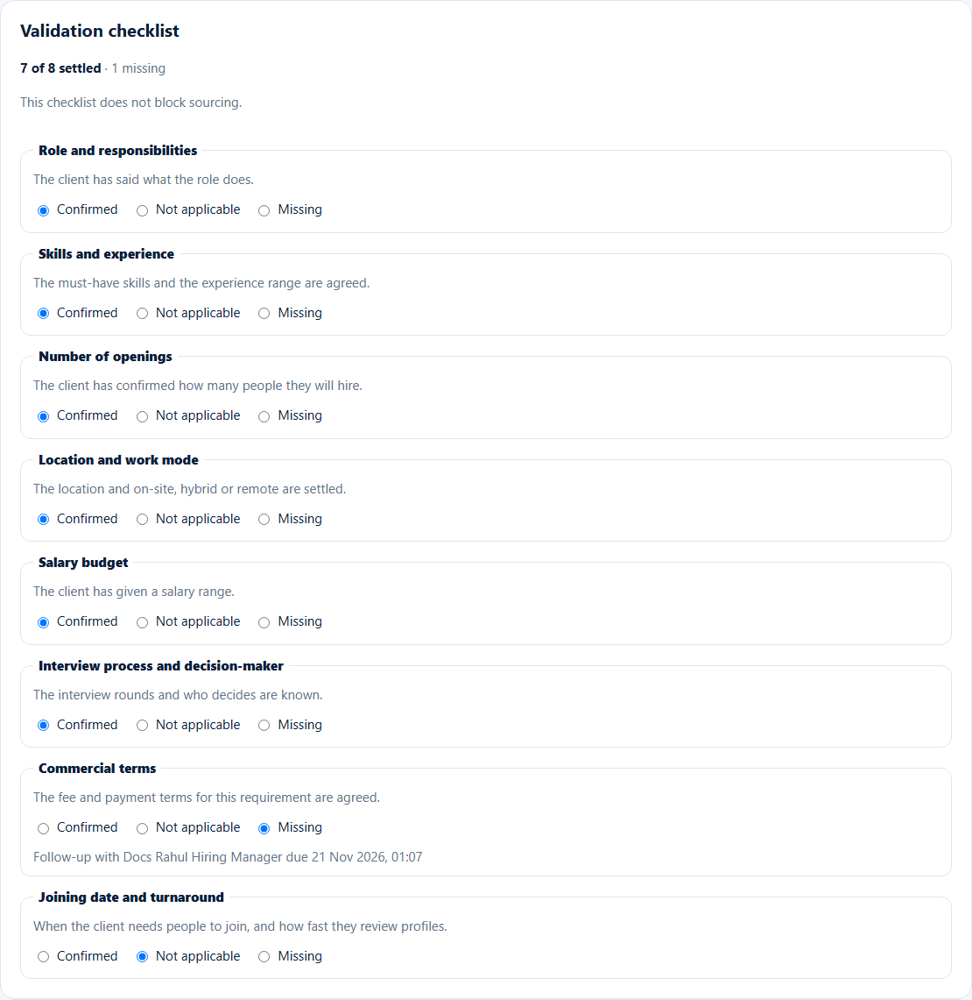
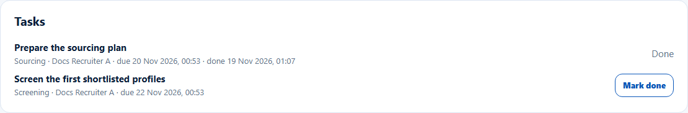

# Validation checklist and requirement tasks
> Doc ID: DOC-REC-REQ-005 · Verified on 2026-11-19 against `main` @ `6b61546c` · Roles: Recruiter (owner), Team Lead (blocking rule)

## Purpose
Check that you know enough about the opening before you source for it, and keep track of the requirement's to-dos.

## Who Can Use This Feature
- The requirement's **Recruiter** owner settles checklist items and marks tasks done. A co-owning **Placement Officer** can mark tasks done too.
- The **Team Lead** sees **Rule for this company**, which decides whether an incomplete checklist blocks sourcing.

## Prerequisites
- The requirement exists.

## How to Access
Requirement page → **Validation checklist** and **Tasks**.

## Steps
### Step 1 — Settle the checklist
The checklist has 8 items: **Role and responsibilities**, **Skills and experience**, **Number of openings**, **Location and work mode**, **Salary budget**, **Interview process and decision-maker**, **Commercial terms**, **Joining date and turnaround**. Each starts as **Not reviewed**. Choose **Confirmed**, **Not applicable** or **Missing**; it saves at once ("Joining date and turnaround: Not applicable.").

The summary counts them: Docs Recruiter A confirmed six, marked **Commercial terms** missing and **Joining date and turnaround** not applicable: **7 of 8 settled · 1 missing**.

### Step 2 — Missing items get a follow-up
Marking an item **Missing** added a follow-up under it: "Follow-up with Docs Rahul Hiring Manager due 21 Nov 2026" (the requirement's decision-maker, two days later).

### Step 3 — The blocking rule (Team Lead)
By default "This checklist does not block sourcing." The Team Lead's **Rule for this company** offers: Follow the rule for every company (does not block), Block sourcing until complete, Do not block sourcing.

### Step 4 — Tasks
Two tasks are created with the requirement: **Prepare the sourcing plan** (Sourcing, due in 1 day) and **Screen the first shortlisted profiles** (Screening, due in 3 days), both for the owner. Select **Mark done**; the task shows "done {time}" and **Done**.

## Validation Messages
| Message | When |
|---|---|
| {item}: Confirmed. / Not applicable. / Missing. | Checklist item saved |

## Tips
- The checklist is for your own control; with the default rule you can source while items are still missing.
- Follow-ups are covered in [Follow-ups](../work/work-001-follow-ups.md).

## Related Features
- [Sourcing plan](req-006-sourcing-plan.md)
- [Requirement page](req-003-requirement-page.md)
