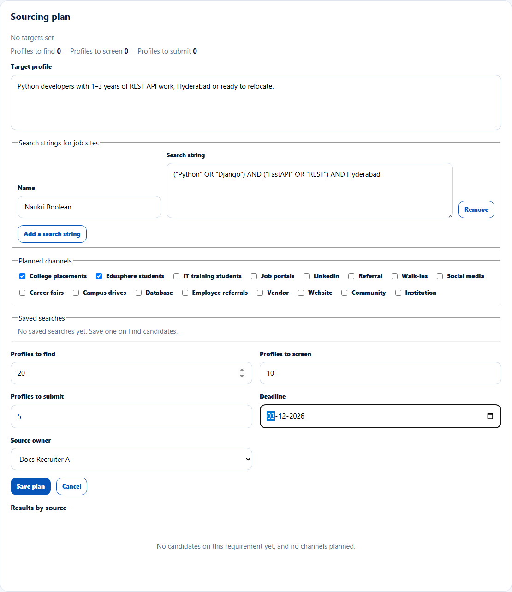
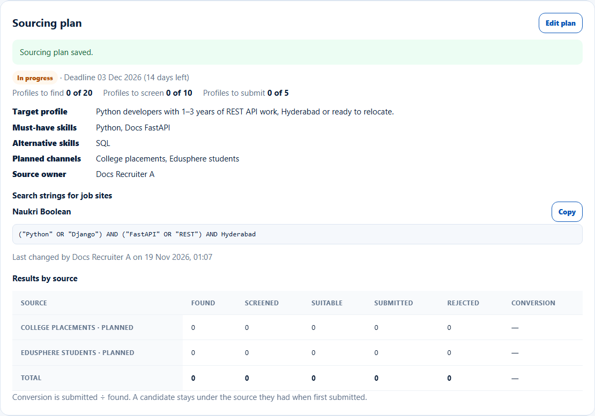

# Sourcing plan and results by source
> Doc ID: DOC-REC-REQ-006 · Verified on 2026-11-19 against `main` @ `6b61546c` · Roles: Recruiter (owner)

## Purpose
Plan where you will find candidates for a requirement, how many you aim to find, screen and submit, and then see which source delivers.

## Who Can Use This Feature
- The requirement's **Recruiter** owner creates and edits the plan. A co-owning **Placement Officer** also gets **Edit plan**.

## Prerequisites
- The requirement exists.

## How to Access
Requirement page → **Sourcing plan** → **Create plan** (later **Edit plan**).

## Steps
### Step 1 — Create the plan
Fill in:
- **Target profile**: who you are looking for.
- **Search strings for job sites**: **Name** and **Search string** (add more with **Add a search string**).
- **Planned channels**: College placements, Edusphere students, IT training students, Job portals, LinkedIn, Referral, Walk-ins, Social media, Career fairs, Campus drives, Database, Employee referrals, Vendor, Website, Community, Institution.
- **Profiles to find**, **Profiles to screen**, **Profiles to submit**, **Deadline**, **Source owner**.

### Step 2 — Save and read the plan
Select **Save plan**: **Sourcing plan saved.** The card shows **In progress** with the deadline and days left, progress against each target (**0 of 20**, **0 of 10**, **0 of 5**), the must-have and alternative skills (from the requirement), channels, source owner, and each search string with a **Copy** button.

### Step 3 — Results by source
**Results by source** has a row per planned channel with **Found**, **Screened**, **Suitable**, **Submitted**, **Rejected** and **Conversion** ("Conversion is submitted ÷ found. A candidate stays under the source they had when first submitted."). It fills as candidates are added in later steps of the hiring flow.

## Validation Messages
| Message | When |
|---|---|
| Sourcing plan saved. | Plan saved |

## Tips
- When the plan is ready, mark the **Prepare the sourcing plan** task done in [Tasks](req-005-checklist-tasks.md).
- Use **Copy** to paste a search string straight into a job site.

## Related Features
- [Checklist and tasks](req-005-checklist-tasks.md)
- [Owners and assignment](req-009-owners.md)
