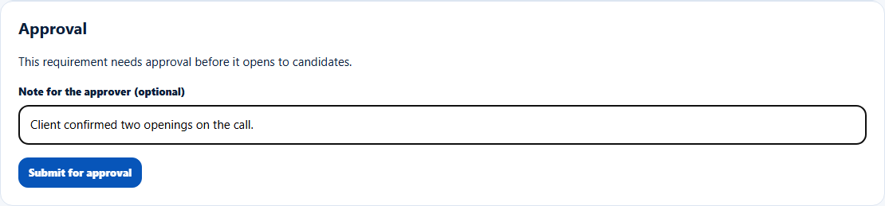
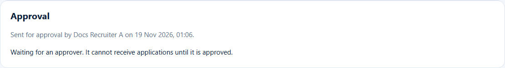
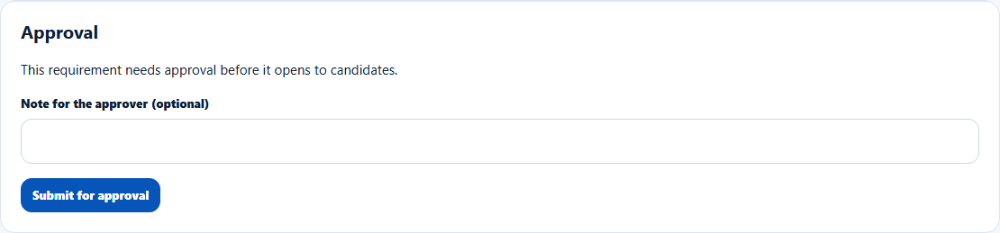
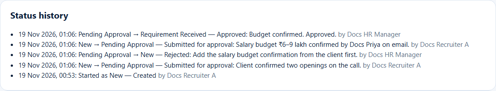

# Submit a requirement for approval
> Doc ID: DOC-REC-REQ-007 · Verified on 2026-11-19 against `main` @ `6b61546c` · Roles: Recruiter (owner)

## Purpose
When your organisation wants jobs checked before they open, send the requirement to an approver, and resend it if it comes back.

## Who Can Use This Feature
- The requirement's **Recruiter** owner submits. The **HR Manager** decides ([Vacancy approvals](../hr-manager/hrm-001-vacancy-approvals.md)).
- Whether recruiter jobs need approval is a Super Admin setting ([Approval settings](../../admin-manual/admin/adm-006-approval-settings.md)). By default they do not.

## Prerequisites
- Approval is turned on for recruiter jobs, and the requirement is **New**.

## How to Access
Requirement page → **Approval** (the card only shows while approval applies).

## Steps
### Step 1 — Submit
The card says "This requirement needs approval before it opens to candidates." Add a **Note for the approver (optional)** and select **Submit for approval**.

The message **Sent for approval. It opens once an approver approves it.** appears and the status becomes **Pending Approval**.

### Step 2 — If it is rejected
The requirement returns to **New** and the Approval card is back. **Status history** shows the reason: "Pending Approval → New — Rejected: Add the salary budget confirmation from the client first. by Docs HR Manager". Fix what was asked and submit again with a new note.

### Step 3 — When it is approved
The status becomes **Requirement Received** and the history shows "Approved: {note} by Docs HR Manager". The requirement is now open.

## Validation Messages
| Message | When |
|---|---|
| Sent for approval. It opens once an approver approves it. | Submitted |

## Tips
- While it is **Pending Approval** you can only cancel it; the approver decides the rest (from code).
- Turning the setting off later never opens jobs already waiting; they still need a decision.

## Related Features
- [Vacancy approvals](../hr-manager/hrm-001-vacancy-approvals.md)
- [Requirement page](req-003-requirement-page.md)
