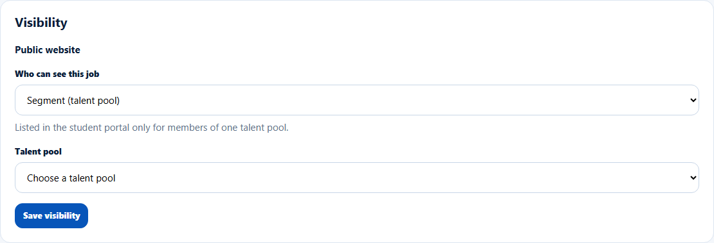
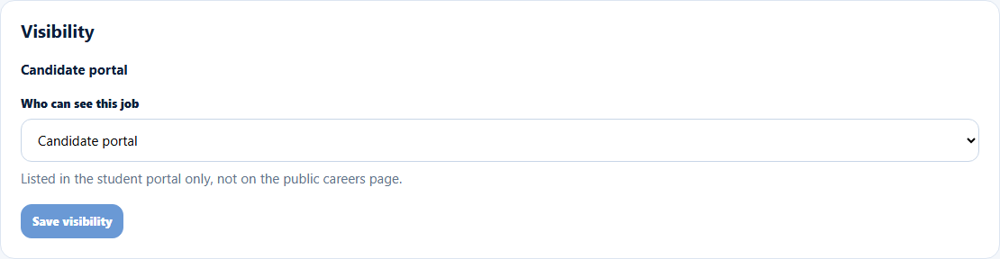

# Job visibility
> Doc ID: DOC-REC-REQ-008 · Verified on 2026-11-19 against `main` @ `6b61546c` · Roles: Team Lead (change), Recruiter and Placement Officer (read)

## Purpose
Decide who can see an open job: everyone, signed-in candidates, one talent pool, or staff only.

## Who Can Use This Feature
- **Team Lead**: changes the setting.
- **Recruiter** owner and co-owning **Placement Officer**: see the current setting only (no **Save visibility**).

## Prerequisites
- The requirement exists.

## How to Access
Requirement page → **Visibility**.

## Steps
### Step 1 — Choose who can see the job
The card names the current setting (**Public website** by default). In **Who can see this job** choose:

| Option | Meaning |
|---|---|
| Public website | On the public careers page |
| Candidate portal | "Listed in the student portal only, not on the public careers page." |
| Segment (talent pool) | "Listed in the student portal only for members of one talent pool." Choose the **Talent pool**. |
| Internal only | Not listed to candidates (helper text not captured) |

### Step 2 — Save
Select **Save visibility**: **Visibility saved: {option}.**

## Validation Messages
| Message | When |
|---|---|
| Visibility saved: {option}. | Saved |

## Tips
- **Talent pool** lists the pools from the sidebar's **Talent Pools** page (seed pools here: Cloud Engineers, Experienced Professionals, Freshers, Full Stack Developers, Java Developers, Python Developers).
- The Docs requirement was put back to **Public website** after the screenshots.

## Related Features
- [Requirement page](req-003-requirement-page.md)
